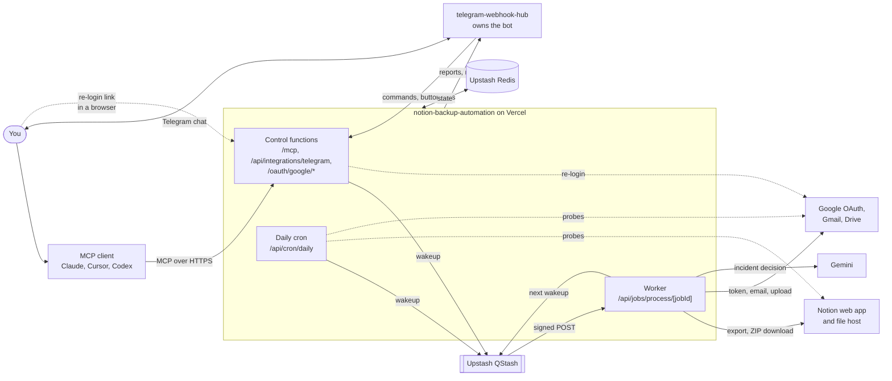
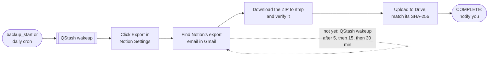

# notion-backup-automation

Backs up a Notion workspace to Google Drive each month. Playwright requests a workspace export,
Gmail supplies the export link, and the app verifies the ZIP before uploading it to Drive.
It uses Notion's web interface, not the Notion API.

Runs on Vercel with QStash wakeups and Redis state. Use MCP to start and manage jobs, Telegram
for status and recovery, and the local CLI for credentials and diagnostics. Automatic monthly
starts are off until `AUTO_START_ENABLED=true`.

## Architecture



- **Control functions:** MCP, the Telegram receiver and Google re-login. They inspect or
  change jobs and schedule work; they never run backup steps or load Chromium.
- **Worker:** runs one job step per QStash delivery (a **tick**). Download, ZIP verification
  and upload share one tick. It also handles automatic Notion login when enabled.
- **Daily cron:** starts due jobs, recovers missed wakeups, probes access and sends login
  warnings. Its Notion probe opens Chromium but never requests an export.
- **Redis:** stores job progress and encrypted credentials, shared by this app's functions.
- **Telegram hub:** owns the bot and all Bot API calls. This app receives authenticated
  updates and sends replies through the hub; it has no bot token or chat ID.

The local CLI calls the adapters directly. Source layout: `src/domain/` holds job rules,
`src/application/` coordinates work, `src/adapters/` connects services, and `src/config/` wires
handlers and validates configuration. `api/` contains Vercel entry points.

| Route                                                | Caller/authentication                                                       |
| ---------------------------------------------------- | --------------------------------------------------------------------------- |
| `POST /api/jobs/process/[jobId]`                     | QStash signature; one worker tick, `_ping` or `_notion-login`               |
| `GET /api/cron/daily`                                | Vercel Cron, `Bearer $CRON_SECRET`; optional `?probe=notion\|google\|drive` |
| `POST /mcp`                                          | MCP client, `Bearer $MCP_AUTH_TOKEN`                                        |
| `POST /api/integrations/telegram`                    | Hub, `Bearer $TELEGRAM_HUB_TOKEN`                                           |
| `GET /oauth/google/reauth`, `/oauth/google/callback` | Public Google consent flow; only the owner can save credentials             |
| `GET /api/health`, `/`, `/privacy`, `/terms`         | Public liveness and static branding pages                                   |

### State in Redis

Keys use `{nba:<APP_ENV>}:` to isolate prod, dev and test:

- `job:<jobId>` and `active` track jobs. `events:<jobId>` keeps their history.
- `health` holds probe and cron results. `secret:*` holds encrypted sessions and tokens.
- Leases and schedule tokens guard concurrent work. Dev uploads go under `_dev/` in Drive.

Key definitions are in
[persistence/keys.ts](src/adapters/persistence/keys.ts).

Detailed flows: [backup lifecycle](docs/backup-lifecycle.md),
[Notion export and login](docs/notion-export-flow.md), and
[cross-app Telegram delivery](../telegram-webhook-hub/docs/webhook-flow.md).
The repository's [C4 model](../../../docs/architecture/workspace.dsl) owns the structural views.

## How a backup runs



1. MCP `backup_start`, or the daily cron when enabled, creates the month's job (`YYYY-MM`).
   Only one job can be active. A forced run gets a separate `YYYY-MM-r<N>` ID.
2. QStash wakes the worker. It takes a Redis lease, checks the schedule token and runs one step.
3. Before exporting or transferring, the worker checks Drive for an existing, checksum-verified
   backup. Normal jobs may adopt the period's backup; forced jobs only adopt their own job ID.
4. Playwright opens Settings → General → Workspace content → Export. It selects Markdown & CSV,
   Current view, Everything, private pages and subpage folders, then clicks Export once per attempt.
5. The first Gmail check is 5 minutes later, the second **15 minutes after that**, then checks
   repeat every 30 minutes. No email within 48 hours requires attention.
6. The worker downloads to `/tmp/nba`, validates every ZIP entry and uploads to `<root>/<YYYY>/`
   using Drive's resumable upload. Completion requires Drive's SHA-256 to match the local hash.
   Temporary files are cleaned up after the run; a later transfer also clears interrupted files.
7. Logs and configured notifiers report the outcome. A backup below 50% of the previous complete
   backup's size or file count still completes, with a shrink warning. Inspect the first backup
   manually because it has no baseline.

Stored files are `notion-workspace-<YYYY-MM-DD>.zip` and, by default, a `.zip.sha256` sidecar.
Download both to check a local copy with `shasum -a 256 -c <name>.zip.sha256`. A sidecar failure is
recorded as an event and does not invalidate the verified ZIP.

## Local setup

Use **Node.js 24**, the repository's pinned **pnpm**, and Chrome for interactive Notion login.
Run commands below from the repository root.

```sh
pnpm install
cp workspaces/apps/notion-backup-automation/.env.example workspaces/apps/notion-backup-automation/.env.local
chmod 600 workspaces/apps/notion-backup-automation/.env.local
```

Fill `.env.local` from your secret manager. The CLI reads this app's file; shell variables win.
Use `APP_ENV=dev` for development and explicitly use `APP_ENV=prod` for production credentials.

1. Provision Upstash Redis and set its REST credentials, `APP_ENV`, and `APP_ENCRYPTION_KEY`
   (`openssl rand -base64 32`). Keep the key: existing encrypted credentials need it.
2. In Google Cloud, enable Gmail and Drive APIs and create a **Desktop OAuth client**. Configure
   `GOOGLE_CLIENT_ID` and `GOOGLE_CLIENT_SECRET`. For ongoing automation, use an appropriate
   production consent setup: external apps in Testing issue
   [refresh tokens that expire after seven days](https://developers.google.com/identity/protocols/oauth2#expiration).
3. Run `pnpm --filter notion-backup-automation auth:google`. Consent as the account holding the
   Gmail and Drive data, granting `gmail.readonly` and `drive.file`. The CLI saves the refresh
   token to `.env.local` and, when Redis and encryption are configured, to Redis for `APP_ENV`.
4. Set `GOOGLE_DRIVE_BACKUP_ROOT_FOLDER_ID`. Run
   `pnpm --filter notion-backup-automation auth:google --pick-folders`, selecting the root and
   current year folder, then `pnpm --filter notion-backup-automation drive:check`.
   **Read all four checks:** exit code 0 only guarantees root access (C1 and C3).
5. Set `NOTION_WORKSPACE_URL` and the exact switcher name in `NOTION_WORKSPACE_NAME`. Run
   `pnpm --filter notion-backup-automation auth:notion` and complete sign-in, including MFA.
   If Google sign-in refuses the browser, use Continue with email. The command requires valid
   `token_v2` and `file_token` cookies before saving the encrypted session.
6. Run `pnpm --filter notion-backup-automation cli doctor` to check dependencies.

If Chrome is unavailable, install the fallback with
`pnpm --filter notion-backup-automation exec playwright-core install chromium`.

`drive.file` only exposes files the app created or folders granted through the Picker. In an
existing root, a missing year folder is created only if its year is later than all visible
ones. Hidden or duplicate year folders fail with `DRIVE_ROOT_INACCESSIBLE`; re-pick the folder.
If Picker access cannot work, `cli drive:init` creates an app-owned root. Update the root ID in
local and deployed configuration, then rerun the access checks.

### Configuration

[.env.example](.env.example) lists variables; [src/config/env.ts](src/config/env.ts) defines
function-specific requirements and defaults. Empty values count as unset.

| Area           | Essential settings                                                                                                                       |
| -------------- | ---------------------------------------------------------------------------------------------------------------------------------------- |
| State          | `APP_ENV` (`prod`, `dev`, `test`), Redis REST URL/token, `APP_ENCRYPTION_KEY`                                                            |
| Scheduling     | `APP_BASE_URL` (HTTPS origin, no trailing slash), `QSTASH_TOKEN`, current/next signing keys; `QSTASH_URL` defaults to the EU endpoint    |
| Google         | Desktop client ID/secret, Drive root folder ID; `GOOGLE_REFRESH_TOKEN` is a fallback only when no encrypted token is stored              |
| Notion         | `NOTION_WORKSPACE_URL`, `NOTION_WORKSPACE_NAME`                                                                                          |
| Endpoint auth  | Separate `MCP_AUTH_TOKEN` (at least 32 characters) and `CRON_SECRET`                                                                     |
| Notifications  | `NOTIFIERS=console` by default; add `telegram` with `TELEGRAM_HUB_URL`, `TELEGRAM_HUB_TOKEN`, matching `TELEGRAM_INTEGRATION_ID`         |
| Supervisor     | `AGENT_MODEL_PROVIDER=gemini` requires `GEMINI_API_KEY` in worker/cron; use `none` to hand incidents to the operator without model calls |
| Optional login | Web client ID/secret and `OWNER_GOOGLE_EMAIL` for Google re-login; `NOTION_AUTO_LOGIN_ENABLED=true` also requires the owner email        |
| Monitoring     | Optional `HEARTBEAT_PING_URL`; `LOG_LEVEL` controls logging                                                                              |

Main policy defaults: backup day **1**, time zone **Europe/Warsaw**, email timeout **48 h**,
**3** export attempts, **3** stage retries and job lifetime **168 h**. Tune these with
`BACKUP_DAY_OF_MONTH`, `BACKUP_TIME_ZONE`, `EMAIL_WAIT_TIMEOUT_HOURS`, `MAX_EXPORT_ATTEMPTS`,
`MAX_STAGE_RETRIES` and `JOB_MAX_LIFETIME_HOURS`. `TRANSFER_MODE=tmp` is the only supported mode.

### CLI and checks

Use `pnpm --filter notion-backup-automation cli <command>`. `cli help` lists all options.

| Command                                   | Purpose                                                                                            |
| ----------------------------------------- | -------------------------------------------------------------------------------------------------- |
| `auth:google`, `auth:notion`              | Refresh Google consent or save a Notion browser session                                            |
| `drive:check [--year YYYY]`, `drive:init` | Check folder access or create an app-owned root                                                    |
| `doctor [--email-since YYYY-MM-DD]`       | Check configuration, Google/Gmail/Drive, Redis, Notion and the hub credential                      |
| `smoke:qstash`                            | Publish a signed `_ping` and wait up to two minutes for its Redis receipt                          |
| `telegram:setup --test`                   | Send a test report through the hub                                                                 |
| `dev:tick --start [--force]`              | Create a dev job                                                                                   |
| `dev:tick <jobId> [--retry \| --cancel]`  | Advance, retry or cancel it locally; run again for each step, respecting the printed next due time |
| `dev:trigger [--dry-run] [--headed]`      | Request a real Notion export; dry-run opens and cancels the dialog                                 |
| `dev:download [--email-since YYYY-MM-DD]` | Download and verify a real export, then delete the temporary ZIP                                   |
| `dev:upload <file.zip>`                   | Upload to `_dev/<YYYY>/` using the storage adapter                                                 |

`dev:*` requires `APP_ENV=dev` and uses its own saved Notion session. `dev:tick` publishes no
QStash messages. It can immediately adopt an existing dev backup; use `--start --force` when a
new run is needed. Google credentials, Notion exports and optional notifications are still real.
`auth:google --print` exposes the refresh token in the terminal; normal output masks it.

```sh
pnpm --filter notion-backup-automation typecheck
pnpm --filter notion-backup-automation lint
pnpm --filter notion-backup-automation test
pnpm --filter notion-backup-automation test:browser
```

Unit tests use fakes; browser tests use installed Chrome against a local Settings fixture.
Optional live checks use credentials and external services:

- `NBA_LIVE_REDIS=1 pnpm --filter notion-backup-automation test:live`: isolated test keys,
  removed afterward.
- `pnpm --filter notion-backup-automation test:live:drive`: creates and deletes probe files.
- `pnpm --filter notion-backup-automation test:agent-live`: sends synthetic incidents to Gemini.
  Run this before changing `AGENT_MODEL_NAME`.

## Deployment

Create a Vercel project with Root Directory `workspaces/apps/notion-backup-automation`, Framework
Preset Other, Node 24, and **Include source files outside the Root Directory** enabled. Keep the
build settings from [package.json](package.json) and [vercel.json](vercel.json): `vercel-build`
builds `@workspaces/telegram-contracts`; the worker and cron include Chromium and allow 300 s,
Google re-login 120 s. Region is `fra1`.

1. Set Production variables from your secret manager. Keep credentials Production-only and
   Sensitive; start with `APP_ENV=prod` and `AUTO_START_ENABLED=false`. Generate separate auth
   tokens with `openssl rand -base64 32`.
2. Deploy, set `APP_BASE_URL` to the production origin, then redeploy. Both QStash delivery and
   signature verification depend on this exact origin. Redeploy after environment changes.
3. Bootstrap Google and Notion with production Redis configuration in `.env.local`:

   ```sh
   APP_ENV=prod pnpm --filter notion-backup-automation auth:google
   APP_ENV=prod pnpm --filter notion-backup-automation auth:notion
   APP_ENV=prod pnpm --filter notion-backup-automation cli doctor
   APP_ENV=prod pnpm --filter notion-backup-automation cli smoke:qstash
   ```

4. Configure an MCP client and, if wanted, the [Telegram integration](#telegram).
5. Check `/api/health`, signed QStash delivery, and authenticated probes. Set `BACKUP_APP_URL` to
   the production origin and `CRON_SECRET` in your shell:

   ```sh
   curl -fsS "$BACKUP_APP_URL/api/health"
   curl -fsS -H "Authorization: Bearer $CRON_SECRET" "$BACKUP_APP_URL/api/cron/daily?probe=notion"
   curl -fsS -H "Authorization: Bearer $CRON_SECRET" "$BACKUP_APP_URL/api/cron/daily?probe=google"
   curl -fsS -H "Authorization: Bearer $CRON_SECRET" "$BACKUP_APP_URL/api/cron/daily?probe=drive"
   ```

   Expect:
   - Health: `ok: true` and a short commit SHA in `version` for a Git deployment.
   - Notion: `ok: true`, `notionSession: "valid"`, and `exportDialog: "ready"`
     (or `"in_progress"` when an export is already running). This also checks the saved download cookie.
   - Google: `ok: true` and both `gmail.readonly` and `drive.file` in `scopes`.
   - Drive: `ok: true` and `mode: "existing"` or `"app-owned"`.

   A failed access probe can still return HTTP 200, so check the JSON too. `smoke:qstash` must
   confirm the signed ping's Redis receipt. With endpoint configuration loaded, unsigned POSTs
   to the worker, `/mcp` and `/api/integrations/telegram`, and an unauthenticated GET to
   `/api/cron/daily`, must return 401.

6. Use `backup_health` to inspect configuration, probe results and cron history. With Gemini
   enabled, `backup_health({ checkAgent: true })` checks one synthetic decision. Run an acceptance
   backup with `backup_start`, inspect its Drive ZIP, then enable auto-start and redeploy.

`/api/health` is liveness only. Unconfigured authenticated services return 503
`CONFIG_INCOMPLETE`; `/`, `/privacy` and `/terms` remain public static pages even in previews.
Configured protected endpoints reject missing credentials with 401.

After shared contract changes or installation with `--ignore-scripts`, run
`pnpm --filter @workspaces/telegram-contracts build`. Preserve the Chromium `includeFiles`
paths. Keep `target`/`module` in this app's `tsconfig.json` and its local `undici-types`
dependency to avoid false `Request`/`Response` errors in Vercel's per-function type check.

### MCP

Connect a Streamable HTTP MCP client to `https://<app>.vercel.app/mcp` with
`Authorization: Bearer <MCP_AUTH_TOKEN>`. The server is stateless, POST-only and has no
subscriptions. Requests with an `Origin` header require a match in `MCP_ALLOWED_ORIGINS`.

| Tool             | Purpose                                                                               |
| ---------------- | ------------------------------------------------------------------------------------- |
| `backup_start`   | Start this month's job; return the existing one, or use `force` for an additional run |
| `backup_status`  | Inspect a job (default active, then latest), result/incident and ten recent events    |
| `backup_list`    | List newest jobs; limit 1–24, default 12                                              |
| `backup_process` | Schedule a job now; does not execute a step in the request                            |
| `backup_retry`   | Resume from the incident stage or explicit `fromStage`                                |
| `backup_cancel`  | Cancel immediately if idle, otherwise at the next step boundary                       |
| `backup_health`  | Read probes and cron history; optional `checkAgent` makes a test model call           |

Limits: 60 MCP requests/hour, 10 `backup_process` calls/job/hour and 5 agent checks/hour.
Tool refusals return `isError: true` with a code and message. Views omit credentials, email
content and download URLs.

#### Client setup

Set `BACKUP_APP_URL` in your shell to the production origin and `NOTION_BACKUP_MCP_TOKEN` to the
deployed `MCP_AUTH_TOKEN`. Register the server in Claude Code's private user configuration
([HTTP setup](https://code.claude.com/docs/en/mcp#option-1-add-a-remote-http-server)):

```sh
claude mcp add --transport http --scope user notion-backup "$BACKUP_APP_URL/mcp" --header "Authorization: Bearer $NOTION_BACKUP_MCP_TOKEN"
```

Check the connection with `/mcp` in Claude Code, then call `backup_list`. Other clients use the
same URL and bearer header. The app does not provide MCP OAuth.
Rotate a leaked token in your secret manager and Vercel, redeploy, then update every client.

#### Phone access

In claude.ai, configure a custom connector ([current setup instructions](https://support.claude.com/en/articles/11175166-get-started-with-custom-connectors-using-remote-mcp)):

1. Open **Customize → Connectors → Add → Add custom connector**. Name it Notion Backup,
   enter `https://<app>.vercel.app/mcp`, and continue to authentication settings.
2. Choose **No sign-in**. Under **Request headers**, select `authorization` and enter
   `Bearer ` followed by `MCP_AUTH_TOKEN`, including the space. Mark the header Required and add the connector.
3. Enable it in a chat through **+ → Connectors**. Expect seven `backup_*` tools and a working
   `backup_list`; the connector is also available in Claude's phone app.

[Request headers](https://claude.com/docs/connectors/custom/add-unlisted#authenticate-with-request-headers)
are in beta and may be unavailable for your account. Without them, use Claude Code or Telegram.

### Telegram

Set up the bot in [telegram-webhook-hub](../telegram-webhook-hub/README.md#setup-and-deployment).
Its registry must route to this app's `/api/integrations/telegram` with:

- `id: "nb-prod"`, commands `status` and `backup_status`;
- a random integration token, also set here as `TELEGRAM_HUB_TOKEN`;
- `TELEGRAM_INTEGRATION_ID=nb-prod`, `TELEGRAM_HUB_URL` set to the hub origin, and
  `NOTIFIERS=console,telegram` here.

Redeploy both apps, then run
`APP_ENV=prod pnpm --filter notion-backup-automation cli telegram:setup --test`. Test `/status`
and the report's Status button. Telegram can show status, retry, cancel and guide login fixes;
it cannot start a backup. Cancel and Retry from scratch require a second, single-use tap within
10 minutes. Old unprefixed buttons need `HUB_LEGACY_INTEGRATION_ID` in the hub.

Reports sent through the hub:

| Event                  | Message                                             | Buttons                                                                   |
| ---------------------- | --------------------------------------------------- | ------------------------------------------------------------------------- |
| Backup stored          | ✅ size, file count, file name, folder and duration | Open in Drive                                                             |
| Stored but shrunk      | ⚠️ previous and current sizes/counts                | Open in Drive · Status                                                    |
| Needs attention        | ⚠️ code, reason, fix and recent events              | Status · Retry · Cancel; Retry from scratch and Fix login when applicable |
| Failed (lifetime)      | ❌ stage, code and reason                           | Status                                                                    |
| Export email late      | ⏳ attempt and wait time; checks continue           | Status                                                                    |
| Login expiring or lost | 🔑 expiry or lost access, with the fix              | Fix login                                                                 |
| Login renewed          | 🔑 access renewed                                   | None                                                                      |

Use a separate route/token for dev and keep the default `nb-dev` namespace. Reusing `nb-prod`
can make a dev button act on a production job with the same ID. Delivery and duplicate handling
are described once in the [hub's workflow](../telegram-webhook-hub/docs/webhook-flow.md).

### Google re-login by link

For phone recovery, create a **Web OAuth client** with redirect URI
`https://<app>.vercel.app/oauth/google/callback`. Set `GOOGLE_WEB_CLIENT_ID`,
`GOOGLE_WEB_CLIENT_SECRET` and `OWNER_GOOGLE_EMAIL` in Vercel, then redeploy.

Open `/oauth/google/reauth`, or Telegram's Fix login link. The callback requires a verified
owner identity and both Gmail/Drive scopes, then encrypts the refresh token in Redis, runs
probes and tries to resume the waiting job. PKCE and single-use, 15-minute sign-in state protect
the callback. Starts are limited to 10/hour per caller and 100/hour overall.

Expect a **Done** page, then `ok: true` and both scopes from the Google probe above. To verify
that Redis supplies the token, remove the `GOOGLE_REFRESH_TOKEN` fallback from Vercel,
redeploy, and repeat that probe. It must still pass. Check the Drive probe separately: the
Done page confirms Google access but does not prove Drive folder access.

Stored tokens take precedence over `GOOGLE_REFRESH_TOKEN` and use the OAuth client that issued
them. After web re-login, local Google commands also need the Web client credentials. Once
Redis token access is verified, the environment fallback can be retired. CLI `auth:google`
also updates Redis for `APP_ENV` without redeployment; a later passing daily probe or
`backup_retry` resumes a job it did not resume itself.

## Operations and recovery

Start with `backup_status`, `backup_health` and `cli doctor`. Redis retains the newest 200 events
per job; MCP status shows ten. Public health does not test dependencies.

<a id="worker-and-daily-cron"></a>

### Retries and safety

- Job failures back off **5 min → 15 min → 45 min → 2 h 15 min → 6 h**. Longer `Retry-After`
  values are honored up to the same 6 h cap. Retry budgets are per stage or a 24 h backoff window
  for outage codes; see [error-catalog.ts](src/domain/error-catalog.ts).
- Exhausted or non-retryable failures become `NEEDS_ATTENTION`. The supervisor gets a bounded
  chance to resolve eligible incidents. After handover, the job waits for the operator or a login fix.
- An expired download link starts another export when attempts remain. An invalid ZIP gets a
  second transfer run before another export.
- For email timeout, Retry checks Gmail again. Retry from scratch requests another export.
  A job past its lifetime becomes `FAILED`.
- A saved pre-click marker prevents another Export click in the same attempt after a crash.
  Email claims, Redis leases, compare-and-set writes and rotating schedule tokens limit duplicate
  work. Interrupted transfers restart from the saved email, within their run budget.
- QStash delivery failures are separate from job failures. Messages allow 3 delivery retries,
  with parallelism 1 per environment. Worker responses tell QStash whether to retry:

| HTTP | Code/result                                                | Meaning                                                          |
| ---- | ---------------------------------------------------------- | ---------------------------------------------------------------- |
| 200  | Step handled, recorded job failure, stale or ended job     | Delivery acknowledged; inspect job status for the backup outcome |
| 401  | `INVALID_SIGNATURE`                                        | Signature did not match the URL and body                         |
| 489  | `INVALID_MESSAGE`, `JOB_NOT_FOUND`, `STATE_SCHEMA_INVALID` | No retry; inspect the message or stored state                    |
| 503  | `LEASE_HELD`                                               | Another worker holds the job; retry after `Retry-After`          |
| 503  | `CONFIG_INCOMPLETE`                                        | Fix missing/invalid configuration and redeploy                   |
| 500  | `WORKER_FAILED`                                            | Redis or next-wakeup publish failed; QStash retries              |

### Supervisor

Gemini handles only error codes marked `supervised` after normal recovery rules. Each tick makes
one decision from seven actions: inspect status, check the Notion session, search email again,
wait, retry a stage, request another export, or notify the operator. Deterministic policy checks
all actions; it cannot bypass the click guard, attempt limits or lifetime.

Defaults: model `gemini-3.6-flash`, timeout 20 s, 4 decisions/incident, 3 incidents/job and
20 decisions/UTC day. `AGENT_*` settings tune these limits. Context contains allowlisted job
metadata and, for UI failures, redacted UI landmarks; no workspace content, email body, download
URL or credential is sent. Decisions appear in job events. With provider `none`, incidents go
to the operator without an LLM call.

### Daily maintenance and login renewal

[vercel.json](vercel.json) schedules the cron at **04:00 UTC**. Month/day decisions use
`BACKUP_TIME_ZONE`. It starts the month's job on or after the configured day when enabled and
idle, and re-arms missing or more-than-one-hour-late wakeups. It also wakes expired jobs to end them.

Google and Drive are probed daily; Notion on Mondays, two days before the backup day, and while
an active job waits for Notion login. Drive probes create and delete a file under `_dev/<YYYY>`.
Passing probes resume matching login incidents. Lost access and Notion expiry thresholds
(default 30, 7, 1 days) trigger warnings. Notifications are deduplicated and best effort;
channel failures are logged without failing the backup.

Optional `NOTION_AUTO_LOGIN_ENABLED=true` queues `_notion-login` when a session is lost or near
expiry. It uses the saved browser identity and a trusted Gmail login code for `OWNER_GOOGLE_EMAIL`;
no password or Google sign-in. Each environment permits one attempt per 24 h, with a 120 s
budget and no retry of the login itself. A failed queue publish also consumes that allowance.
Challenges, ambiguous emails or invalid credentials require manual `auth:notion`. Enable it in
only one environment to avoid repeated login notices. Results appear under `notionLogin` in health.

Thrown cron sub-step failures produce HTTP 500 and a `/fail` heartbeat; failed access probes
are recorded separately and do not necessarily fail the cron. Configure healthchecks.io for
a daily ping with a one-day grace period. [Vercel does not retry failed cron invocations](https://vercel.com/docs/cron-jobs/manage-cron-jobs#cron-job-error-handling).

### Common fixes

Run credential commands with the intended `APP_ENV` and Redis settings. After a fix, use
`backup_retry` if the job has not resumed; ended jobs need a new forced `backup_start`.

| Code or symptom                                        | Action                                                                                                                                                        |
| ------------------------------------------------------ | ------------------------------------------------------------------------------------------------------------------------------------------------------------- |
| `NOTION_SESSION_EXPIRED`, challenge or wrong workspace | Run `APP_ENV=prod pnpm --filter notion-backup-automation auth:notion`; check `NOTION_WORKSPACE_*` for a workspace mismatch                                    |
| `GOOGLE_AUTH_REQUIRED`                                 | Use the re-login link, or `APP_ENV=prod pnpm --filter notion-backup-automation auth:google`                                                                   |
| `DRIVE_ROOT_INACCESSIBLE`                              | Run `drive:check`; re-pick root/year folders. Check all C1–C4 results                                                                                         |
| `NOTION_UI_CHANGED`, `EMAIL_UNRECOGNIZED`              | Check Notion's current UI/email shape, update the owning adapter and fixtures, deploy, then retry                                                             |
| `EMAIL_TIMEOUT`                                        | Check Gmail/Notion notifications; Retry searches again, Retry from scratch starts another export if allowed                                                   |
| `TMP_SPACE_INSUFFICIENT`, repeated `TRANSFER_TIMEOUT`  | Inspect ZIP size, free space and timings. The ZIP must fit beside a 16 MiB reserve and transfer within one worker invocation; no fixed 250 MB cap is enforced |
| Service outage or download/ZIP/checksum error          | Read the job's code and events, verify the service or archive, then retry; check the unverified upload in log `drive.upload.delete_failed` before deleting it |
| `CONFIG_INCOMPLETE`, failed QStash smoke               | Check named variables, production origin, signing keys and deployed Chromium packaging; redeploy after config changes                                         |
| `STATE_SCHEMA_INVALID`                                 | Inspect the stored job against its schema before repair; do not erase state as a routine retry                                                                |
| Telegram silent or callbacks refused                   | Check both apps' health, notifier settings, token, route URL and matching namespace; inspect hub webhook info                                                 |

The complete code-to-fix reference lives in [src/domain/error-catalog.ts](src/domain/error-catalog.ts).

### Security and maintenance

- Keep `.env.local` untracked and mode 0600. Never log or commit tokens, cookies, export content
  or signed URLs. Notion sessions and Google refresh tokens are AES-256-GCM encrypted in Redis;
  access tokens stay in memory. Back up the encryption key securely.
- Protected routes use QStash signatures, MCP/cron bearer tokens or the hub integration token.
  Google re-login is public to start, but only the configured owner can save credentials.
  `/api/health` and the static branding pages are public.
- Export emails require Gmail's DKIM/DMARC verdicts, signed trust headers and the expected
  sender/recipient/template. Downloads allow only the expected Mailgun-to-Notion hop; cookies
  go only to the matching Notion file host. ZIP checks reject unsafe paths, encryption,
  empty archives, size errors and CRC mismatches.
- No browser traces, screenshots or raw content enter the supervisor context. Keep credentials
  separate across MCP, cron and Telegram, and maintain dev/prod namespaces when rotating them.
- Keep Chromium core dumps disabled in the Vercel launcher; a memory dump can contain session
  credentials. The launcher also clears leftover core files from `/tmp`.
- When Notion changes, use `dev:trigger --dry-run --headed`, update selectors or email fixtures,
  then run the relevant unit/browser checks before an acceptance backup.

### Deployment cleanup

The [cleanup workflow](../../../.github/workflows/vercel-deployment-cleanup.yml) runs on pushes
to `main`, separately for both apps. It retains ten newest successful/in-progress `main` builds
plus protected live targets, and removes eligible older, preview, failed and canceled builds.
Removed deployments cannot be rollback targets. Chromium makes retained backup builds sizable.

GitHub Actions needs secret `VERCEL_CLEANUP_TOKEN` and variables `VERCEL_TEAM_ID`,
`VERCEL_NOTION_BACKUP_PROJECT_ID` and `VERCEL_TELEGRAM_HUB_PROJECT_ID`. The token needs access to
the owning team and deployment deletion; it is not an app runtime variable. The script validates
project ownership/branch/domain and rechecks live targets before deleting.

Preview both projects through **Clean up Vercel deployments → Run workflow → dry_run** on `main`.
For a local preview, export `VERCEL_TOKEN`, `VERCEL_TEAM_ID`, `VERCEL_PROJECT_ID` and
`VERCEL_PROJECT_NAME`, then run `node scripts/cleanup-vercel-deployments.mjs` from the repository
root. It defaults to dry-run; deletion requires `--apply`. Vercel's own retention still applies.

## Resources

Each link needs your own sign-in; credentials are in the 1Password note "Notion Backup Agent",
not here.

- **Vercel:** [project](https://vercel.com/artsem-paulenkas-projects/notion-backup-automation)
  (deployments, variables, cron), [logs](https://vercel.com/artsem-paulenkas-projects/notion-backup-automation/logs)
  (kept 1 hour on Hobby), [telegram-webhook-hub](https://vercel.com/artsem-paulenkas-projects/telegram-webhook-hub/deployments).
- **Live:** [app health](https://notion-backup-automation.vercel.app/api/health) (`ok` and the
  commit), [hub health](https://telegram-webhook-hub.vercel.app/api/health).
- **Upstash:** [console](https://console.upstash.com/home): Redis `notion-backup-state` and
  QStash EU (wakeups, dead-letter queue).
- **Google Cloud**, project `notion-backup-agent`:
  [OAuth clients](https://console.cloud.google.com/auth/clients?project=notion-backup-agent)
  (Desktop for the CLI, Web for the phone re-login),
  [Audience](https://console.cloud.google.com/auth/audience?project=notion-backup-agent) (publishing
  status),
  [Branding](https://console.cloud.google.com/auth/branding?project=notion-backup-agent) (home,
  privacy and terms pages),
  [Enabled APIs](https://console.cloud.google.com/apis/dashboard?project=notion-backup-agent),
  [account access](https://myaccount.google.com/connections) (revoke the grant).
- **Gemini:** [rate limits](https://aistudio.google.com/rate-limit?timeRange=last-1-day&project=notion-backup-agent),
  [API keys](https://aistudio.google.com/apikey).
- **Gmail:** [Notion export emails](https://mail.google.com/mail/u/0/#search/from%3Anotify%40mail.notion.com+subject%3A%22Your+workspace+export+is+ready%22),
  [Notion login codes](https://mail.google.com/mail/u/0/#search/from%3Anotify%40updates.notion.com+subject%3A%22Your+temporary+Notion+login+code%22).
- **Drive:** [Backups/Notion/Full Workspace](https://drive.google.com/drive/folders/1T-Wnw8H8eqGam7qc7vvrGix9xImuMS5G)
  (the ZIPs, one folder per year).
- **Notion:** [Dashboard](https://app.notion.com/p/Dashboard-39a92d1ef41b81d09ff7fdbfabab9943)
  (the backed-up workspace).
- **Telegram:** [@artsem_automation_bot](https://t.me/artsem_automation_bot).
- **healthchecks.io:** [checks](https://healthchecks.io/) (daily cron heartbeat; alerts by email).
- **Claude:** [connectors](https://claude.ai/settings/connectors) (the `/mcp` custom connector).
- **GitHub:** [nodejs-backend-mastery](https://github.com/itemka/nodejs-backend-mastery) (Vercel
  deploys `main`).
