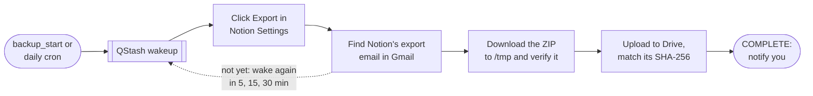

# notion-backup-automation

Backs up a Notion workspace to Google Drive once a month, without the Notion API: a headless
browser clicks Export in Notion's Settings, the app finds Notion's export email in Gmail,
downloads the ZIP, verifies it and uploads it to Drive with a checksum. It runs as Vercel
Functions, woken by Upstash QStash, with state in Upstash Redis.

You control it from an MCP client (Claude Code, Cursor, Codex) and from Telegram buttons, and
set it up with a local CLI.

A bounded [Gemini supervisor](#supervisor) triages selected incidents after the deterministic
retries run out. It can inspect, wait or retry within the job's limits, then ask you for help.
`AGENT_MODEL_PROVIDER=none` hands incidents to you without an LLM call.

## How It Works



1. **Start.** `backup_start` (MCP) or the daily cron (when `AUTO_START_ENABLED=true`) creates
   this month's job (`2026-10`) and publishes a QStash wakeup.
2. **Tick.** Each wakeup is one `POST /api/jobs/process/<jobId>`. The worker takes the job's
   lease, runs exactly one step, saves the result, and publishes the next wakeup.
3. **Trigger.** Playwright replays the saved Notion session and clicks Export
   (Markdown & CSV, everything, private pages and subpage folders on).
4. **Wait.** Gmail is checked at +5 min, +15 min, then every 30 min for a trusted export email,
   for up to 48 hours.
5. **Transfer.** In one invocation: download the ZIP with the session's cookies, verify every
   entry, upload it to `<root>/<YYYY>/` in Drive, and require Drive's SHA-256 to match.
6. **Notify.** Success, failure and "needs attention" go to the console log and, if enabled,
   to Telegram through [telegram-webhook-hub](../telegram-webhook-hub/README.md).

Failures are retried with backoff or wait for you (see [Backup Jobs](#backup-jobs)). Detailed
diagrams: [docs/backup-lifecycle.md](docs/backup-lifecycle.md) (job states, the tick, the cron)
and [docs/notion-export-flow.md](docs/notion-export-flow.md) (sign-in, session gate, export
trigger). Structure: the [C4 model](../../../docs/architecture/workspace.dsl).

## Functions

| Function                          | Trigger and auth                                   | Does                                                         |
| --------------------------------- | -------------------------------------------------- | ------------------------------------------------------------ |
| `POST /api/jobs/process/[jobId]`  | QStash, `Upstash-Signature`                        | One tick of one job, or the `_ping` smoke test. 300 s.       |
| `GET /api/cron/daily`             | Vercel Cron 04:00 UTC, `Bearer $CRON_SECRET`       | Auto-start, watchdog, health probes, login warnings. 300 s.  |
| `POST /mcp` (→ `/api/mcp`)        | MCP client, `Bearer $MCP_AUTH_TOKEN`               | Seven `backup_*` tools. Publishes wakeups, never runs steps. |
| `POST /api/integrations/telegram` | telegram-webhook-hub, `Bearer $TELEGRAM_HUB_TOKEN` | Status, retry, cancel and login help from Telegram.          |
| `GET /api/health`                 | Public                                             | `{"ok":true,"version":"<short SHA>"}`, nothing else.         |

The worker and the cron load Playwright and serverless Chromium. `/mcp` and the Telegram
integration import `src/config/control-containers.ts` only, so they stay small;
`tests/api/browser-imports.test.ts` fails if either reaches the browser code again.

## Layout

| Path                        | Purpose                                                                                                   |
| --------------------------- | --------------------------------------------------------------------------------------------------------- |
| `api/`                      | Vercel entry points (Web `Request` → `Response`); no logic.                                               |
| `src/domain/`               | Pure rules: job schema, statuses and transitions, retry and schedule policy, error catalog.               |
| `src/application/`          | Ports, the tick (`process-job.ts`), job methods (`backup-service.ts`), the cron, notifications.           |
| `src/agent/`                | Supervisor context, action policy, budgets and the `checkAgent` diagnostic.                               |
| `src/adapters/llm/`         | Gemini structured-output model and the `none` provider.                                                   |
| `src/adapters/`             | Notion (Playwright), Google OAuth, Gmail, Drive, transfer, Redis + Lua, QStash, Telegram, heartbeat.      |
| `src/http/`                 | Request auth (QStash, cron, bearer), rate limits, handlers, content-free responses.                       |
| `src/mcp/`, `src/telegram/` | MCP tools and allowlisted views; the Telegram integration receiver.                                       |
| `src/config/`               | Zod env schemas per function (`env.ts`) and composition roots (`containers.ts`, `control-containers.ts`). |
| `src/cli/`                  | Local CLI commands.                                                                                       |
| `src/shared/`               | Redacting JSON logger, AES-256-GCM envelope crypto, `.env.local` writer, small helpers.                   |
| `tests/`                    | Vitest; `contract/`, `live/` and `browser/` hold the repository contract and opt-in suites.               |

## Local Setup

Copy `.env.example` to `.env.local`, `chmod 600 .env.local`, and fill it from 1Password. Git
ignores every `.env.*` file except the example. Each function validates only the variables it
needs (`src/config/env.ts`); errors name variables, never values. Defaults are in `env.ts`.

```sh
pnpm --filter notion-backup-automation typecheck
pnpm --filter notion-backup-automation lint
pnpm --filter notion-backup-automation test                 # no network, browser or credentials
NBA_LIVE_REDIS=1 pnpm --filter notion-backup-automation test:live
pnpm --filter notion-backup-automation test:live:drive
pnpm --filter notion-backup-automation test:browser
pnpm --filter notion-backup-automation test:agent-live
```

- `test:live` runs the repository contract, secret store and health store against the Redis in
  `.env.local`, under `{nba:test}:live-<run>:`, and deletes its keys. It skips without
  `NBA_LIVE_REDIS=1`. A local Redis behind
  [serverless-redis-http](https://github.com/hiett/serverless-redis-http) works too.
- `test:live:drive` runs the Drive access checks against the real root; it creates and deletes
  two empty probe files.
- `test:browser` runs the export trigger in your installed Chrome, headless, against a local
  copy of Notion's Settings UI (`tests/fixtures/notion/workspace.html`). It never opens Notion.
- `test:agent-live` sends the 7 made-up supervisor fixtures to Gemini using `GEMINI_API_KEY`
  from `.env.local`; see [Supervisor](#supervisor) for the acceptance criteria.

### CLI

```sh
pnpm --filter notion-backup-automation cli <command> [options]
```

The CLI reads `.env.local` (shell variables win), prints masked output only, and logs JSON to
stderr at `LOG_LEVEL` (default `warn`). `dev:*` commands require `APP_ENV=dev`.

| Command                                   | Does                                                                                                                                                          |
| ----------------------------------------- | ------------------------------------------------------------------------------------------------------------------------------------------------------------- |
| `auth:google [--print]`                   | Google consent (loopback on `127.0.0.1`, PKCE) for `gmail.readonly` + `drive.file`. Writes `GOOGLE_REFRESH_TOKEN` to `.env.local`; `--print` shows it.        |
| `auth:google --pick-folders`              | Grants the app the Drive folders you pick in the Google Picker. Saves no token.                                                                               |
| `auth:notion`                             | Opens Chrome on Notion's login; you sign in (MFA included). Saves the session encrypted to Redis for `APP_ENV`, re-checks it headless, resumes a waiting job. |
| `drive:check [--year YYYY]`               | C1 root visible, C2 one year folder visible, C3/C4 create and delete a file in the root/year folder. Exits 0 when C1 and C3 pass.                             |
| `drive:init`                              | Creates an app-owned `Full Workspace` root at the top of My Drive (fallback when picking fails).                                                              |
| `doctor [--email-since YYYY-MM-DD]`       | Checks Google token and scopes, Gmail and the newest trusted export email, the Drive root, Redis, the Notion session, and the hub token. Exits 1 on failure.  |
| `smoke:qstash`                            | Publishes a signed `_ping` to the worker at `APP_BASE_URL` and waits up to 2 min for its nonce in Redis.                                                      |
| `telegram:setup --test`                   | Sends a test message with a Status button through the hub. Bot setup itself is the hub's CLI.                                                                 |
| `dev:upload <file.zip>`                   | Uploads a file as today's backup into `_dev/<YYYY>/` with the real storage code. Idempotent by SHA-256.                                                       |
| `dev:trigger [--dry-run] [--headed]`      | Requests a real export with the saved session; `--dry-run` stops at the dialog and cancels.                                                                   |
| `dev:download [--email-since YYYY-MM-DD]` | Downloads and verifies the newest export ZIP into a temp dir, prints size/SHA-256/file count, deletes it.                                                     |
| `dev:tick --start [--force]`              | Creates this month's dev job (`--force`: a new `<period>-r<N>`).                                                                                              |
| `dev:tick <jobId> [--retry \| --cancel]`  | Runs the job's next step locally and prints when the next one is due. Publishes nothing: run it again for each step.                                          |

`dev:tick` uses the dev Redis prefix, the dev Notion session and `_dev/<YYYY>/` in Drive. A
verified ZIP of this month already in `_dev/<YYYY>/` is adopted at once; delete it or use
`--start --force` to see a real export.

## Backup Jobs

A job is `job:<period>` (`2026-10`; a forced one is `2026-10-r2`). It moves through
`CREATED → TRIGGERING_EXPORT → WAITING_FOR_EMAIL → EMAIL_FOUND → COMPLETE`, one step per tick
([state diagram](docs/backup-lifecycle.md#job-states)).

**One tick** (`ProcessJobUseCase`):

1. Load the job. A job waiting for you needs no lease; any other takes one (60 s light step,
   330 s heavy step: the trigger, transfer and supervisor). A held lease answers `lease_held`.
2. Reload and compare the delivery's **schedule token** with the job's. A superseded wakeup is
   `stale` and does nothing.
3. Pick the step: cancel first, then the lifetime limit, then rolling back a transfer a dead
   worker left, then the status's own step. A heavy step starts no new work after 270 s, a
   light one after 45 s.
4. Save with compare-and-set (3 tries on conflict), notify, then publish the next wakeup with a
   new token and save that token. A failed publish throws before the save, so QStash retries
   the same delivery with the still-valid token.

**Safety guards:**

- **Drive first.** Before exporting or downloading, the job adopts a verified backup of the
  period already in Drive (protects against lost Redis state).
- **Write-ahead click.** `exportClickAt` is saved just before the final Export click; a worker
  that dies after it never clicks again in that attempt.
- **One email per job.** A found email is claimed (`email:<messageId>`).
- **Transfer markers** (`DOWNLOADING`, `VERIFYING`, `UPLOADING`) are saved before each part; a
  dead run's marker rolls back to `EMAIL_FOUND` once.
- **Cancel** is honoured at the next step boundary.

**Retries and incidents** (`src/domain/error-catalog.ts`, `retry-policy.ts`):

- A retryable code with budget left goes to `RETRYABLE_FAILURE` and wakes after 5 min, 15 min,
  45 min, 2 h 15 min, then every 6 h (a longer `Retry-After` wins). The budget is
  `MAX_STAGE_RETRIES` per stage, or 24 h of backoff for outage codes such as `DRIVE_UNAVAILABLE`.
- Anything else goes to `NEEDS_ATTENTION`. Supervised codes wake after one minute for the
  [supervisor](#supervisor); other incidents wait for you: `backup_retry`, a Telegram button,
  or a login fix. `auth:notion` resumes the job itself; after `auth:google` or a Drive grant,
  the next cron probe that passes resumes it. Once an incident is handed to you, no further
  supervisor wakeup is scheduled.
- No email after `EMAIL_WAIT_TIMEOUT_HOURS` (48) stops the job with `EMAIL_TIMEOUT`, without a
  new export. The ⚠️ message offers Retry, which checks for the email once more, and Retry from
  scratch, which requests a new export.
- An expired link, or an invalid ZIP downloaded twice, starts a new export attempt, up to
  `MAX_EXPORT_ATTEMPTS` (3).
- A job older than `JOB_MAX_LIFETIME_HOURS` (168) ends as `FAILED`.

**Shrink check.** On `COMPLETE`, the backup is compared with the previous complete one. Below
`EXPORT_SHRINK_RATIO` (0.5) of its file count or size, the job still completes, but the
success message becomes a ⚠️ and an `export.shrunk` event is recorded.

**Application methods** (`BackupApplicationService`), shared by MCP, Telegram and the cron:
`start`, `process`, `retry`, `cancel`, `status`, `list`. `process`, `retry` and `cancel` hold a
15 s control lease while they write and cancel the superseded QStash message.

## Notion Session And Export

No Notion API or password is used. `auth:notion` saves a browser session; the worker replays it.

- **Sign-in** (`auth:notion`): headed Chrome with a fresh temporary profile (falls back to
  Playwright's Chromium after `pnpm --filter notion-backup-automation exec playwright-core
install chromium`). Use "Continue with email" if Google sign-in refuses the window. Only
  Notion's cookies and localStorage are kept; an unexpired `token_v2` and a `file_token` for
  `file.notion.com` (needed for the download) are required, otherwise nothing is saved. The
  session is stored AES-256-GCM-encrypted as `secret:notion-storage-state`. Then a job waiting
  for the Notion login is retried: a prod job through QStash (needs `QSTASH_TOKEN` and
  `APP_BASE_URL` in `.env.local`, else the command tells you to run `backup_retry`), a dev job
  by your next `dev:tick`.
- **Session gate.** Notion answers `200` even when signed out, so the rendered page decides:
  login page → `NOTION_SESSION_EXPIRED`; CAPTCHA → `NOTION_INTERACTIVE_CHALLENGE`; a workspace
  switcher not named `NOTION_WORKSPACE_NAME` → `NOTION_WRONG_WORKSPACE`; load failure or 5xx →
  `NOTION_UNAVAILABLE` (retried). The first three need `auth:notion`.
- **Export trigger.** Workspace switcher → Settings → General → "Workspace content" → Export,
  found by role and text. Dialog values are set only where they differ. A missing element is
  `NOTION_UI_CHANGED` after one reload. Results: `confirmed`, `already_in_progress` (nothing
  clicked), or `in_doubt` (clicked, no confirmation seen; the job waits for the email anyway).
  Each step waits up to 30 s; downloads are refused in the browser.
- **Rolling refresh.** When Notion rotates cookies during a run, the session is saved again
  (best effort, never throws).
- **On Vercel** the browser is `@sparticuz/chromium` (headless, `--single-process`). It starts
  through a `/bin/sh` wrapper with `ulimit -c 0`, and `core.*` files in `/tmp` are deleted, since
  a crash dump could contain the session.

## Export Email, Download And Upload

**Trusted email** (`src/adapters/gmail/`): Gmail's topmost `Authentication-Results` must show
DKIM pass for `@mail.notion.com` and DMARC pass for `mail.notion.com`; the Notion DKIM signature
must cover `From`, `To`, `Subject` and `X-Feedback-Id`; the single `To` must be the Gmail
account; sender, subject and feedback subtype (`export-completed`) must match; the HTML must
hold exactly one "here" link to `https://mg.mail.notion.com/c/…`. The link is re-read when
needed and never stored or logged. The search scans at most 10 pages of 10 messages, then fails
with `EMAIL_SEARCH_LIMIT` instead of reporting "no email".

**Transfer** (`TmpExportTransfer`, the only `TRANSFER_MODE`):

1. **Link.** Follow the Mailgun link one hop without cookies. Only a redirect to
   `https://file.notion.com/f/…` with `table=user_export` and an `expirationTimestamp` is
   accepted (else `EMAIL_UNRECOGNIZED`); a link past its expiry ends as `link_expired`.
2. **Download.** Send only Notion cookies that match `file.notion.com`; refuse redirects. Stream
   to `/tmp/nba/<jobId>.zip.part` (0600) while hashing, rename only when the length matches
   `Content-Length`, and keep 16 MiB of free space (`TMP_SPACE_INSUFFICIENT`). A 403 before
   expiry is `NOTION_SESSION_EXPIRED`. Network errors, 30 s without data, a short body, and 429
   or 5xx with `Retry-After` ≤ 10 s get 3 attempts, then `DOWNLOAD_FAILED`.
3. **Verify.** yauzl reads every entry; absolute or `..` names, encryption, wrong sizes, CRC-32
   mismatches and empty archives are `ZIP_INVALID` (with a static reason, never an entry name).
4. **Upload** through the Drive storage below. `/tmp/nba` is removed after every run.

**Drive storage** (`drive.file` scope: the app sees only files it created and folders you
picked):

```text
Full Workspace/                       GOOGLE_DRIVE_BACKUP_ROOT_FOLDER_ID (picked)
├── 2026/                             your folder (picked); found by exact name
│   ├── notion-workspace-2026-10-01.zip
│   └── notion-workspace-2026-10-01.zip.sha256
├── 2027/                             created by the app
└── _dev/2026/                        APP_ENV=dev writes only here
```

- **Setup:** run `auth:google --pick-folders`, pick `Full Workspace` and the current year
  folder, then `drive:check` must pass C1–C4. Later years are created by the app. If a probe
  file's creation is ambiguous, `drive:check` finds it again by its app marker and deletes it,
  or names the leftover by ID; it never repeats the create.
- **Year folders:** found by exact name, or created only for a year after every visible one. A
  hidden (un-picked) `2026` therefore fails with `DRIVE_ROOT_INACCESSIBLE` instead of creating
  a duplicate; pick it again. Two folders with the same year also fail.
- **Uploads** use Drive's resumable protocol in 16 MiB chunks. A dropped connection, 429 or 5xx
  resumes from the byte count Drive reports; a long `Retry-After` ends with `DRIVE_UNAVAILABLE`.
- **Verification:** each ZIP carries `appProperties` (period, job ID, SHA-256). It counts as a
  backup only while Drive's own `sha256Checksum` matches; on a mismatch the new file is deleted
  (`DRIVE_CHECKSUM_MISMATCH`). A verified ZIP with the same SHA-256 is reused instead of uploaded.
- **Sidecar:** `<name>.zip.sha256` lets `shasum -a 256 -c` check a downloaded copy
  (`WRITE_SHA256_SIDECAR`, default `true`). A failed sidecar is logged; the ZIP stays.

## Supervisor

The deterministic rules handle every known failure. An incident whose code the error catalog
(`src/domain/error-catalog.ts`) marks `supervised` waits for the supervisor first: 14 codes,
such as `NOTION_UI_CHANGED`, `UNKNOWN_ERROR`, `EMAIL_UNRECOGNIZED`, `ZIP_INVALID` and `TRANSFER_TIMEOUT` after their re-runs, and the
transient codes once their retries ran out. The login, access and configuration codes, and
`EMAIL_TIMEOUT`, go straight to you. The supervisor never bypasses the state machine.

Each supervisor wakeup (1 minute after the incident, then after each decision) makes **one
decision** (`src/agent/`, called from the tick's `supervise` step):

1. **Budgets.** At least a minute since the last decision; at most
   `AGENT_MAX_DECISIONS_PER_INCIDENT` per incident (the last one may only hand the incident to
   you), `AGENT_MAX_INCIDENTS_PER_JOB` incidents per job, and `AGENT_MAX_DECISIONS_PER_DAY`
   across every job. A spent budget hands the incident to you without a model call. The day's
   counter is taken before the model call, so a delivery QStash retries after a failed save
   takes another slot; the day's cap still bounds it.
2. **Context**, built field by field from an allowlist (`context-builder.ts`): the job's
   counters and stage, the code with the catalog's text, the earlier decisions and their
   outcomes, what the actions observed, and the allowed actions. For `NOTION_UI_CHANGED`, up
   to 30 ARIA `role:name` pairs of the open Settings or export dialog (never the page around
   it, whose titles are private), cut to 40 characters, with email addresses and the workspace
   name redacted; a name that is not one of Notion's known Settings labels goes as `[other]`,
   so neither the account holder's name nor a teamspace's reaches the model. After
   `inspect_status`, the recent events' type, status, code and time, never their text (it can
   hold a caller's `backup_start` reason). No screenshot, page text, URL, email, workspace
   content, cookie or token; a context that fails its strict schema is never sent.
3. **One model call** within `AGENT_TIMEOUT_MS`, validated with Zod. A timeout, a 429 or an
   invalid answer counts as a decision; after two, the incident goes to you.
4. **The action policy** (`actions.ts`) checks the action's preconditions; a refused action
   becomes `notify_user`, with the model's reading in the summary.
5. **Exactly one action** runs, and the decision, its outcome and its observations are saved
   on the incident with one compare-and-set write, plus a `supervisor` event. The next tick
   re-evaluates the state first.

| Action                 | Does                                                                          | Only when                                                       |
| ---------------------- | ----------------------------------------------------------------------------- | --------------------------------------------------------------- |
| `inspect_status`       | Adds the last 20 events (no text) and the probe results to the next context   | Once per incident                                               |
| `check_notion_session` | Runs the session gate (no Settings, no click)                                 | Stage `NOTION_TRIGGER`; not in the last 30 min                  |
| `search_email_again`   | The Gmail match from 60 or 180 min earlier; keeps counts and reasons only     | Stage `EMAIL_WAIT`                                              |
| `wait`                 | Decides again in 15, 60 or 240 min; saved, so an early wakeup decides nothing | Within the job's lifetime                                       |
| `retry_stage`          | Runs the incident's stage again, one more stage retry; the incident stays     | Retries left; never `NOTION_TRIGGER` after this attempt's click |
| `retry`                | Starts a new export attempt                                                   | Attempts left; 2 h after this attempt's export request          |
| `notify_user`          | Hands the incident to you with the cleaned summary (≤ 400 characters)         | Always                                                          |

A session probe or email search that finds a known, unsupervised cause (an expired Notion
session, `GOOGLE_AUTH_REQUIRED`) turns the incident into that code's, so its usual fix and the
automatic resume after a login fix apply. A retried stage that fails the same way reopens the
same incident with its decisions; one that succeeds closes it.

**Settings** (all optional; the defaults suit production):

| Variable                           | Default            | Meaning                                                                                                |
| ---------------------------------- | ------------------ | ------------------------------------------------------------------------------------------------------ |
| `AGENT_MODEL_PROVIDER`             | `gemini`           | `gemini`, or `none`: every incident goes to you after one decision, with no LLM call.                  |
| `AGENT_MODEL_NAME`                 | `gemini-3.6-flash` | The Gemini model. Changing it needs only the variable and a redeploy; check it with `test:agent-live`. |
| `GEMINI_API_KEY`                   | —                  | Google AI Studio key (1Password). Required by the worker and the cron while the provider is `gemini`.  |
| `AGENT_TIMEOUT_MS`                 | `20000`            | One model call in the worker; `checkAgent` uses at most 20 s, inside `/mcp`'s 30 s limit.              |
| `AGENT_MAX_DECISIONS_PER_INCIDENT` | `4`                | The last one may only be `notify_user`.                                                                |
| `AGENT_MAX_INCIDENTS_PER_JOB`      | `3`                | Later incidents of the job go straight to you.                                                         |
| `AGENT_MAX_DECISIONS_PER_DAY`      | `20`               | Across every job, per UTC day (Redis counter).                                                         |

`GeminiAgentModel` calls the Gemini API with the key in a header, at temperature 0 with at most
2048 output tokens (thinking included), and JSON output constrained to the decision schema. Thinking is off for
`gemini-2.5-flash*` and low for a `gemini-3*` model, so it does not use up those
tokens. The SDK retries nothing; the supervisor's budget does.

**Where you see it:** a `supervisor` event per decision in `backup_status`'s `recentEvents`;
the summary as `attention.supervisorSummary` there and as the **Supervisor:** line of the ⚠️
Telegram message; `backup_health({ checkAgent: true })` runs one canned, content-free decision
on the configured model (at most 5 an hour) and reports it as `agent.lastCheck`.
`dev:tick` uses the model `.env.local` configures, prints which one, and shows the incident's
last decision (`supervisor  decision N: <action> → <outcome>`) and the summary.

**S5 evaluation:** `pnpm --filter notion-backup-automation test:agent-live` sends the 7 made-up
incidents in `tests/fixtures/agent/` to the configured model and requires every answer to be
valid and at least 6 acceptable: an acceptable action, allowed, with parameters the policy would
take (`retry_stage` on the incident's stage, a `wait` within the lifetime). Each fixture's
context is the one production builds for an incident reached through the lifecycle rules
(`tests/support/agent-scenarios.ts`); a unit test keeps them equal. A shell variable wins over
`.env.local`, so
`AGENT_MODEL_NAME=<model> pnpm --filter notion-backup-automation test:agent-live` tries another
model.

## Worker And Daily Cron

**Worker.** The scheduler publishes each wakeup to `<APP_BASE_URL>/api/jobs/process/<jobId>`
on QStash's EU endpoint, with body `{ jobId, token, reason }`, deduplication ID
`<jobId>.<token>`, 3 QStash retries, and flow control `nba-<APP_ENV>` (parallelism 1). The worker
verifies `Upstash-Signature` against `APP_BASE_URL` + path + raw body (current and next signing
key) before reading anything else; it ignores the Host header and the query Vercel adds.
Responses carry codes only, since QStash keeps failed bodies in its DLQ:

| Case                                                         | Response                                      |
| ------------------------------------------------------------ | --------------------------------------------- |
| Step done, waiting, recorded failure, stale token, ended job | `200`                                         |
| Signature invalid for this URL and body                      | `401 INVALID_SIGNATURE`                       |
| Body the app never sends, or naming another job              | `489 INVALID_MESSAGE` (QStash does not retry) |
| Unknown job, or a stored record that fails its schema        | `489 JOB_NOT_FOUND` / `STATE_SCHEMA_INVALID`  |
| Another worker holds the lease                               | `503 LEASE_HELD` + `Retry-After`              |
| Signing keys, `APP_BASE_URL`, Redis or backup config missing | `503 CONFIG_INCOMPLETE`                       |
| Redis failed, or the next wakeup could not be published      | `500 WORKER_FAILED` (QStash retries)          |

The reserved job ID `_ping` only records the delivery's nonce in `health` (used by
`smoke:qstash`); it needs the signing keys, `APP_BASE_URL` and Redis, not the backup config.

**Daily cron** (04:00 UTC; dates use `BACKUP_TIME_ZONE`, default `Europe/Warsaw`):

1. Record the run in `health` (also keeps the Redis database active).
2. Auto-start this month's job if `AUTO_START_ENABLED=true`, the day is `BACKUP_DAY_OF_MONTH` or
   later, and no job is active. A period's job is never started twice.
3. Watchdog: re-arm an active job whose wakeup is over an hour late, and wake a job past its
   lifetime so its tick fails it. Jobs waiting for you are not polled.
4. Probes, in parallel: Google (token, both scopes, Gmail profile) and Drive (root, year
   folder, a probe file under `_dev/<YYYY>`) daily; Notion (session gate, then the export dialog,
   cancelled) on Mondays, two days before `BACKUP_DAY_OF_MONTH`, and while a job waits for the
   Notion login. Results go to `health`.
5. A probe that newly fails sends one 🔑 "access is gone"; a probe that passes resumes a job
   waiting for that login, as `backup_retry` would.
6. Warn 30, 7 and 1 days (`LOGIN_WARNING_DAYS`) before the Notion session expires, once each.
7. Ping `HEARTBEAT_PING_URL`, or `<url>/fail` if a sub-step threw. healthchecks.io (period and
   grace 1 day) alerts after 2 silent days.

A sub-step that throws is logged and skipped; the run then answers 500 with a report naming it.
Vercel Cron does not retry. `?probe=notion|google|drive` runs one probe and returns its
content-free result, such as `{"ok":false,"probe":"google","code":"GOOGLE_AUTH_REQUIRED"}`.

## Notifications And Telegram

`NOTIFIERS` (default `console`) lists the channels. `console` writes one log line per event;
`telegram` sends HTML through the hub and needs `TELEGRAM_HUB_URL` and `TELEGRAM_HUB_TOKEN`
(without them it is skipped with a warning). A failing channel is logged and never fails a tick.

| Event                 | Message                                          | Buttons                                                             |
| --------------------- | ------------------------------------------------ | ------------------------------------------------------------------- |
| Backup stored         | ✅ size, file count, file name, folder, duration | Open in Drive                                                       |
| Stored but shrunk     | ⚠️ old and new file counts and sizes             | Open in Drive · Status                                              |
| Needs attention       | ⚠️ stage, code, reason, fix, last 10 events      | Status · Retry · Retry from scratch · Cancel; Fix login if relevant |
| Failed (lifetime)     | ❌ stage, code, reason                           | Status                                                              |
| Export email late     | ⏳ attempt, time waited; the job keeps checking  | Status                                                              |
| Login expiring / lost | 🔑 the date or "access is gone", and the fix     | Fix login                                                           |

- Messages use allowlisted fields only, redacted and HTML-escaped; free text loses URLs. The
  Drive link is the only URL, as a button.
- An attention is sent once per job and code per 24 h; a lost-login warning once per service
  per 24 h (`notify:<key>`, `SET NX EX`). Each sent notification is recorded as a job event
  (login warnings, which belong to no job, in `health`), since Vercel Hobby keeps logs for an
  hour.
- A late email is reported once a day: first at the first check 45 minutes or more after the
  request (50 minutes on the normal schedule), then about 24 hours later. It changes nothing
  about the job. At 48 hours the job stops, and the `EMAIL_TIMEOUT` ⚠️ replaces the third one.
- Success and failure are sent once even after a crash: a later delivery sends what a dead
  worker left unsent. Dev messages start with "🧪 dev".

**Telegram commands and buttons** arrive at `POST /api/integrations/telegram` from the hub,
which already checked Telegram's secret and the owner chat:

| You send or tap                     | The bot                                                                                               |
| ----------------------------------- | ----------------------------------------------------------------------------------------------------- |
| `/status`, `/backup_status`, Status | The job (given, else active, else latest) as `backup_status` shows it, with allowed buttons.          |
| Retry                               | `backup_retry` from the failed stage, then removes the report's buttons.                              |
| Retry from scratch, Cancel          | "Tap again to confirm" (single use, 10 min), then retry from `NOTION_TRIGGER` or cancel.              |
| Fix login                           | The command to run: `auth:notion`, `auth:google` (then update Vercel and redeploy), or `drive:check`. |
| Anything else                       | Short help. The bot cannot start a backup.                                                            |

- **Idempotent:** each `updateId` gets a 60 s processing lease and a 2-day completed receipt.
  A mutation saves its reply receipt before replying, so a redelivery replays the reply instead
  of acting twice. Buttons act on the job's current state; a stale one changes nothing.
- **Errors:** domain refusals are replied with their code. Redis, QStash or hub failures release
  the lease and return 503 so the hub retries. A reply the hub refuses for good (4xx other than
  408/429) finishes the update as `rejected`.
- **Namespace:** outgoing callback data is prefixed with `TELEGRAM_INTEGRATION_ID` (default
  `nb-<APP_ENV>`), which must equal the route `id` in the hub's `HUB_INTEGRATIONS`, or the hub
  refuses the buttons (403).

The app never sees the bot token, chat ID or webhook secret. How the hub routes updates:
[telegram-webhook-hub flow](../telegram-webhook-hub/docs/webhook-flow.md).

### Telegram Setup

The bot belongs to the hub: create it and register its webhook with the
[hub's deployment steps](../telegram-webhook-hub/README.md#deployment). Then connect this app:

1. Generate the integration token with `openssl rand -base64 32` and save it in 1Password. It is
   not the bot token or the webhook secret.
2. In the hub's Production variables, add this route to `HUB_INTEGRATIONS`
   ([format](../telegram-webhook-hub/README.md#configuration)), then Redeploy the hub:
   `id` `nb-prod`, `commands` `status` and `backup_status`, `url`
   `https://<app>.vercel.app/api/integrations/telegram`, and `token` from step 1.
3. In this app's Production variables, set `TELEGRAM_HUB_URL`, `TELEGRAM_HUB_TOKEN` (the same
   token), `TELEGRAM_INTEGRATION_ID=nb-prod` and `NOTIFIERS=console,telegram`, then Redeploy.
4. With the same hub URL and token in `.env.local`, send a test message:

   ```sh
   APP_ENV=prod pnpm --filter notion-backup-automation cli telegram:setup --test
   ```

   Expect a test message with a Status button in the bot's chat. Tap Status, and send `/status`:
   both answer with the job's status, or say there is no job.

Each environment needs its own route. Without an `nb-dev` route the hub refuses dev messages with
403, and the job carries on. Do not set `TELEGRAM_INTEGRATION_ID=nb-prod` for dev: dev and prod job
IDs match, so a button could act on the prod job.

## MCP Server

`POST /mcp` is a stateless Streamable HTTP MCP server (a new server per request). Checks, in
order: `Authorization: Bearer $MCP_AUTH_TOKEN` (401), `Origin` must be absent or listed in
`MCP_ALLOWED_ORIGINS` (403), `POST` only (405), 60 requests per hour (429 + `Retry-After`).
A `subscriptions/listen` request is refused at once: no change event is ever sent, and a held
stream would only run into the function's 30 s limit.

| Tool             | Does                                                                                                                                        |
| ---------------- | ------------------------------------------------------------------------------------------------------------------------------------------- |
| `backup_start`   | Creates this month's job, or returns the existing one. `force` starts `<period>-r<N>`.                                                      |
| `backup_status`  | One job (default: active, else latest), its result or incident, and 10 events.                                                              |
| `backup_list`    | Newest jobs first (`limit` 1–24, default 12).                                                                                               |
| `backup_process` | Wakes a job now with a new token; 10 calls per job per hour.                                                                                |
| `backup_retry`   | Resumes a job that needs attention or waits to retry, from its stage or `fromStage`.                                                        |
| `backup_cancel`  | Cancels a job that has not ended.                                                                                                           |
| `backup_health`  | Stored probe results, last QStash ping and cron run, notification and agent settings; `checkAgent: true` runs one canned decision (5/hour). |

Results carry `structuredContent` plus a text summary. Refusals are `isError: true` with
`{ code, message }`: `ACTIVE_JOB_EXISTS`, `JOB_NOT_FOUND`, `INVALID_STATE`, `RATE_LIMITED`,
`SCHEDULER_UNAVAILABLE` or `INTERNAL_ERROR`. Views are built from an allowlist: no URL, token,
cookie, email content, schedule token or Drive folder ID reaches a client.

**Client setup** (Claude Code, user scope; `NOTION_BACKUP_MCP_TOKEN` is your shell's copy of
`MCP_AUTH_TOKEN`):

```sh
claude mcp add --transport http --scope user notion-backup https://<app>.vercel.app/mcp --header "Authorization: Bearer $NOTION_BACKUP_MCP_TOKEN"
```

Cursor and Codex use the same URL and header (Codex: `bearer_token_env_var =
"NOTION_BACKUP_MCP_TOKEN"`).

## State In Redis

Keys start with `{nba:<APP_ENV>}:`, so `prod`, `dev` and `test` share one database without
overlap; the hash tag keeps an environment in one slot for the Lua scripts.

| Key                           | Content                                                              |
| ----------------------------- | -------------------------------------------------------------------- |
| `job:<jobId>`                 | Hash `{ v, data }`: compare-and-set version and job JSON             |
| `jobs`                        | Sorted set of job IDs by `createdAt`                                 |
| `active`                      | The one active job ID; cleared at a terminal status                  |
| `lease:<jobId>`               | The worker holding the job (`SET NX PX`)                             |
| `events:<jobId>`              | Newest 200 sanitized events                                          |
| `email:<messageId>`           | The job that consumed this export email                              |
| `secret:notion-storage-state` | AES-256-GCM envelope of the Notion session                           |
| `health`                      | Last probe results, last cron run, `_ping` nonce, last login warning |
| `notify:<key>`                | A notification that must not repeat yet (`SET NX EX`)                |

A normal job's ID is its period, so `job:<period>` also guards one normal job per month.

## Security

**Every function except `/api/health` checks its caller first**, in constant time where it
compares a secret, and answers with codes only:

| Function                     | Caller check                                                               |
| ---------------------------- | -------------------------------------------------------------------------- |
| `/mcp`                       | Bearer token, `Origin` allowlist, 60 requests per hour                     |
| `/api/jobs/process/[jobId]`  | QStash signature over `APP_BASE_URL` + path + raw body                     |
| `/api/cron/daily`, `?probe=` | `Bearer $CRON_SECRET`                                                      |
| `/api/integrations/telegram` | The hub's own bearer token; the hub already checked Telegram and the owner |

**Fail closed.** A function refuses to run without its variables: a preview, which has none,
answers 503 `CONFIG_INCOMPLETE` everywhere except `/api/health` (and Vercel Authentication
stands in front of it). A malformed value is refused too, and errors name the variable, never
the value. An unknown `APP_ENV` is refused rather than treated as `prod`.

**Least privilege.** The Google scopes are exactly `gmail.readonly` and `drive.file`. MCP has
no raw Gmail or Drive tool. The supervisor has only its [7 bounded actions](#supervisor).

**Secrets.** 1Password is the source of truth; the app never reads it at run time. Vercel holds
them as Production-only Sensitive variables, and `.env.local` is gitignored with mode 0600. The
Notion session is AES-256-GCM encrypted in Redis. The refresh token prints only with `--print`,
and access tokens stay in memory.

**Data minimisation.** Signed download URLs are never stored, logged or returned. Every log
line goes through `redactString` and `redact`, which remove URL queries and secret URL paths;
`tests/shared` covers them. MCP views and Telegram messages use allowlisted fields, and the
supervisor's context is content-free. Vercel runs keep no Playwright traces or screenshots.

**Isolation and replay.** Redis keys carry an `APP_ENV` prefix, and dev uploads stay in `_dev/`.
`AUTO_START_ENABLED` defaults to off. A redelivered wakeup carries a replaced schedule token and
is a no-op; the lease and compare-and-set stop two workers from acting on one job. Telegram
updates act once per `updateId`, and Cancel and Retry from scratch need a second tap.

**Supply chain.** CI runs Dependency Review and Gitleaks; run `pnpm run check:secrets` before a
PR.

## Configuration

All variables are in [.env.example](.env.example) with comments; defaults and validation are in
`src/config/env.ts`. Groups:

| Group         | Variables                                                                                                                                                                                                                              |
| ------------- | -------------------------------------------------------------------------------------------------------------------------------------------------------------------------------------------------------------------------------------- |
| Core          | `APP_ENV` (`prod`, `dev`, `test`), `LOG_LEVEL`                                                                                                                                                                                         |
| Redis, crypto | `UPSTASH_REDIS_REST_URL`, `UPSTASH_REDIS_REST_TOKEN`, `APP_ENCRYPTION_KEY` (`openssl rand -base64 32`)                                                                                                                                 |
| QStash        | `QSTASH_URL` (EU), `QSTASH_TOKEN`, `QSTASH_CURRENT_SIGNING_KEY`, `QSTASH_NEXT_SIGNING_KEY`, `APP_BASE_URL`                                                                                                                             |
| Google        | `GOOGLE_CLIENT_ID`, `GOOGLE_CLIENT_SECRET`, `GOOGLE_REFRESH_TOKEN`, `GOOGLE_DRIVE_BACKUP_ROOT_FOLDER_ID`                                                                                                                               |
| Notion        | `NOTION_WORKSPACE_URL`, `NOTION_WORKSPACE_NAME`                                                                                                                                                                                        |
| Auth tokens   | `MCP_AUTH_TOKEN` (≥ 32 chars), `MCP_ALLOWED_ORIGINS`, `CRON_SECRET`                                                                                                                                                                    |
| Notifications | `NOTIFIERS`, `TELEGRAM_HUB_URL`, `TELEGRAM_HUB_TOKEN` (≥ 32 chars), `TELEGRAM_INTEGRATION_ID`, `HEARTBEAT_PING_URL`                                                                                                                    |
| Job policy    | `AUTO_START_ENABLED`, `BACKUP_TIME_ZONE`, `BACKUP_DAY_OF_MONTH`, `EMAIL_WAIT_TIMEOUT_HOURS`, `MAX_EXPORT_ATTEMPTS`, `MAX_STAGE_RETRIES`, `JOB_MAX_LIFETIME_HOURS`, `EXPORT_SHRINK_RATIO`, `LOGIN_WARNING_DAYS`, `WRITE_SHA256_SIDECAR` |
| Supervisor    | `AGENT_MODEL_PROVIDER` (`gemini` default, or `none`), `GEMINI_API_KEY`, `AGENT_*` limits                                                                                                                                               |

`GEMINI_API_KEY` is required by the worker and the cron while `AGENT_MODEL_PROVIDER=gemini`.
The model, limits and diagnostics are documented under [Supervisor](#supervisor).

While the Google OAuth app is in **Testing**, refresh tokens expire after 7 days: when `doctor`
reports `GOOGLE_AUTH_REQUIRED`, run `auth:google` again and update Vercel.

## Deployment

**Vercel project** (imported from GitHub):

| Setting                                         | Value                                      |
| ----------------------------------------------- | ------------------------------------------ |
| Framework Preset                                | Other                                      |
| Root Directory                                  | `workspaces/apps/notion-backup-automation` |
| Include source files outside the Root Directory | On                                         |
| Build, install and output settings              | Defaults                                   |
| Node.js                                         | 24.x (from `engines`)                      |
| Region                                          | `fra1` (from `vercel.json`)                |
| Environment variables                           | Production only                            |

Build notes:

- Vercel compiles each `api/*.ts` without bundling. `vercel-build` first builds
  `@workspaces/telegram-contracts`, whose exports point to `dist/`. Locally `pnpm install`
  builds it; after schema changes or `--ignore-scripts`, run
  `pnpm --filter @workspaces/telegram-contracts build`.
- Functions must not import the three-segment `@workspaces/packages/*` packages: Node cannot
  resolve those names (`ERR_UNSUPPORTED_DIR_IMPORT`). `@workspaces/telegram-contracts` is fine.
- Vercel's per-function type check only honours `target`/`module` set in this app's
  `tsconfig.json`, and finds `undici-types` only through this app's own devDependency. Keep its
  version in the range `@types/node` declares, or the build log fills with false errors.
- `vercel.json` includes Chromium's archives for the worker and the cron by pnpm's real path
  (`../../../node_modules/.pnpm/@sparticuz+chromium@*/…/bin/**`); the symlinked path is rejected.

**First deployment** (repeat the redeploy after any variable change):

1. Add the variables to Vercel → Settings → Environment Variables, **Production** only, from
   1Password. Previews get none, so every function but `/api/health` answers 503
   `CONFIG_INCOMPLETE` there.
   - Secrets (mark Sensitive): `UPSTASH_REDIS_REST_URL`, `UPSTASH_REDIS_REST_TOKEN`,
     `APP_ENCRYPTION_KEY`, `QSTASH_TOKEN`, `QSTASH_CURRENT_SIGNING_KEY`,
     `QSTASH_NEXT_SIGNING_KEY`, `GOOGLE_CLIENT_ID`, `GOOGLE_CLIENT_SECRET`,
     `GOOGLE_REFRESH_TOKEN`, `GEMINI_API_KEY`, `CRON_SECRET`, `MCP_AUTH_TOKEN`,
     `TELEGRAM_HUB_TOKEN`, `HEARTBEAT_PING_URL`. Generate `CRON_SECRET`, `MCP_AUTH_TOKEN` and
     `TELEGRAM_HUB_TOKEN` with `openssl rand -base64 32` each.
   - Plain: `APP_ENV=prod`, `QSTASH_URL=https://qstash-eu-central-1.upstash.io`,
     `GOOGLE_DRIVE_BACKUP_ROOT_FOLDER_ID`, `NOTION_WORKSPACE_URL`, `NOTION_WORKSPACE_NAME`,
     `TELEGRAM_HUB_URL=https://telegram-webhook-hub.vercel.app`, `TELEGRAM_INTEGRATION_ID=nb-prod`,
     `NOTIFIERS=console,telegram`, `AUTO_START_ENABLED=false`.
2. Merge to `main`, set `APP_BASE_URL` to the production origin (no trailing slash), and
   **Redeploy**: QStash destinations and the signature check both use it.
3. Save the prod Notion session: with prod Redis credentials in `.env.local`, run
   `APP_ENV=prod pnpm --filter notion-backup-automation auth:notion`.
4. Connect this app to the hub: follow [Telegram Setup](#telegram-setup).
5. Smoke tests (`CRON_SECRET` in your shell):

   ```sh
   curl -s https://<app>.vercel.app/api/health
   curl -si -X POST https://<app>.vercel.app/api/jobs/process/_ping
   curl -si https://<app>.vercel.app/api/cron/daily
   curl -si -X POST https://<app>.vercel.app/mcp
   curl -si -X POST https://<app>.vercel.app/api/integrations/telegram
   APP_ENV=prod pnpm --filter notion-backup-automation cli smoke:qstash
   curl -s -H "Authorization: Bearer $CRON_SECRET" "https://<app>.vercel.app/api/cron/daily?probe=notion"
   curl -s -H "Authorization: Bearer $CRON_SECRET" "https://<app>.vercel.app/api/cron/daily?probe=google"
   curl -s -H "Authorization: Bearer $CRON_SECRET" "https://<app>.vercel.app/api/cron/daily?probe=drive"
   ```

   Expect `{"ok":true,…}` from health; 401 from the unsigned worker, cron without its secret,
   `/mcp` and the integration calls; "ping delivered and verified"; `"notionSession":"valid"` with
   `"exportDialog":"ready"`; both scopes for Google; `"ok":true` for Drive.
   `NBA_LIVE_REDIS=1 pnpm --filter notion-backup-automation test:live` checks Redis itself.

6. Add the MCP client ([MCP Server](#mcp-server)): `tools/list` shows 7 tools,
   `backup_list` returns persisted jobs, and `backup_health` reports hub configuration and
   fresh probe results. After the first scheduled cron run, the healthchecks.io check shows
   "up".
7. Validate the supervisor locally with `test:agent-live` (all 7 answers valid, at least 6
   acceptable). Set `AGENT_MODEL_PROVIDER=gemini` and the chosen `AGENT_MODEL_NAME` in
   Production and redeploy. Call `backup_health` with `checkAgent: true` from the MCP client;
   expect `agent.lastCheck.ok` to be `true`.

### Deployment Cleanup

[Clean up Vercel deployments](../../../.github/workflows/vercel-deployment-cleanup.yml) runs on
every push to `main`, so on every merge, with a separate job for this project. It retains the **ten
newest successful or in-progress `main` builds**, the deployment behind
`notion-backup-automation.vercel.app`, and other current project targets. It deletes older builds
and completed preview, failed, and canceled deployments. If fewer than ten such `main` builds exist,
it keeps all of them. Other in-progress builds and deployments without Git branch metadata stay
intact.

This project is the main driver of Function Storage: `api/jobs/process/[jobId].ts` and
`api/cron/daily.ts` each bundle Chromium, and every retained build keeps those bundles. Check Vercel
Usage → Deployment Storage → Functions Storage → Projects after a few merges.

Vercel's Git integration deploys the same push independently, so cleanup runs alongside that
deployment rather than strictly before it. The new build normally shows as in progress and takes one
of the ten slots, leaving nine older successful builds. If that build then fails, those nine remain
until the next merge. If Vercel has not registered the build when cleanup lists deployments, or a
protected target is outside the newest ten, more than ten deployments can exist until a later merge.
Removed preview links stop working, and older builds are no longer available as rollback targets.
Vercel's native age-based retention also applies: Hobby permits up to 30 days, so Vercel can expire
older retained builds and leave fewer than ten. This workflow does not override that platform limit
or restore previously deleted builds.

Configure these under GitHub → repository Settings → Secrets and variables → Actions:

| Type     | Name                              | Value                                                                    |
| -------- | --------------------------------- | ------------------------------------------------------------------------ |
| Secret   | `VERCEL_CLEANUP_TOKEN`            | Vercel access token for the owning team, with deletion access            |
| Variable | `VERCEL_NOTION_BACKUP_PROJECT_ID` | Project ID from Vercel → `notion-backup-automation` → Settings → General |
| Variable | `VERCEL_TEAM_ID`                  | Owning team ID from Vercel → Team Settings → General                     |

The token and team ID are shared with
[`telegram-webhook-hub`](../telegram-webhook-hub/README.md#deployment-cleanup). Enter the token
directly in GitHub; do not commit it or add it to the app's runtime environment. The script verifies
the project name, owner, production branch, and production domain before cleanup, and rechecks live
targets before each deletion. It stops on API or validation errors, and a failure in the other
project's job does not stop this one. No dependencies are installed in the workflow, and the
credential is available only to the cleanup step running code from `main`.

Pushes to `main` apply the cleanup automatically, including the merge that adds this workflow. To
preview a run, open GitHub Actions → **Clean up Vercel deployments** → **Run workflow** on `main`,
leave **dry_run** checked, and open the `notion-backup-automation` job to review the retained IDs
and deletion candidates. A manual run covers both projects, so unchecking **dry_run** applies the
cleanup to both. For a local dry-run of this project, export `VERCEL_TOKEN`, `VERCEL_TEAM_ID`,
`VERCEL_PROJECT_ID`, and `VERCEL_PROJECT_NAME=notion-backup-automation`, then run
`node scripts/cleanup-vercel-deployments.mjs` from the repository root; deletion requires
`--apply`.

### Deployment Acceptance

Complete these checks after deploying both apps, following the hub's
[deployment runbook](../telegram-webhook-hub/README.md#deployment):

- Send `/status` and `/backup_status`; tap both old, unprefixed Status buttons and new,
  namespaced ones.
- Exercise Retry, Fix login (Notion, Google and Drive), Cancel and Retry from scratch,
  including the second-tap confirmations for mutations.
- Verify success, failure, needs-attention and login-warning notification delivery.
- Replay duplicate updates and check that a job action runs only once. Exercise temporary
  backend unavailability and verify redelivery recovers without repeating the action.
- Verify environment isolation: dev jobs and uploads stay in `{nba:dev}:` and `_dev/`, and
  an unconfigured `nb-dev` callback never falls back to `nb-prod`.
- Inspect deployed function bundles: the hub has no backup, Google or Playwright dependencies;
  the backup app's `/api/mcp` and `/api/integrations/telegram` have no Playwright or Chromium.

Real backups start only through `backup_start`, or through the cron once
`AUTO_START_ENABLED=true`.

## Recovery

Find the code with `backup_status`, or in the ⚠️ Telegram message. Run the commands from the
repository root. The fixes:

- **Notion login:** `APP_ENV=prod pnpm --filter notion-backup-automation auth:notion`. It saves
  the session and resumes the waiting job.
- **Google login:** `pnpm --filter notion-backup-automation auth:google`, copy the new
  `GOOGLE_REFRESH_TOKEN` to Vercel, and Redeploy. The next daily cron whose probe passes resumes
  the job, or run `backup_retry`.
- **Drive access:** `pnpm --filter notion-backup-automation cli drive:check`. If it reports a
  hidden folder, run `pnpm --filter notion-backup-automation auth:google --pick-folders` and pick
  it. The next daily cron whose probe passes resumes the job, or run `backup_retry`.

The daily cron sends a 🔑 message with a Fix login button, which replies with the command:

| Warning                      | What happened                                                                                 | What to do                                                                                  |
| ---------------------------- | --------------------------------------------------------------------------------------------- | ------------------------------------------------------------------------------------------- |
| Notion login expires on date | The saved session ends within 30, 7 or 1 days; backups still work                             | Notion login before that date. The new session has a new expiry, so the warnings start over |
| Notion access is gone        | The Notion probe found the session signed out, a challenge or the wrong workspace             | Notion login; for the wrong workspace, first check the two `NOTION_WORKSPACE_*` variables   |
| Google access is gone        | The Google probe got `GOOGLE_AUTH_REQUIRED`: the token was refused, or a scope is missing     | Google login                                                                                |
| Drive access is gone         | The Drive probe got `DRIVE_ROOT_INACCESSIBLE`: the root or year folder is hidden or read-only | Drive access                                                                                |

A probe that fails because a service is down sends no 🔑. A lost-access warning is sent again only
after a probe in between did not find the access gone, and at most once per service per 24 h.

"Supervised" means the supervisor triages the incident first, after any automatic retries, and
then hands it to you if it cannot clear it.

| Code                           | Supervised | What happened                                            | What to do                                                                                                     |
| ------------------------------ | ---------- | -------------------------------------------------------- | -------------------------------------------------------------------------------------------------------------- |
| `NOTION_SESSION_EXPIRED`       | No         | The saved session is signed out, or a 403 on a live link | Notion login                                                                                                   |
| `NOTION_INTERACTIVE_CHALLENGE` | No         | Notion showed a CAPTCHA or verification page             | Notion login                                                                                                   |
| `NOTION_WRONG_WORKSPACE`       | No         | The account does not show the configured workspace       | Check `NOTION_WORKSPACE_URL` and `NOTION_WORKSPACE_NAME`, then Notion login                                    |
| `NOTION_UI_CHANGED`            | Yes        | Settings or the export dialog no longer matches          | Update `src/adapters/notion/`, deploy, `backup_retry`                                                          |
| `NOTION_UNAVAILABLE`           | Yes        | Notion did not load or answered 5xx, 3 retries           | Wait for Notion, then `backup_retry`                                                                           |
| `BROWSER_LAUNCH_FAILED`        | Yes        | Chromium did not start, 3 retries                        | Read the job's events and logs, then `backup_retry`                                                            |
| `EMAIL_TIMEOUT`                | No         | No export email within 48 hours                          | Check Notion's email notifications and Gmail. Retry checks once more; Retry from scratch requests a new export |
| `EMAIL_UNRECOGNIZED`           | Yes        | An export email or its link has a new shape              | Update `src/adapters/gmail/`, deploy, `backup_retry`                                                           |
| `EMAIL_SEARCH_LIMIT`           | Yes        | The search hit its scan limit                            | Look for a flood of matching messages in Gmail, then `backup_retry`                                            |
| `GMAIL_UNAVAILABLE`            | Yes        | Gmail failed or rate-limited for about 24 hours          | Wait for Google, then `backup_retry`                                                                           |
| `GOOGLE_AUTH_REQUIRED`         | No         | Google refused the token, or a scope is missing          | Google login                                                                                                   |
| `DRIVE_ROOT_INACCESSIBLE`      | No         | The root or year folder is hidden or read-only           | Drive access                                                                                                   |
| `DRIVE_UNAVAILABLE`            | Yes        | Drive failed or rate-limited for about 24 hours          | Wait for Google, then `backup_retry`                                                                           |
| `DRIVE_CHECKSUM_MISMATCH`      | Yes        | Drive's SHA-256 differs; the new file was deleted        | Check the folder in Drive, then `backup_retry`                                                                 |
| `DOWNLOAD_FAILED`              | Yes        | The download failed for about 24 hours                   | Wait for Notion's file host, then `backup_retry`                                                               |
| `DOWNLOAD_LINK_EXPIRED`        | Yes        | The link expired and no export attempt is left           | `backup_cancel`, then `backup_start` with `force`                                                              |
| `ZIP_INVALID`                  | Yes        | The ZIP stayed invalid on every export attempt           | Check the export in Notion, then `backup_retry`                                                                |
| `TMP_SPACE_INSUFFICIENT`       | No         | The ZIP does not fit in `/tmp`                           | Check the sizes in the logs, then `backup_retry`; over about 250 MB it cannot fit                              |
| `TRANSFER_TIMEOUT`             | Yes        | The transfer outlasted one invocation, twice             | Check the ZIP size and timings in the logs, then `backup_retry`                                                |
| `INTEGRATION_UNCLASSIFIED`     | Yes        | A service gave an answer the app cannot classify         | Read the job's events and logs, then `backup_retry`                                                            |
| `UNKNOWN_ERROR`                | Yes        | An unexpected error                                      | Read the job's events and logs, then `backup_retry`                                                            |
| `JOB_LIFETIME_EXCEEDED`        | No         | The job passed 168 hours and ended as `FAILED`           | `backup_start` with `force`                                                                                    |
| `CONFIG_INCOMPLETE`            | No         | A variable is missing or invalid; functions answer 503   | Run `doctor`, fix the variable in Vercel, Redeploy, then `backup_retry` if a job waits                         |
| `STATE_SCHEMA_INVALID`         | No         | A stored job record fails its schema; nothing is written | Inspect `job:<jobId>` in Redis, then repair or delete it                                                       |

Vercel Hobby keeps logs for an hour, so a job's events (`backup_status`) are the lasting record.
