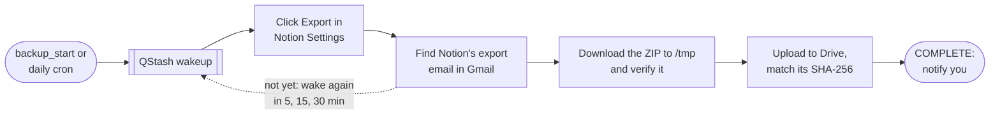

# notion-backup-automation

Backs up a Notion workspace to Google Drive once a month, without the Notion API: a headless
browser clicks Export in Notion's Settings, the app finds Notion's export email in Gmail,
downloads the ZIP, verifies it and uploads it to Drive with a checksum. It runs as Vercel
Functions, woken by Upstash QStash, with state in Upstash Redis.

You control it from an MCP client (Claude Code, Cursor, Codex, Claude on the phone) and from
Telegram buttons, and set it up with a local CLI. A bounded Gemini [supervisor](#supervisor)
triages incidents after the deterministic retries run out, then asks you for help.

## Architecture


- **Control functions** answer people: `/mcp` serves MCP clients, `/api/integrations/telegram`
  serves commands and taps that the hub forwards, and `/oauth/google/*` serves the re-login link
  you open in a browser. They read and update jobs in Redis and publish QStash wakeups, but never
  run a backup step or load a browser (`tests/api/browser-imports.test.ts` enforces this).
- **Worker** runs exactly one step of one job per QStash delivery (a "tick"), saves the result,
  and publishes the next wakeup. It is the only function that exports, downloads and uploads.
- **Daily cron** (Vercel Cron, 04:00 UTC) auto-starts the month's job, re-arms stuck jobs, probes
  Notion, Google and Drive, warns before logins expire, and pings healthchecks.io.
- **Redis** holds jobs, leases, events, health, and the encrypted Notion session and Google
  token. Every function uses it.
- **Telegram** works in both directions through
  [telegram-webhook-hub](../telegram-webhook-hub/README.md): the hub forwards your commands and
  taps to this app, and this app sends reports and replies to the hub's `/api/messages`. This app
  never sees the bot token.
- **Local CLI** (not drawn) calls the same services directly for setup and diagnostics; see
  [CLI](#cli).

Repository-level C4 view: [workspace.dsl](../../../docs/architecture/workspace.dsl).

What each function calls besides Redis:

| Function                     | QStash                                 | Notion (Chromium)                      | Google                      | Gemini               | Hub `/api/messages` |
| ---------------------------- | -------------------------------------- | -------------------------------------- | --------------------------- | -------------------- | ------------------- |
| Worker                       | Next wakeup, `_notion-login`           | Export, ZIP download, email-code login | Token refresh, Gmail, Drive | Supervisor decisions | Reports             |
| Daily cron                   | Start, re-arm, resume, `_notion-login` | Session and export-dialog probe        | Google and Drive probes     | —                    | Login warnings      |
| `/mcp`                       | Wakeups, cancels                       | —                                      | —                           | `checkAgent` only    | —                   |
| `/api/integrations/telegram` | Wakeups, cancels                       | —                                      | —                           | —                    | Replies             |
| `/oauth/google/*`            | Resume wakeup                          | —                                      | Consent, probes             | —                    | Renewal notice      |

### Functions

| Function                          | Trigger and auth                                   | Does                                                              |
| --------------------------------- | -------------------------------------------------- | ----------------------------------------------------------------- |
| `POST /api/jobs/process/[jobId]`  | QStash, `Upstash-Signature`                        | One tick of one job, or the `_ping` / `_notion-login` ids. 300 s. |
| `GET /api/cron/daily`             | Vercel Cron 04:00 UTC, `Bearer $CRON_SECRET`       | Auto-start, watchdog, probes, login warnings. 300 s.              |
| `POST /mcp` (→ `/api/mcp`)        | MCP client, `Bearer $MCP_AUTH_TOKEN`               | Seven `backup_*` tools. Publishes wakeups, never runs steps.      |
| `GET /oauth/google/*`             | Public link; only the owner's Google account saves | Phone Google re-login ([Phone Access](#phone-access)). 120 s.     |
| `POST /api/integrations/telegram` | telegram-webhook-hub, `Bearer $TELEGRAM_HUB_TOKEN` | Status, retry, cancel and login help from Telegram.               |
| `GET /api/health`                 | Public                                             | `{"ok":true,"version":"<short SHA>"}`, nothing else.              |
| `GET /`, `/privacy`, `/terms`     | Public                                             | Fixed text for Google's OAuth Branding page.                      |

### Layout

| Path                                                   | Purpose                                                                                                        |
| ------------------------------------------------------ | -------------------------------------------------------------------------------------------------------------- |
| `api/`                                                 | Vercel entry points (Web `Request` → `Response`); no logic.                                                    |
| `src/domain/`                                          | Pure rules: job schema, statuses and transitions, retry and schedule policy, error catalog.                    |
| `src/application/`                                     | Ports, the tick (`process-job.ts`), job methods (`backup-service.ts`), the cron, notifications.                |
| `src/agent/`                                           | Supervisor context, action policy, budgets.                                                                    |
| `src/adapters/`                                        | Notion (Playwright), Google OAuth, Gmail, Drive, transfer, Redis + Lua, QStash, hub client, Gemini, heartbeat. |
| `src/http/`, `src/mcp/`, `src/telegram/`, `src/oauth/` | Request auth, rate limits, handlers; MCP tools and views; the Telegram receiver; the phone re-login.           |
| `src/config/`                                          | Zod env schemas per function (`env.ts`) and composition roots.                                                 |
| `src/cli/`, `src/shared/`                              | Local CLI; redacting logger, AES-256-GCM envelopes, helpers.                                                   |

## How A Backup Runs



1. **Start.** `backup_start` (MCP) or the daily cron (when `AUTO_START_ENABLED=true`) creates
   this month's job (`2026-10`) and publishes a QStash wakeup.
2. **Tick.** Each wakeup is one `POST /api/jobs/process/<jobId>`: take the job's lease, run one
   step, save, publish the next wakeup.
3. **Trigger.** Playwright replays the saved Notion session and clicks Export (Markdown & CSV,
   everything, private pages and subpage folders on).
4. **Wait.** Gmail is checked at +5 min, +15 min, then every 30 min for a trusted export email,
   for up to 48 hours.
5. **Transfer.** In one invocation: download the ZIP with the session's cookies, verify every
   entry, upload to `<root>/<YYYY>/` in Drive, and require Drive's SHA-256 to match.
6. **Notify.** Success, failure and "needs attention" go to the log and, if enabled, to
   Telegram through the hub.

Failures are retried with backoff or wait for you. More diagrams:
[docs/backup-lifecycle.md](docs/backup-lifecycle.md) (job states, the tick, the cron) and
[docs/notion-export-flow.md](docs/notion-export-flow.md) (session gate, export trigger, sign-in).

## Backup Jobs

A job is `job:<period>` (`2026-10`; a forced one is `2026-10-r2`). It moves through
`CREATED → TRIGGERING_EXPORT → WAITING_FOR_EMAIL → EMAIL_FOUND → COMPLETE`, one step per tick
([state diagram](docs/backup-lifecycle.md#job-states)). Other statuses: `RETRYABLE_FAILURE`,
`NEEDS_ATTENTION`, `FAILED`, `CANCELLED`.

**One tick** (`ProcessJobUseCase`, [diagram](docs/backup-lifecycle.md#one-tick--processjobusecaseexecute)):

1. Load the job. A job waiting for you needs no lease; any other takes one (60 s for a light
   step, 330 s for a heavy one: trigger, transfer, supervisor). A held lease answers `lease_held`.
2. Compare the delivery's **schedule token** with the job's. A superseded wakeup is `stale`.
3. Pick the step: cancel, then the lifetime limit, then rolling back a transfer a dead worker
   left, then the status's own step. A heavy step starts no new work after 270 s, a light one
   after 45 s.
4. Save with compare-and-set (3 tries), notify, then publish the next wakeup with a new token
   and save that token. If the publish fails, the tick throws and QStash retries the same
   delivery.

**Safety guards**

- **Drive first.** Before exporting or downloading, the job adopts a verified backup of the
  period already in Drive (protects against lost Redis state).
- **Write-ahead click.** `exportClickAt` is saved just before the final Export click; a worker
  that dies after it never clicks again in that attempt.
- **One email per job.** A found email is claimed (`email:<messageId>`).
- **Transfer markers** (`DOWNLOADING`, `VERIFYING`, `UPLOADING`) are saved before each part; a
  dead run's marker rolls back to `EMAIL_FOUND` once.
- **Cancel** is honoured at the next step boundary.

**Retries and incidents** (`src/domain/error-catalog.ts`, `retry-policy.ts`)

- A retryable code with budget left goes to `RETRYABLE_FAILURE` and wakes after 5 min, 15 min,
  45 min, 2 h 15 min, then every 6 h (a longer `Retry-After` wins). The budget is
  `MAX_STAGE_RETRIES` per stage, or 24 h of backoff for outage codes like `DRIVE_UNAVAILABLE`.
- Anything else goes to `NEEDS_ATTENTION`. Supervised codes wake after one minute for the
  [supervisor](#supervisor); the rest wait for you (`backup_retry`, a Telegram button, or a
  login fix). Once an incident is handed to you, nothing more is scheduled.
- No email after `EMAIL_WAIT_TIMEOUT_HOURS` (48) stops the job with `EMAIL_TIMEOUT`. The ⚠️
  message offers Retry (check for the email once more) and Retry from scratch (new export).
- An expired link, or an invalid ZIP downloaded twice, starts a new export attempt, up to
  `MAX_EXPORT_ATTEMPTS` (3).
- A job older than `JOB_MAX_LIFETIME_HOURS` (168) ends as `FAILED`.

**Shrink check.** On `COMPLETE`, the backup is compared with the previous complete one. Below
`EXPORT_SHRINK_RATIO` (0.5) of its file count or size, the job still completes, but the message
becomes a ⚠️ and an `export.shrunk` event is recorded. The first backup in an environment has
nothing to compare with: its ✅ says so and asks you to open it once.

**Application methods** (`BackupApplicationService`), shared by MCP, Telegram and the cron:
`start`, `process`, `retry`, `cancel`, `status`, `list`. The mutating ones hold a 15 s control
lease and cancel the superseded QStash message.

## Notion Session And Export

No Notion API or password is used. `auth:notion` saves a browser session; the worker replays it.

- **Sign-in** (`auth:notion`): headed Chrome with a fresh temporary profile (falls back to
  Playwright's Chromium after `pnpm --filter notion-backup-automation exec playwright-core
install chromium`). Use "Continue with email" if Google sign-in refuses the window. Only
  Notion's cookies and localStorage are kept. An unexpired `token_v2` and a `file_token` for
  `file.notion.com` (needed for the download) are required, otherwise nothing is saved. The
  session is stored AES-256-GCM-encrypted as `secret:notion-storage-state`, then a job waiting
  for the login is resumed: a prod job through QStash (needs `QSTASH_TOKEN` and `APP_BASE_URL`
  in `.env.local`, else the command tells you to run `backup_retry`), a dev job by your next
  `dev:tick`.
- **Session gate.** Notion answers `200` even when signed out, so the rendered page decides:
  login page → `NOTION_SESSION_EXPIRED`; CAPTCHA → `NOTION_INTERACTIVE_CHALLENGE`; a workspace
  switcher not named `NOTION_WORKSPACE_NAME` → `NOTION_WRONG_WORKSPACE`; load failure or 5xx →
  `NOTION_UNAVAILABLE` (retried). The first three need `auth:notion`
  ([diagram](docs/notion-export-flow.md#session-gate--passsessiongate)).
- **Export trigger.** Settings → General → "Workspace content" → Export, found by role and
  text; dialog values are set only where they differ. A missing element is `NOTION_UI_CHANGED`
  after one reload. Results: `confirmed`, `already_in_progress` (nothing clicked), or `in_doubt`
  (clicked, no confirmation seen; the job waits for the email anyway). Downloads are refused in
  the browser.
- **Rolling refresh.** If Notion rotates cookies during a run, the session is saved again (best
  effort).
- **On Vercel** the browser is `@sparticuz/chromium` (headless, `--single-process`), started
  through a `/bin/sh` wrapper with `ulimit -c 0`; `core.*` files in `/tmp` are deleted, since a
  crash dump could contain the session.

**Automatic login** (`NOTION_AUTO_LOGIN_ENABLED=true`, off by default). When the session is gone
or expires within `LOGIN_WARNING_DAYS`, the worker signs in again with Notion's emailed code:
a fresh headless context with the saved browser identity, `OWNER_GOOGLE_EMAIL`, then the code
from the newest trusted login email in Gmail ([diagram](docs/notion-export-flow.md#automatic-sign-in--_notion-login)).

- Never Google sign-in, a password or a 2FA secret. The login email must pass Gmail's DKIM and
  DMARC verdicts for `updates.notion.com`; two trusted login emails in the window stop the
  attempt (`email_ambiguous`). The code is never logged or stored, and nothing is typed off
  Notion hosts.
- At most one attempt per 24 h, 120 s each, no retry within an attempt. Each login makes Notion
  send "A new device logged into your account". Enable it in one environment only.
- **Triggers:** a Notion probe that finds the session signed out, a tick that records
  `NOTION_SESSION_EXPIRED`, and the daily cron when the session nears expiry. Each queues the
  worker's reserved id `_notion-login`.
- **Outcome:** on success the waiting job resumes and Telegram gets "Notion login renewed". On
  failure you get "Notion access is gone" (or the expiry warning it stood in for) with the
  `auth:notion` fix. `backup_health` shows the last attempt as `notionLogin`.

## Export Email, Download And Upload

**Trusted email** (`src/adapters/gmail/`): Gmail's topmost `Authentication-Results` must show
DKIM pass for `@mail.notion.com` and DMARC pass for `mail.notion.com`; the DKIM signature must
cover `From`, `To`, `Subject` and `X-Feedback-Id`; the single `To` must be the Gmail account;
sender, subject and feedback subtype (`export-completed`) must match; the HTML must hold
exactly one "here" link to `https://mg.mail.notion.com/c/…`. The link is re-read when needed
and never stored or logged. The search scans at most 10 pages of 10 messages, then fails with
`EMAIL_SEARCH_LIMIT` instead of reporting "no email".

**Transfer** (`TmpExportTransfer`, the only `TRANSFER_MODE`):

1. **Link.** Follow the Mailgun link one hop without cookies. Only a redirect to
   `https://file.notion.com/f/…` with `table=user_export` and an `expirationTimestamp` is
   accepted (else `EMAIL_UNRECOGNIZED`); an expired link starts a new export attempt.
2. **Download.** Send only Notion cookies matching `file.notion.com`; refuse redirects. Stream
   to `/tmp/nba/<jobId>.zip.part` (0600) while hashing, rename only when the length matches
   `Content-Length`, and keep 16 MiB free (`TMP_SPACE_INSUFFICIENT`). A 403 before expiry is
   `NOTION_SESSION_EXPIRED`. Network errors, 30 s without data, a short body, and 429/5xx with
   `Retry-After` ≤ 10 s get 3 attempts, then `DOWNLOAD_FAILED`.
3. **Verify.** yauzl reads every entry; absolute or `..` names, encryption, wrong sizes, CRC-32
   mismatches and empty archives are `ZIP_INVALID` (static reason, never an entry name).
4. **Upload** to Drive. `/tmp/nba` is removed after every run.

**Drive storage** (`drive.file` scope: the app sees only files it created and folders you picked):

```text
Full Workspace/                       GOOGLE_DRIVE_BACKUP_ROOT_FOLDER_ID (picked)
├── 2026/                             your folder (picked); found by exact name
│   ├── notion-workspace-2026-10-01.zip
│   └── notion-workspace-2026-10-01.zip.sha256
├── 2027/                             created by the app
└── _dev/2026/                        APP_ENV=dev writes only here
```

- **Setup:** run `auth:google --pick-folders`, pick `Full Workspace` and the current year
  folder, then `drive:check` must pass C1–C4.
- **Year folders** are found by exact name, or created only for a year after every visible one.
  A hidden (un-picked) `2026` fails with `DRIVE_ROOT_INACCESSIBLE` instead of creating a
  duplicate; pick it again. Two folders with the same year also fail.
- **Uploads** use Drive's resumable protocol in 16 MiB chunks and resume from the byte count
  Drive reports after a dropped connection, 429 or 5xx. A long `Retry-After` ends with
  `DRIVE_UNAVAILABLE`.
- **Verification:** each ZIP carries `appProperties` (period, job ID, SHA-256). It counts as a
  backup only while Drive's own `sha256Checksum` matches; on a mismatch the new file is deleted
  (`DRIVE_CHECKSUM_MISMATCH`). A verified ZIP with the same SHA-256 is reused, not re-uploaded.
- **Sidecar:** `<name>.zip.sha256` lets `shasum -a 256 -c` check a downloaded copy
  (`WRITE_SHA256_SIDECAR`, default `true`).

## Supervisor

The deterministic rules handle every known failure. An incident whose code the error catalog
marks `supervised` (14 codes, such as `NOTION_UI_CHANGED`, `UNKNOWN_ERROR`, `EMAIL_UNRECOGNIZED`,
`ZIP_INVALID`, and transient codes once their retries ran out) waits for the supervisor first.
Login, access and configuration codes, and `EMAIL_TIMEOUT`, go straight to you. The supervisor
never bypasses the state machine.

Each wakeup (1 minute after the incident, then after each decision) makes **one decision**
(`src/agent/`, called from the tick's `supervise` step):

1. **Budgets.** At least a minute since the last decision; at most
   `AGENT_MAX_DECISIONS_PER_INCIDENT` per incident (the last may only hand over to you),
   `AGENT_MAX_INCIDENTS_PER_JOB` per job, and `AGENT_MAX_DECISIONS_PER_DAY` overall. A spent
   budget hands the incident to you without a model call.
2. **Context**, built from an allowlist (`context-builder.ts`): job counters and stage, the
   code and catalog text, earlier decisions, what the actions observed, and the allowed actions.
   For `NOTION_UI_CHANGED` it adds up to 30 ARIA `role:name` pairs of the Settings or export
   dialog, with emails and workspace names redacted. Never a screenshot, page text, URL, email,
   workspace content, cookie or token.
3. **One model call** within `AGENT_TIMEOUT_MS`, validated with Zod. A timeout, 429 or invalid
   answer counts as a decision; after two, the incident goes to you.
4. **The action policy** (`actions.ts`) checks preconditions; a refused action becomes
   `notify_user`.
5. **Exactly one action** runs; the decision and outcome are saved on the incident, plus a
   `supervisor` event.

| Action                 | Does                                                                        | Only when                                                       |
| ---------------------- | --------------------------------------------------------------------------- | --------------------------------------------------------------- |
| `inspect_status`       | Adds the last 20 events (no text) and the probe results to the next context | Once per incident                                               |
| `check_notion_session` | Runs the session gate (no Settings, no click)                               | Stage `NOTION_TRIGGER`; not in the last 30 min                  |
| `search_email_again`   | Repeats the Gmail match from 60 or 180 min earlier; keeps counts only       | Stage `EMAIL_WAIT`                                              |
| `wait`                 | Decides again in 15, 60 or 240 min                                          | Within the job's lifetime                                       |
| `retry_stage`          | Runs the incident's stage again (one more stage retry)                      | Retries left; never `NOTION_TRIGGER` after this attempt's click |
| `retry`                | Starts a new export attempt                                                 | Attempts left; 2 h after this attempt's export request          |
| `notify_user`          | Hands the incident to you with a cleaned summary (≤ 400 characters)         | Always                                                          |

A probe or search that finds a known, unsupervised cause (expired Notion session,
`GOOGLE_AUTH_REQUIRED`) turns the incident into that code, so its usual fix applies.

**Settings** (all optional): `AGENT_MODEL_PROVIDER` (`gemini` default, or `none`: every incident
goes to you with no LLM call), `AGENT_MODEL_NAME` (`gemini-3.6-flash`), `GEMINI_API_KEY`
(required by the worker and cron while the provider is `gemini`), `AGENT_TIMEOUT_MS` (20000),
`AGENT_MAX_DECISIONS_PER_INCIDENT` (4), `AGENT_MAX_INCIDENTS_PER_JOB` (3),
`AGENT_MAX_DECISIONS_PER_DAY` (20, per UTC day). `GeminiAgentModel` uses temperature 0, at most
2048 output tokens, JSON output constrained to the decision schema, and no SDK retries.

**Where you see it:** `supervisor` events in `backup_status`'s `recentEvents`;
`attention.supervisorSummary` there and the **Supervisor:** line of the ⚠️ Telegram message;
`backup_health({ checkAgent: true })` runs one canned, content-free decision (5 an hour) and
reports `agent.lastCheck`.

**Changing the model:** set `AGENT_MODEL_NAME`, redeploy, and check it first with
`AGENT_MODEL_NAME=<model> pnpm --filter notion-backup-automation test:agent-live`. That sends 7
made-up incidents (`tests/fixtures/agent/`) to the model and requires every answer to be valid
and at least 6 acceptable.

## Worker And Daily Cron

**Worker.** The scheduler publishes each wakeup to `<APP_BASE_URL>/api/jobs/process/<jobId>` on
QStash's EU endpoint with body `{ jobId, token, reason }`, deduplication ID `<jobId>.<token>`,
3 QStash retries and flow control `nba-<APP_ENV>` (parallelism 1). The worker verifies
`Upstash-Signature` against `APP_BASE_URL` + path + raw body (current and next signing key)
before reading anything else. Responses carry codes only, since QStash keeps failed bodies in its
dead-letter queue:

| Case                                                         | Response                                      |
| ------------------------------------------------------------ | --------------------------------------------- |
| Step done, waiting, recorded failure, stale token, ended job | `200`                                         |
| Signature invalid for this URL and body                      | `401 INVALID_SIGNATURE`                       |
| Body the app never sends, or naming another job              | `489 INVALID_MESSAGE` (QStash does not retry) |
| Unknown job, or a stored record that fails its schema        | `489 JOB_NOT_FOUND` / `STATE_SCHEMA_INVALID`  |
| Another worker holds the lease                               | `503 LEASE_HELD` + `Retry-After`              |
| Signing keys, `APP_BASE_URL`, Redis or backup config missing | `503 CONFIG_INCOMPLETE`                       |
| Redis failed, or the next wakeup could not be published      | `500 WORKER_FAILED` (QStash retries)          |

Two reserved job IDs: `_ping` only records the delivery's nonce in `health` (used by
`smoke:qstash`), and `_notion-login` runs one [automatic Notion login](#notion-session-and-export)
(at most one per day's `notion-login:attempt`, otherwise `stale`).

**Daily cron** (04:00 UTC; dates use `BACKUP_TIME_ZONE`, default `Europe/Warsaw`;
[diagram](docs/backup-lifecycle.md#daily-cron--dailymaintenancerun)):

1. Record the run in `health` (also keeps the Redis database active).
2. Auto-start this month's job if `AUTO_START_ENABLED=true`, the day is `BACKUP_DAY_OF_MONTH` or
   later, and no job is active. A period's job is never started twice.
3. Watchdog: re-arm an active job whose wakeup is over an hour late, and wake a job past its
   lifetime so its tick fails it. Jobs waiting for you are not polled.
4. Probes in parallel: Google (token, both scopes, Gmail profile) and Drive (root, year folder, a
   probe file under `_dev/<YYYY>`) daily; Notion (session gate, then the export dialog,
   cancelled) on Mondays, two days before `BACKUP_DAY_OF_MONTH`, and while a job waits for the
   Notion login. Results go to `health`.
5. A probe that newly fails sends one 🔑 "access is gone"; a probe that passes resumes a job
   waiting for that login. With the automatic login on, a signed-out Notion session queues the
   login instead.
6. Warn 30, 7 and 1 days (`LOGIN_WARNING_DAYS`) before the Notion session expires, once each.
7. Ping `HEARTBEAT_PING_URL`, or `<url>/fail` if a sub-step threw (healthchecks.io alerts after
   2 silent days).

A sub-step that throws is logged and skipped; the run then answers 500 with a report naming it.
Vercel Cron does not retry. `?probe=notion|google|drive` runs one probe and returns its
content-free result, e.g. `{"ok":false,"probe":"google","code":"GOOGLE_AUTH_REQUIRED"}`.

## Notifications And Telegram

`NOTIFIERS` (default `console`) lists the channels. `console` writes one log line per event;
`telegram` sends HTML through the hub and needs `TELEGRAM_HUB_URL` and `TELEGRAM_HUB_TOKEN`
(without them it is skipped with a warning). A failing channel is logged and never fails a tick.

| Event                 | Message                                             | Buttons                                                             |
| --------------------- | --------------------------------------------------- | ------------------------------------------------------------------- |
| Backup stored         | ✅ size, file count, file name, folder, duration    | Open in Drive                                                       |
| Stored but shrunk     | ⚠️ old and new file counts and sizes                | Open in Drive · Status                                              |
| Needs attention       | ⚠️ stage, code, reason, fix, last 10 events         | Status · Retry · Retry from scratch · Cancel; Fix login if relevant |
| Failed (lifetime)     | ❌ stage, code, reason                              | Status                                                              |
| Export email late     | ⏳ attempt, time waited; the job keeps checking     | Status                                                              |
| Login expiring / lost | 🔑 the date or "access is gone", and the fix        | Fix login (for Google, a link to the re-login)                      |
| Login renewed         | 🔑 "Google access renewed" / "Notion login renewed" | None                                                                |

- Messages use allowlisted fields only, redacted and HTML-escaped; free text loses URLs. The only
  URLs are buttons: the Drive link and Fix login's re-login link.
- An attention message is sent once per job and code per 24 h; a lost-login warning once per
  service per 24 h (`notify:<key>`, `SET NX EX`). A late email is reported once a day and changes
  nothing about the job. Each sent notification is also recorded as a job event, since Vercel
  Hobby keeps logs for an hour.
- Success and failure are sent once even after a crash: a later delivery sends what a dead worker
  left unsent. Dev messages start with "🧪 dev".

**Telegram commands and buttons** arrive at `POST /api/integrations/telegram` from the hub, which
already checked Telegram's secret and the owner chat:

| You send or tap                     | The bot                                                                                                |
| ----------------------------------- | ------------------------------------------------------------------------------------------------------ |
| `/status`, `/backup_status`, Status | The job (given, else active, else latest) as `backup_status` shows it, with allowed buttons.           |
| Retry                               | `backup_retry` from the failed stage, then removes the report's buttons.                               |
| Retry from scratch, Cancel          | "Tap again to confirm" (single use, 10 min), then retries from `NOTION_TRIGGER` or cancels.            |
| Fix login                           | For Google, opens the phone re-login; else replies with `auth:notion`, `auth:google` or `drive:check`. |
| Anything else                       | Short help. The bot cannot start a backup.                                                             |

- **Idempotent:** each `updateId` gets a 60 s processing lease and a 2-day receipt. A mutation
  saves its reply receipt before replying, so a redelivery replays the reply instead of acting
  twice. Buttons act on the job's current state; a stale one changes nothing.
- **Errors:** domain refusals are replied with their code. Redis, QStash or hub failures release
  the lease and return 503 so the hub retries.
- **Namespace:** outgoing callback data is prefixed with `TELEGRAM_INTEGRATION_ID` (default
  `nb-<APP_ENV>`), which must equal the route `id` in the hub's `HUB_INTEGRATIONS`, or the hub
  refuses the buttons (403).

How the hub routes updates: [telegram-webhook-hub flow](../telegram-webhook-hub/docs/webhook-flow.md).

### Telegram Setup

The bot belongs to the hub: create it and register its webhook with the
[hub's deployment steps](../telegram-webhook-hub/README.md#deployment). Then connect this app:

1. Generate the integration token with `openssl rand -base64 32` and save it in 1Password. It is
   not the bot token or the webhook secret.
2. In the hub's Production variables, add a route to `HUB_INTEGRATIONS`
   ([format](../telegram-webhook-hub/README.md#configuration)): `id` `nb-prod`, `commands`
   `status` and `backup_status`, `url` `https://<app>.vercel.app/api/integrations/telegram`,
   `token` from step 1. Redeploy the hub.
3. In this app's Production variables, set `TELEGRAM_HUB_URL`, `TELEGRAM_HUB_TOKEN` (the same
   token), `TELEGRAM_INTEGRATION_ID=nb-prod` and `NOTIFIERS=console,telegram`. Redeploy.
4. With the same hub URL and token in `.env.local`, send a test message:

   ```sh
   APP_ENV=prod pnpm --filter notion-backup-automation cli telegram:setup --test
   ```

   Expect a test message with a Status button. Tap Status and send `/status`: both answer with
   the job's status, or say there is no job.

Each environment needs its own route. Without an `nb-dev` route the hub refuses dev messages with
403 and the job carries on. Do not set `TELEGRAM_INTEGRATION_ID=nb-prod` for dev: dev and prod job
IDs match, so a button could act on the prod job.

## MCP Server And Phone Access

`POST /mcp` is a stateless Streamable HTTP MCP server (a new server per request). Checks, in
order: `Authorization: Bearer $MCP_AUTH_TOKEN` (401), `Origin` absent or listed in
`MCP_ALLOWED_ORIGINS` (403), `POST` only (405), 60 requests per hour (429 + `Retry-After`).
`subscriptions/listen` is refused at once: no change event is ever sent.

| Tool             | Does                                                                                                                               |
| ---------------- | ---------------------------------------------------------------------------------------------------------------------------------- |
| `backup_start`   | Creates this month's job, or returns the existing one. `force` starts `<period>-r<N>`.                                             |
| `backup_status`  | One job (default: active, else latest), its result or incident, and 10 events.                                                     |
| `backup_list`    | Newest jobs first (`limit` 1–24, default 12).                                                                                      |
| `backup_process` | Wakes a job now with a new token; 10 calls per job per hour.                                                                       |
| `backup_retry`   | Resumes a job that needs attention or waits to retry, from its stage or `fromStage`.                                               |
| `backup_cancel`  | Cancels a job that has not ended.                                                                                                  |
| `backup_health`  | Last probe results and cron run, notification and agent settings; `checkAgent: true` runs one canned supervisor decision (5/hour). |

Results carry `structuredContent` plus a text summary. Refusals are `isError: true` with
`{ code, message }`: `ACTIVE_JOB_EXISTS`, `JOB_NOT_FOUND`, `INVALID_STATE`, `RATE_LIMITED`,
`SCHEDULER_UNAVAILABLE` or `INTERNAL_ERROR`. Views are built from an allowlist: no URL, token,
cookie, email content, schedule token or Drive folder ID reaches a client.

**Client setup** (Claude Code, user scope; `NOTION_BACKUP_MCP_TOKEN` is your shell's copy of
`MCP_AUTH_TOKEN`):

```sh
claude mcp add --transport http --scope user notion-backup https://<app>.vercel.app/mcp --header "Authorization: Bearer $NOTION_BACKUP_MCP_TOKEN"
```

Cursor and Codex use the same URL and header (Codex: `bearer_token_env_var =
"NOTION_BACKUP_MCP_TOKEN"`).

### Phone Access

Two things work from a phone, with no Mac and no redeploy
([ADR 0006](../../../docs/adr/0006-notion-backup-phone-access.md)).

**Claude on the phone.** Add `/mcp` on claude.ai as a custom connector that sends
`MCP_AUTH_TOKEN` as a fixed header. Claude calls the server from Anthropic's cloud, so it works
in the phone app too.

1. On claude.ai in a browser: Customize → Connectors → Add custom connector.
2. Name it "Notion Backup", URL `https://<app>.vercel.app/mcp`.
3. Authentication: **No sign-in**. Under **Request headers**, choose `authorization` and enter
   `Bearer ` (with the space) followed by `MCP_AUTH_TOKEN` from 1Password. Click Add.
4. Expect the seven `backup_*` tools: Claude allows the three read-only ones and asks before the
   four that change a job.

- Request headers are a beta for a limited set of accounts. Without them Claude cannot reach
  `/mcp`; Telegram's buttons still cover status, Retry, Cancel and Fix login.
- Claude stores the value encrypted and never shows it again; to change it, remove the connector
  and add it again.
- One token with no expiry is shared by every client. If it leaks, a caller can start, cancel and
  retry backups and read their status; no tool returns Notion or Drive content. After a leak: put
  a new `MCP_AUTH_TOKEN` in 1Password and Vercel, redeploy, then update every client.
- ChatGPT's connectors need OAuth, which the app does not serve.

**Google re-login by link.** Needs the Web OAuth client ([setup below](#web-client-setup)); until
then `/oauth/google/*` answers 503 `CONFIG_INCOMPLETE` and Fix login replies with the command.
`GET /oauth/google/reauth` is a fixed, non-secret link (10 starts an hour per caller). Telegram's
Fix login opens it, and `backup_status` returns it as `attention.fixUrl` for
`GOOGLE_AUTH_REQUIRED`. It runs a Google consent for `gmail.readonly` and `drive.file`. Only when
the callback proves `OWNER_GOOGLE_EMAIL` and both scopes does it store the refresh token as the
`secret:google-refresh-token` envelope, run the Google and Drive probes, resume a job waiting for
the Google login, and send "🔑 Google access renewed". A job another invocation holds at that
moment is not resumed; the next daily cron does it.

The token provider reads that envelope first, refreshing with the client it names;
`GOOGLE_REFRESH_TOKEN` is only the fallback while none is stored. `auth:google` writes the
envelope too for `APP_ENV`, so `APP_ENV=prod … auth:google` needs no redeploy. The CLI's Google
commands read the same envelope when `APP_ENV`, the Upstash variables and `APP_ENCRYPTION_KEY`
are set. After a phone re-login the stored token belongs to the Web client, so the CLI also needs
`GOOGLE_WEB_CLIENT_ID` and `GOOGLE_WEB_CLIENT_SECRET` in `.env.local`; without them its Google
commands fail with `CONFIG_INCOMPLETE`.

#### Web Client Setup

1. Google Auth Platform → Clients → Create client → Web application, named "Notion Backup Agent
   Web", with redirect URI `https://<app>.vercel.app/oauth/google/callback`.
2. Store `GOOGLE_WEB_CLIENT_ID`, `GOOGLE_WEB_CLIENT_SECRET` and `OWNER_GOOGLE_EMAIL` (the account
   that owns the Gmail and Drive data) in 1Password, then in Vercel Production as Sensitive
   variables. Redeploy.
3. On your phone, open `https://<app>.vercel.app/oauth/google/reauth` and consent through
   "Google hasn't verified this app"; expect "Done". `?probe=google` then passes.
4. Remove `GOOGLE_REFRESH_TOKEN` from Vercel and redeploy; `?probe=google` still passes, from
   the envelope.

## State In Redis

Keys start with `{nba:<APP_ENV>}:`, so `prod`, `dev` and `test` share one database without
overlap; the hash tag keeps an environment in one slot for the Lua scripts.

| Key                              | Content                                                                                  |
| -------------------------------- | ---------------------------------------------------------------------------------------- |
| `job:<jobId>`                    | Hash `{ v, data }`: compare-and-set version and job JSON                                 |
| `jobs`                           | Sorted set of job IDs by `createdAt`                                                     |
| `active`                         | The one active job ID; cleared at a terminal status                                      |
| `lease:<jobId>`                  | The worker holding the job (`SET NX PX`)                                                 |
| `events:<jobId>`                 | Newest 200 sanitized events                                                              |
| `email:<messageId>`              | The job that consumed this export email                                                  |
| `secret:notion-storage-state`    | AES-256-GCM envelope of the Notion session                                               |
| `secret:notion-browser-identity` | AES-256-GCM envelope of the session's browser identity (used by the automatic login)     |
| `secret:google-refresh-token`    | AES-256-GCM envelope of the Google token; `meta.client` names its client                 |
| `google-login:<hash>`            | A phone re-login's PKCE verifier for 15 min, under its state's SHA-256                   |
| `health`                         | Last probe results, last cron run, `_ping` nonce, last login warning and automatic login |
| `notify:<key>`                   | A notification that must not repeat yet (`SET NX EX`)                                    |
| `notion-login:attempt`           | The ID of the day's one automatic Notion login, for 24 h                                 |

A normal job's ID is its period, so `job:<period>` also guards one normal job per month.

## Security

**Every function except `/api/health` checks its caller first**, in constant time where it
compares a secret, and answers with codes only:

| Function                     | Caller check                                                               |
| ---------------------------- | -------------------------------------------------------------------------- |
| `/mcp`                       | Bearer token, `Origin` allowlist, 60 requests per hour                     |
| `/oauth/google/*`            | Public link; saves only for the owner's Google account with both scopes    |
| `/api/jobs/process/[jobId]`  | QStash signature over `APP_BASE_URL` + path + raw body                     |
| `/api/cron/daily`, `?probe=` | `Bearer $CRON_SECRET`                                                      |
| `/api/integrations/telegram` | The hub's own bearer token; the hub already checked Telegram and the owner |

- **Fail closed.** A function refuses to run without its variables: a preview, which has none,
  answers 503 `CONFIG_INCOMPLETE` everywhere except `/api/health`. A malformed value is refused
  too; errors name the variable, never the value. An unknown `APP_ENV` is refused, not treated
  as `prod`.
- **Least privilege.** Google scopes are exactly `gmail.readonly` and `drive.file`. MCP has no
  raw Gmail or Drive tool. The supervisor has only its 7 bounded actions.
- **Secrets.** 1Password is the source of truth; the app never reads it at run time. Vercel
  holds them as Production-only Sensitive variables; `.env.local` is gitignored, mode 0600. The
  Notion session and Google refresh token are AES-256-GCM encrypted in Redis; Google access
  tokens stay in memory. A re-login's sign-in state is stored only as its SHA-256 and used once.
- **Data minimisation.** Signed download URLs are never stored, logged or returned. Every log
  line goes through `redactString`/`redact`. MCP views and Telegram messages use allowlisted
  fields; the supervisor's context is content-free. Vercel runs keep no Playwright traces or
  screenshots.
- **Isolation and replay.** Redis keys carry an `APP_ENV` prefix and dev uploads stay in `_dev/`.
  `AUTO_START_ENABLED` defaults to off. A redelivered wakeup carries a replaced schedule token and
  is a no-op; the lease and compare-and-set stop two workers acting on one job. Telegram updates
  act once per `updateId`, and Cancel and Retry from scratch need a second tap.
- **Supply chain.** CI runs Dependency Review and Gitleaks; run `pnpm run check:secrets` before
  a PR.

## Local Setup

Copy `.env.example` to `.env.local`, `chmod 600 .env.local`, and fill it from 1Password. Git
ignores every `.env.*` file except the example. Each function validates only the variables it
needs (`src/config/env.ts`); errors name variables, never values.

```sh
pnpm --filter notion-backup-automation typecheck
pnpm --filter notion-backup-automation lint
pnpm --filter notion-backup-automation test                 # no network, browser or credentials
NBA_LIVE_REDIS=1 pnpm --filter notion-backup-automation test:live
pnpm --filter notion-backup-automation test:live:drive
pnpm --filter notion-backup-automation test:browser
pnpm --filter notion-backup-automation test:agent-live
```

- `test:live` runs the repository contract, secret store and health store against the Redis in
  `.env.local` under `{nba:test}:live-<run>:` and deletes its keys. Skipped without
  `NBA_LIVE_REDIS=1`.
- `test:live:drive` runs the Drive access checks against the real root (creates and deletes two
  empty probe files).
- `test:browser` runs the export trigger in your installed Chrome, headless, against a local copy
  of Notion's Settings UI. It never opens Notion.
- `test:agent-live` sends the made-up supervisor fixtures to Gemini using `GEMINI_API_KEY`.

### CLI

```sh
pnpm --filter notion-backup-automation cli <command> [options]
```

The CLI reads `.env.local` (shell variables win), prints masked output only, and logs JSON to
stderr at `LOG_LEVEL` (default `warn`). `dev:*` commands require `APP_ENV=dev`.

| Command                                   | Does                                                                                                                            |
| ----------------------------------------- | ------------------------------------------------------------------------------------------------------------------------------- |
| `auth:google [--print]`                   | Google consent (loopback on `127.0.0.1`, PKCE) for `gmail.readonly` + `drive.file`. Writes `.env.local` and the token envelope. |
| `auth:google --pick-folders`              | Grants the app the Drive folders you pick in the Google Picker.                                                                 |
| `auth:notion`                             | Opens Chrome on Notion's login; you sign in (MFA included). Saves the session encrypted, re-checks it, resumes a waiting job.   |
| `drive:check [--year YYYY]`               | C1 root visible, C2 year folder visible, C3/C4 create and delete a file in each. Exits 0 when C1 and C3 pass.                   |
| `drive:init`                              | Creates an app-owned `Full Workspace` root in My Drive (fallback when picking fails).                                           |
| `doctor [--email-since YYYY-MM-DD]`       | Checks Google token and scopes, Gmail and the newest export email, the Drive root, Redis, the Notion session, the hub token.    |
| `smoke:qstash`                            | Publishes a signed `_ping` to the worker at `APP_BASE_URL` and waits up to 2 min for its nonce in Redis.                        |
| `telegram:setup --test`                   | Sends a test message with a Status button through the hub. Bot setup itself is the hub's CLI.                                   |
| `dev:upload <file.zip>`                   | Uploads a file as today's backup into `_dev/<YYYY>/` with the real storage code.                                                |
| `dev:trigger [--dry-run] [--headed]`      | Requests a real export with the saved session; `--dry-run` stops at the dialog and cancels.                                     |
| `dev:download [--email-since YYYY-MM-DD]` | Downloads and verifies the newest export ZIP into a temp dir, prints size/SHA-256/file count, deletes it.                       |
| `dev:tick --start [--force]`              | Creates this month's dev job (`--force`: a new `<period>-r<N>`).                                                                |
| `dev:tick <jobId> [--retry \| --cancel]`  | Runs the job's next step locally and prints when the next is due. Publishes nothing: run it again for each step.                |

`dev:tick` uses the dev Redis prefix, the dev Notion session and `_dev/<YYYY>/` in Drive. A
verified ZIP of this month already in `_dev/<YYYY>/` is adopted at once; delete it or use
`--start --force` to see a real export.

## Configuration

All variables are in [.env.example](.env.example) with comments; defaults and validation are in
`src/config/env.ts`.

| Group          | Variables                                                                                                                                                                                                                              |
| -------------- | -------------------------------------------------------------------------------------------------------------------------------------------------------------------------------------------------------------------------------------- |
| Core           | `APP_ENV` (`prod`, `dev`, `test`), `LOG_LEVEL`                                                                                                                                                                                         |
| Redis, crypto  | `UPSTASH_REDIS_REST_URL`, `UPSTASH_REDIS_REST_TOKEN`, `APP_ENCRYPTION_KEY` (`openssl rand -base64 32`)                                                                                                                                 |
| QStash         | `QSTASH_URL` (EU), `QSTASH_TOKEN`, `QSTASH_CURRENT_SIGNING_KEY`, `QSTASH_NEXT_SIGNING_KEY`, `APP_BASE_URL` (production origin, no trailing slash)                                                                                      |
| Google         | `GOOGLE_CLIENT_ID`, `GOOGLE_CLIENT_SECRET`, `GOOGLE_REFRESH_TOKEN` (fallback once the envelope exists), `GOOGLE_DRIVE_BACKUP_ROOT_FOLDER_ID`                                                                                           |
| Phone re-login | `GOOGLE_WEB_CLIENT_ID`, `GOOGLE_WEB_CLIENT_SECRET`, `OWNER_GOOGLE_EMAIL`                                                                                                                                                               |
| Notion         | `NOTION_WORKSPACE_URL`, `NOTION_WORKSPACE_NAME`, `NOTION_AUTO_LOGIN_ENABLED` (default `false`; needs `OWNER_GOOGLE_EMAIL`)                                                                                                             |
| Auth tokens    | `MCP_AUTH_TOKEN` (≥ 32 chars), `MCP_ALLOWED_ORIGINS`, `CRON_SECRET`                                                                                                                                                                    |
| Notifications  | `NOTIFIERS`, `TELEGRAM_HUB_URL`, `TELEGRAM_HUB_TOKEN` (≥ 32 chars), `TELEGRAM_INTEGRATION_ID`, `HEARTBEAT_PING_URL`                                                                                                                    |
| Job policy     | `AUTO_START_ENABLED`, `BACKUP_TIME_ZONE`, `BACKUP_DAY_OF_MONTH`, `EMAIL_WAIT_TIMEOUT_HOURS`, `MAX_EXPORT_ATTEMPTS`, `MAX_STAGE_RETRIES`, `JOB_MAX_LIFETIME_HOURS`, `EXPORT_SHRINK_RATIO`, `LOGIN_WARNING_DAYS`, `WRITE_SHA256_SIDECAR` |
| Supervisor     | `AGENT_MODEL_PROVIDER`, `AGENT_MODEL_NAME`, `GEMINI_API_KEY`, `AGENT_*` limits ([Supervisor](#supervisor))                                                                                                                             |

Check the Google OAuth app's status under Google Auth Platform → Audience. While it is
**Testing**, refresh tokens expire after 7 days. Once it is **In production** and unverified,
consent shows "Google hasn't verified this app" (Advanced, then continue), and a token lasts
until it is revoked, your Google password changes, or it goes 6 months unused; monthly backups
keep it active.

## Deployment

**Vercel project** (imported from GitHub): Framework Preset Other; Root Directory
`workspaces/apps/notion-backup-automation`; "Include source files outside the Root Directory"
on; default build settings; Node.js 24.x (from `engines`); region `fra1` (from `vercel.json`);
environment variables Production only.

Build notes:

- Vercel compiles each `api/*.ts` without bundling. `vercel-build` first builds
  `@workspaces/telegram-contracts`, whose exports point to `dist/`. Locally `pnpm install`
  builds it; after schema changes or `--ignore-scripts`, run
  `pnpm --filter @workspaces/telegram-contracts build`.
- Functions must not import the three-segment `@workspaces/packages/*` packages: Node cannot
  resolve those names (`ERR_UNSUPPORTED_DIR_IMPORT`). `@workspaces/telegram-contracts` is fine.
- Vercel's per-function type check only honours `target`/`module` set in this app's
  `tsconfig.json`, and finds `undici-types` only through this app's own devDependency. Keep its
  version in the range `@types/node` declares, or the build log fills with false errors.
- `vercel.json` includes Chromium's archives for the worker and the cron by pnpm's real path
  (`../../../node_modules/.pnpm/@sparticuz+chromium@*/…/bin/**`); the symlinked path is rejected.

**First deployment** (redeploy after any variable change):

1. Add the variables to Vercel → Settings → Environment Variables, **Production** only, from
   1Password. Previews get none, so every function but `/api/health` answers 503 there.
   - Mark Sensitive: `UPSTASH_REDIS_REST_URL`, `UPSTASH_REDIS_REST_TOKEN`, `APP_ENCRYPTION_KEY`,
     `QSTASH_TOKEN`, `QSTASH_CURRENT_SIGNING_KEY`, `QSTASH_NEXT_SIGNING_KEY`,
     `GOOGLE_CLIENT_ID`, `GOOGLE_CLIENT_SECRET`, `GOOGLE_REFRESH_TOKEN`, `GEMINI_API_KEY`,
     `CRON_SECRET`, `MCP_AUTH_TOKEN`, `TELEGRAM_HUB_TOKEN`, `HEARTBEAT_PING_URL`. Generate
     `CRON_SECRET`, `MCP_AUTH_TOKEN` and `TELEGRAM_HUB_TOKEN` with `openssl rand -base64 32` each.
   - Plain: `APP_ENV=prod`, `QSTASH_URL=https://qstash-eu-central-1.upstash.io`,
     `GOOGLE_DRIVE_BACKUP_ROOT_FOLDER_ID`, `NOTION_WORKSPACE_URL`, `NOTION_WORKSPACE_NAME`,
     `TELEGRAM_HUB_URL=https://telegram-webhook-hub.vercel.app`, `TELEGRAM_INTEGRATION_ID=nb-prod`,
     `NOTIFIERS=console,telegram`, `AUTO_START_ENABLED=false`.
2. Merge to `main`, set `APP_BASE_URL` to the production origin, and redeploy: QStash
   destinations and the signature check both use it.
3. Save the prod Notion session: with prod Redis credentials in `.env.local`, run
   `APP_ENV=prod pnpm --filter notion-backup-automation auth:notion`.
4. Connect the hub: [Telegram Setup](#telegram-setup).
5. Smoke tests (`CRON_SECRET` in your shell):

   ```sh
   curl -s https://<app>.vercel.app/api/health
   curl -si -X POST https://<app>.vercel.app/api/jobs/process/_ping
   curl -si https://<app>.vercel.app/api/cron/daily
   curl -si -X POST https://<app>.vercel.app/mcp
   curl -si -X POST https://<app>.vercel.app/api/integrations/telegram
   APP_ENV=prod pnpm --filter notion-backup-automation cli smoke:qstash
   curl -s -H "Authorization: Bearer $CRON_SECRET" "https://<app>.vercel.app/api/cron/daily?probe=notion"
   curl -s -H "Authorization: Bearer $CRON_SECRET" "https://<app>.vercel.app/api/cron/daily?probe=google"
   curl -s -H "Authorization: Bearer $CRON_SECRET" "https://<app>.vercel.app/api/cron/daily?probe=drive"
   ```

   Expect `{"ok":true,…}` from health; 401 from the unsigned worker, the cron without its
   secret, `/mcp` and the integration; "ping delivered and verified"; `"notionSession":"valid"`
   with `"exportDialog":"ready"`; both scopes for Google; `"ok":true` for Drive.

6. Add the MCP client ([MCP Server](#mcp-server-and-phone-access)): `tools/list` shows 7 tools,
   `backup_list` works, and `backup_health` reports hub configuration and fresh probe results.
   After the first scheduled cron run, the healthchecks.io check shows "up".
7. Run `test:agent-live` locally, set `AGENT_MODEL_NAME` in Production if needed, redeploy, then
   call `backup_health` with `checkAgent: true`; expect `agent.lastCheck.ok` to be `true`.
8. After an acceptance backup ends as `COMPLETE`, set `AUTO_START_ENABLED=true`, redeploy, and
   expect `autoStartEnabled: true` from `backup_health`.

**Acceptance after deploying both apps:** `/status` and `/backup_status` answer; old (unprefixed)
and new (namespaced) Status buttons work; Retry, Fix login, and the second-tap confirmation for
Cancel and Retry from scratch work; success, failure, attention and login-warning messages
arrive; a replayed update acts once; an unconfigured `nb-dev` callback never reaches `nb-prod`;
the hub's bundle has no Playwright, Google or backup dependencies, and this app's `/api/mcp`
and `/api/integrations/telegram` bundles have no Playwright or Chromium. Real backups start only through `backup_start`, or
the cron once `AUTO_START_ENABLED=true`.

**Automatic login drill** (after setting `NOTION_AUTO_LOGIN_ENABLED=true` and redeploying;
`OWNER_GOOGLE_EMAIL` must be set). Call
`curl -s -H "Authorization: Bearer $CRON_SECRET" "https://<app>.vercel.app/api/cron/daily?probe=notion"`
at each step:

1. Probe → `"notionSession":"valid"`.
2. Upstash console → `notion-backup-state` → Data Browser: delete
   `{nba:prod}:secret:notion-storage-state`.
3. Probe → `"code":"NOTION_SESSION_EXPIRED"` and `"notionLogin":"queued"`. Within about two
   minutes Telegram shows "🔑 Notion login renewed" and `backup_health` shows
   `notionLogin.outcome: "renewed"`.
4. Delete the key again, then probe → `"notionLogin":"refused"` (one login a day) and Telegram
   "🔑 Notion access is gone". Restore with `auth:notion`.

A `failed` outcome names its `failure`; Vercel keeps details for an hour under `notion.login.*`
and `gmail.login_email.*`.

### Deployment Cleanup

[Clean up Vercel deployments](../../../.github/workflows/vercel-deployment-cleanup.yml) runs on
every push to `main`, with a separate job per project (this app and the hub). It keeps the **ten
newest successful or in-progress `main` builds**, the deployment behind the production domain,
and other current targets, and deletes older builds and completed preview, failed and canceled
deployments. Removed builds are no longer rollback targets. This app is the main driver of
Function Storage: the worker and the cron each bundle Chromium, and every retained build keeps
those bundles.

The new build usually counts as one of the ten, so nine older ones remain; if Vercel has not yet
registered it, or Hobby's 30-day retention expires builds, the count can differ. The workflow does
not override Vercel's own retention.

Configure under GitHub → Settings → Secrets and variables → Actions:

| Type     | Name                              | Value                                                                    |
| -------- | --------------------------------- | ------------------------------------------------------------------------ |
| Secret   | `VERCEL_CLEANUP_TOKEN`            | Vercel access token for the owning team, with deletion access            |
| Variable | `VERCEL_NOTION_BACKUP_PROJECT_ID` | Project ID from Vercel → `notion-backup-automation` → Settings → General |
| Variable | `VERCEL_TELEGRAM_HUB_PROJECT_ID`  | The same for `telegram-webhook-hub`                                      |
| Variable | `VERCEL_TEAM_ID`                  | Team ID from Vercel → Team Settings → General                            |

Enter the token directly in GitHub; never commit it or add it to an app's runtime environment.
The script verifies the project name, owner, production branch and production domain, rechecks
live targets before each deletion, and stops on any API or validation error. To preview: GitHub
Actions → **Clean up Vercel deployments** → **Run workflow** on `main` with **dry_run** checked
(a manual run covers both projects). Locally, export `VERCEL_TOKEN`, `VERCEL_TEAM_ID`,
`VERCEL_PROJECT_ID` and `VERCEL_PROJECT_NAME`, then run
`node scripts/cleanup-vercel-deployments.mjs` from the repository root; deletion needs `--apply`.

## Recovery

Find the code with `backup_status` or in the ⚠️ Telegram message. Run commands from the
repository root. Vercel Hobby keeps logs for an hour, so a job's events (`backup_status`) are the
lasting record.

**The three logins**

- **Notion login:** `APP_ENV=prod pnpm --filter notion-backup-automation auth:notion` saves the
  session and resumes the waiting job. With the automatic login on, the app tries it once a day
  itself; you need `auth:notion` only after "Notion access is gone".
- **Google login:** tap Fix login in the 🔑 or ⚠️ message (or open `attention.fixUrl`) and
  consent on your phone. Without the Web client, or from the Mac:
  `APP_ENV=prod pnpm --filter notion-backup-automation auth:google` (no redeploy needed); the
  next daily cron whose probe passes resumes the job, or run `backup_retry`.
- **Drive access:** `pnpm --filter notion-backup-automation cli drive:check`. If it reports a
  hidden folder, run `pnpm --filter notion-backup-automation auth:google --pick-folders` and pick
  it. The next passing probe resumes the job, or run `backup_retry`.

**🔑 warnings**

| Warning                      | What happened                                                          | What to do                                                       |
| ---------------------------- | ---------------------------------------------------------------------- | ---------------------------------------------------------------- |
| Notion login expires on date | The saved session ends within 30, 7 or 1 days; backups still work      | Notion login. The new session restarts the warnings              |
| Notion access is gone        | The probe found the session signed out, a challenge or wrong workspace | Notion login (for a wrong workspace, check `NOTION_WORKSPACE_*`) |
| Google access is gone        | `GOOGLE_AUTH_REQUIRED`: token refused or a scope missing               | Google login                                                     |
| Drive access is gone         | `DRIVE_ROOT_INACCESSIBLE`: root or year folder hidden or read-only     | Drive access                                                     |

A probe that fails because a service is down sends no 🔑. A lost-access warning repeats only
after a probe in between found access working, and at most once per service per 24 h.

**Error codes.** "Supervised" means the supervisor triages the incident first, then hands it to
you if it cannot clear it.

| Code                           | Supervised | What happened                                            | What to do                                                                                                     |
| ------------------------------ | ---------- | -------------------------------------------------------- | -------------------------------------------------------------------------------------------------------------- |
| `NOTION_SESSION_EXPIRED`       | No         | Saved session signed out, or a 403 on a live link        | Notion login                                                                                                   |
| `NOTION_INTERACTIVE_CHALLENGE` | No         | Notion showed a CAPTCHA or verification page             | Notion login                                                                                                   |
| `NOTION_WRONG_WORKSPACE`       | No         | The account does not show the configured workspace       | Check `NOTION_WORKSPACE_URL` and `NOTION_WORKSPACE_NAME`, then Notion login                                    |
| `NOTION_UI_CHANGED`            | Yes        | Settings or the export dialog no longer matches          | Update `src/adapters/notion/`, deploy, `backup_retry`                                                          |
| `NOTION_UNAVAILABLE`           | Yes        | Notion did not load or answered 5xx, 3 retries           | Wait for Notion, then `backup_retry`                                                                           |
| `BROWSER_LAUNCH_FAILED`        | Yes        | Chromium did not start, 3 retries                        | Read the job's events and logs, then `backup_retry`                                                            |
| `EMAIL_TIMEOUT`                | No         | No export email within 48 hours                          | Check Notion's email notifications and Gmail. Retry checks once more; Retry from scratch requests a new export |
| `EMAIL_UNRECOGNIZED`           | Yes        | An export email or its link has a new shape              | Update `src/adapters/gmail/`, deploy, `backup_retry`                                                           |
| `EMAIL_SEARCH_LIMIT`           | Yes        | The search hit its scan limit                            | Look for a flood of matching messages in Gmail, then `backup_retry`                                            |
| `GMAIL_UNAVAILABLE`            | Yes        | Gmail failed or rate-limited for about 24 hours          | Wait for Google, then `backup_retry`                                                                           |
| `GOOGLE_AUTH_REQUIRED`         | No         | Google refused the token, or a scope is missing          | Google login                                                                                                   |
| `DRIVE_ROOT_INACCESSIBLE`      | No         | The root or year folder is hidden or read-only           | Drive access                                                                                                   |
| `DRIVE_UNAVAILABLE`            | Yes        | Drive failed or rate-limited for about 24 hours          | Wait for Google, then `backup_retry`                                                                           |
| `DRIVE_CHECKSUM_MISMATCH`      | Yes        | Drive's SHA-256 differs; the new file was deleted        | Check the folder in Drive, then `backup_retry`                                                                 |
| `DOWNLOAD_FAILED`              | Yes        | The download failed for about 24 hours                   | Wait for Notion's file host, then `backup_retry`                                                               |
| `DOWNLOAD_LINK_EXPIRED`        | Yes        | The link expired and no export attempt is left           | `backup_cancel`, then `backup_start` with `force`                                                              |
| `ZIP_INVALID`                  | Yes        | The ZIP stayed invalid on every export attempt           | Check the export in Notion, then `backup_retry`                                                                |
| `TMP_SPACE_INSUFFICIENT`       | No         | The ZIP does not fit in `/tmp`                           | Check sizes in the logs, then `backup_retry`; over about 250 MB it cannot fit                                  |
| `TRANSFER_TIMEOUT`             | Yes        | The transfer outlasted one invocation, twice             | Check ZIP size and timings in the logs, then `backup_retry`                                                    |
| `INTEGRATION_UNCLASSIFIED`     | Yes        | A service gave an answer the app cannot classify         | Read the job's events and logs, then `backup_retry`                                                            |
| `UNKNOWN_ERROR`                | Yes        | An unexpected error                                      | Read the job's events and logs, then `backup_retry`                                                            |
| `JOB_LIFETIME_EXCEEDED`        | No         | The job passed 168 hours and ended as `FAILED`           | `backup_start` with `force`                                                                                    |
| `CONFIG_INCOMPLETE`            | No         | A variable is missing or invalid; functions answer 503   | Run `doctor`, fix the variable in Vercel, redeploy, then `backup_retry` if a job waits                         |
| `STATE_SCHEMA_INVALID`         | No         | A stored job record fails its schema; nothing is written | Inspect `job:<jobId>` in Redis, then repair or delete it                                                       |

## Resources

Each link needs your own sign-in; credentials are in the 1Password note "Notion Backup Agent",
not here.

- **Vercel:** [project](https://vercel.com/artsem-paulenkas-projects/notion-backup-automation)
  (deployments, variables, cron), [logs](https://vercel.com/artsem-paulenkas-projects/notion-backup-automation/logs)
  (kept 1 hour on Hobby), [telegram-webhook-hub](https://vercel.com/artsem-paulenkas-projects/telegram-webhook-hub/deployments).
- **Live:** [app health](https://notion-backup-automation.vercel.app/api/health) (`ok` and the
  commit), [hub health](https://telegram-webhook-hub.vercel.app/api/health).
- **Upstash:** [console](https://console.upstash.com/home): Redis `notion-backup-state` and
  QStash EU (wakeups, dead-letter queue).
- **Google Cloud**, project `notion-backup-agent`:
  [OAuth clients](https://console.cloud.google.com/auth/clients?project=notion-backup-agent)
  (Desktop for the CLI, Web for the phone re-login),
  [Audience](https://console.cloud.google.com/auth/audience?project=notion-backup-agent) (publishing
  status),
  [Branding](https://console.cloud.google.com/auth/branding?project=notion-backup-agent) (home,
  privacy and terms pages),
  [Enabled APIs](https://console.cloud.google.com/apis/dashboard?project=notion-backup-agent),
  [account access](https://myaccount.google.com/connections) (revoke the grant).
- **Gemini:** [rate limits](https://aistudio.google.com/rate-limit?timeRange=last-1-day&project=notion-backup-agent),
  [API keys](https://aistudio.google.com/apikey).
- **Gmail:** [Notion export emails](https://mail.google.com/mail/u/0/#search/from%3Anotify%40mail.notion.com+subject%3A%22Your+workspace+export+is+ready%22),
  [Notion login codes](https://mail.google.com/mail/u/0/#search/from%3Anotify%40updates.notion.com+subject%3A%22Your+temporary+Notion+login+code%22).
- **Drive:** [Backups/Notion/Full Workspace](https://drive.google.com/drive/folders/1T-Wnw8H8eqGam7qc7vvrGix9xImuMS5G)
  (the ZIPs, one folder per year).
- **Notion:** [Dashboard](https://app.notion.com/p/Dashboard-39a92d1ef41b81d09ff7fdbfabab9943)
  (the backed-up workspace).
- **Telegram:** [@artsem_automation_bot](https://t.me/artsem_automation_bot).
- **healthchecks.io:** [checks](https://healthchecks.io/) (daily cron heartbeat; alerts by email).
- **Claude:** [connectors](https://claude.ai/settings/connectors) (the `/mcp` custom connector).
- **GitHub:** [nodejs-backend-mastery](https://github.com/itemka/nodejs-backend-mastery) (Vercel
  deploys `main`).
