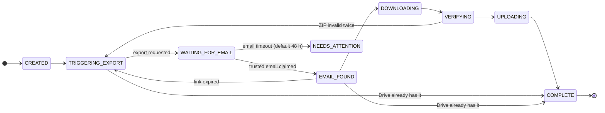
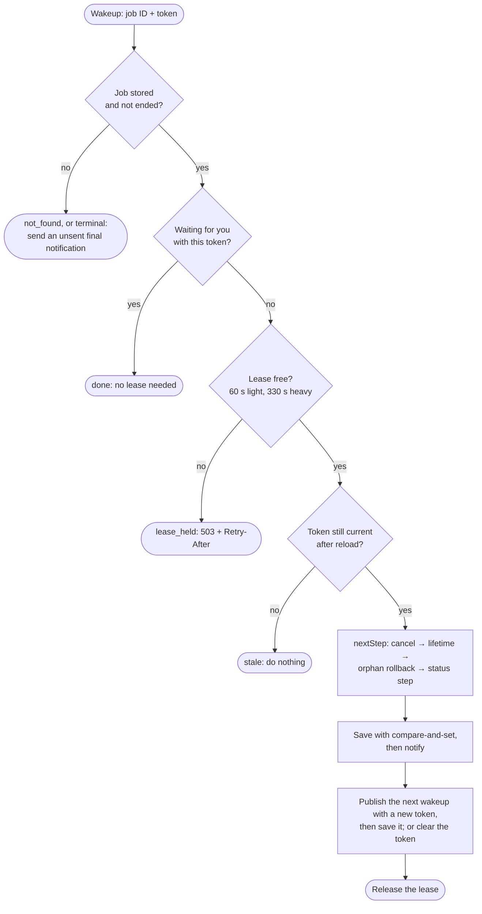
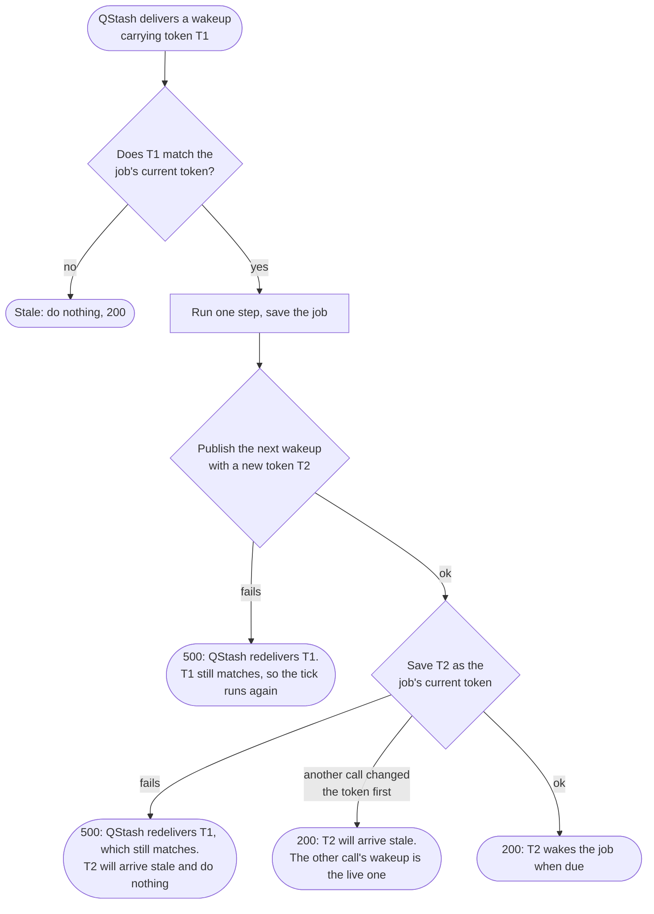
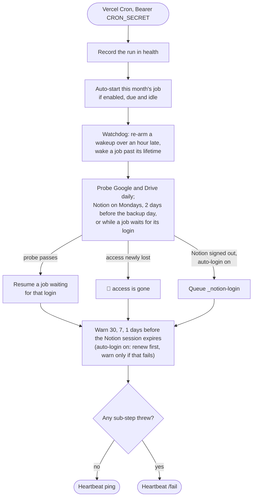

# notion-backup-automation — Job States, Ticks and the Daily Cron

Workflow diagrams for the [notion-backup-automation workspace](../). Behavior, codes and limits
are in the [README](../README.md#backup-jobs); the Notion steps inside a tick are in
[notion-export-flow.md](notion-export-flow.md). Structure-level view: the
[repository C4 workspace](../../../../docs/architecture/workspace.dsl).

## Job States

The happy path, one step per tick. `DOWNLOADING`, `VERIFYING` and `UPLOADING` are progress
markers inside one transfer run, not tick entry points. Source of truth:
`src/domain/transitions.ts`.

Not shown, to keep the diagram readable:

- Any working status can fail into `RETRYABLE_FAILURE` or `NEEDS_ATTENTION` (next section); any
  non-terminal status can end as `CANCELLED`, or as `FAILED` when the lifetime
  (`JOB_MAX_LIFETIME_HOURS`, default 168 h) runs out.
- A dead or over-budget transfer run rolls back to `EMAIL_FOUND` once. A link that expires during
  the download also starts a new export attempt.
- A new export attempt (back to `TRIGGERING_EXPORT`) needs attempts left (`MAX_EXPORT_ATTEMPTS`);
  otherwise the job needs attention.

## Failures And Incidents

Supervised codes (such as `NOTION_UI_CHANGED`) first wait one minute for the
[supervisor](../README.md#supervisor), which makes one bounded decision per wakeup. Inspection
actions wake again after one minute; `wait` defers the next decision for 15, 60 or 240 minutes.
With `AGENT_MODEL_PROVIDER=none`, the next tick hands the incident to you without an LLM call.
Once an incident waits for you, nothing more is scheduled.

## One Tick — `ProcessJobUseCase.execute`

Each wakeup runs exactly one step. A Redis failure or a failed publish of the next wakeup throws,
so QStash retries the same delivery with the same token.

## Schedule Token — Publish, Then Save

Every job keeps one **current token** (`schedule.token`), and every QStash wakeup carries a
token. A wakeup does work only if its token matches the job's. Each new wakeup gets a new token,
so duplicate, late or replaced wakeups do nothing.

Follow one wakeup from arrival to answer:

**Why publish before saving:** a published wakeup whose token was never saved is harmless: it
arrives stale. A saved token whose wakeup was never published would leave the job asleep for
good. When the job needs no wakeup (it waits for you), the token is cleared instead, so any late
wakeup is stale.

## Daily Cron — `DailyMaintenance.run`

A sub-step that throws is logged and skipped, and turns the heartbeat into `/fail`. A probe
resumes only the incident it read before probing, re-checked under the job's lease.

