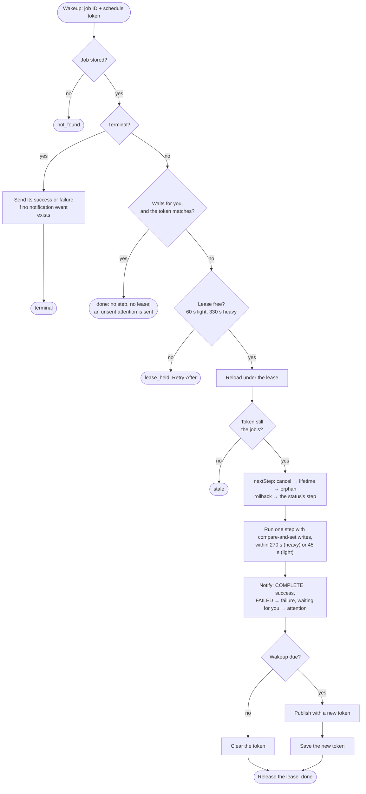
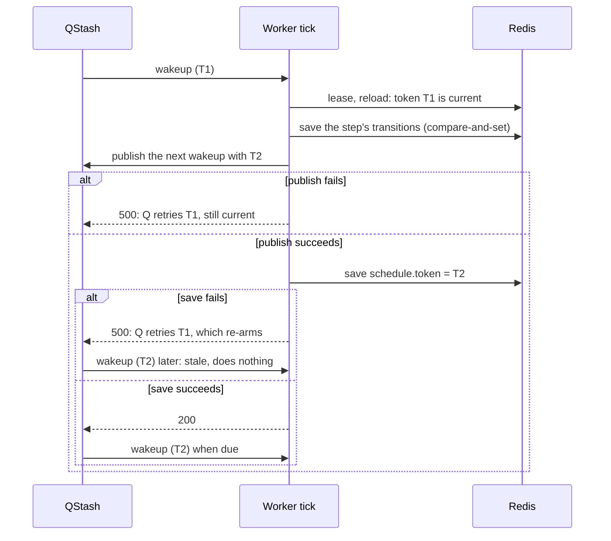
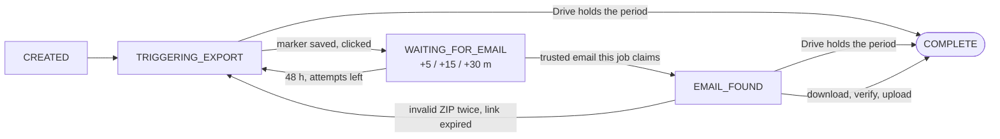
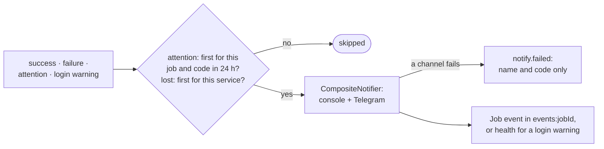

# notion-backup-automation — Backup Job Tick, Wakeups, and Notifications

Workflow diagrams for the [notion-backup-automation workspace](../). Behavior is described in
the [README](../README.md#backup-jobs); the Notion steps inside a tick are in
[notion-export-flow.md](notion-export-flow.md).

Structure-level view: [repository C4 workspace](../../../../docs/architecture/workspace.dsl).

## One Tick — `ProcessJobUseCase.execute`

Each wakeup runs exactly one step. Redis failing, or the next wakeup failing to publish,
throws, so the same delivery is retried with the same token.

## Schedule Token — Publish, Then Save

A delivery runs only with the job's current token. The next wakeup is published first and its
token saved second, so a publish that fails leaves the delivered token valid for QStash's
retry, and a save that fails leaves only a stale message behind.

## Steps With Ports — Drive First, Then the Work

The trigger and the transfer adopt a verified backup of the period already in Drive before
any export or download (a forced job adopts only its own). The write-ahead click marker and
each transfer marker are saved before their work starts; a cancel request seen at one of them
stops the step, and the next tick cancels.

At the transition to COMPLETE, the backup is compared with the newest earlier COMPLETE job:
below half its file count or size, `result.shrink` is saved, an `export.shrunk` event is
written, and the success notification becomes a ⚠️. The job completes either way.

## Notifications — `JobNotifications`

Nothing in this path throws: a failed channel, gate or event write is logged, and the tick
goes on.
