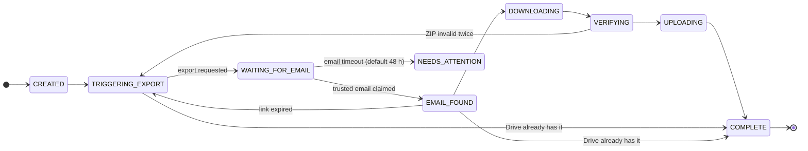
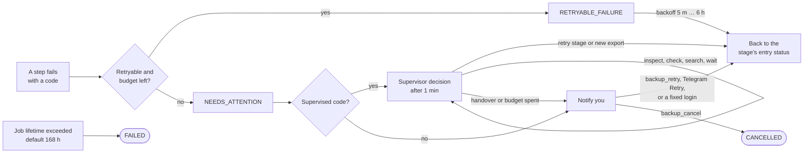

# Backup lifecycle

[Setup, limits and recovery](../README.md) live in the README. Notion's browser work is shown
in [Notion export and login](notion-export-flow.md).

## Job States

The normal path, including transfer progress markers. `DOWNLOADING`, `VERIFYING` and `UPLOADING`
run inside one invocation, not separate ticks.

A verified Drive backup can complete the job before export or transfer. Forced jobs only adopt
their own job ID. Link expiry or two invalid transfers can start another export only while
attempts remain. See [job rules](../src/domain/job-lifecycle.ts) and
[transitions](../src/domain/transitions.ts).

## Failures And Incidents

Supervised incidents make one decision per wakeup, within the
[supervisor's limits](../README.md#supervisor). Once handed to an operator, they have no scheduled
polling; a login fix can also resume them. Lifetime expiry is checked at the next tick, including
when the daily watchdog wakes an expired job.

## One Tick — `ProcessJobUseCase.execute`

The lease is released in `finally`, including stale deliveries and failures. Heavy steps have
270 s to start work inside the 300 s function limit; light steps have 45 s. Redis writes use
compare-and-set. Source: [process-job.ts](../src/application/process-job.ts) and
[next-step.ts](../src/domain/next-step.ts).

## Schedule Token — Publish, Then Save

Only a wakeup matching the job's current schedule token can advance it.

- Publishing first prevents a saved schedule with no message. A published token never saved is stale.
- When no work remains scheduled, the token is cleared.
- Redis or publish failures return 500 so QStash retries. The daily watchdog re-arms missing
  or overdue wakeups.

## Daily Cron — `DailyMaintenance.run`

Thrown sub-step failures produce HTTP 500 and a `/fail` heartbeat. A failed access probe is a
recorded result and does not necessarily fail the cron. A passing probe resumes only the matching
login incident, rechecked under the job's lease. Settings are in
[daily maintenance and login renewal](../README.md#daily-maintenance-and-login-renewal).
