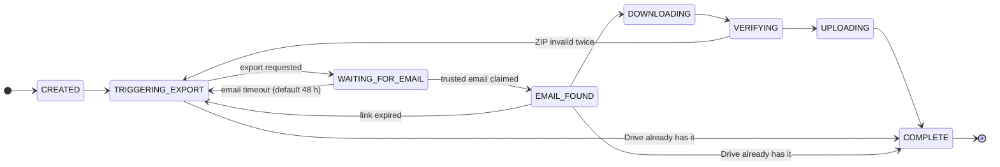
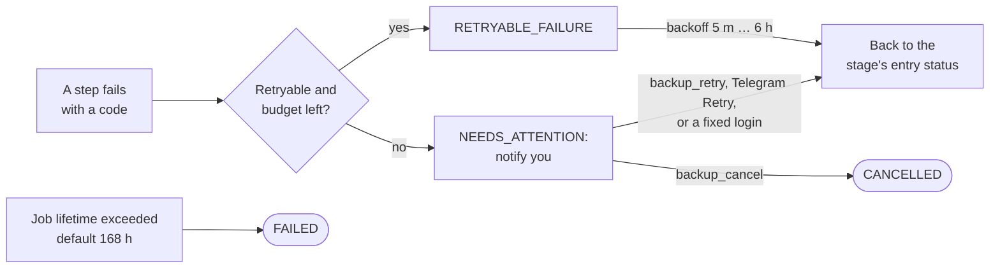
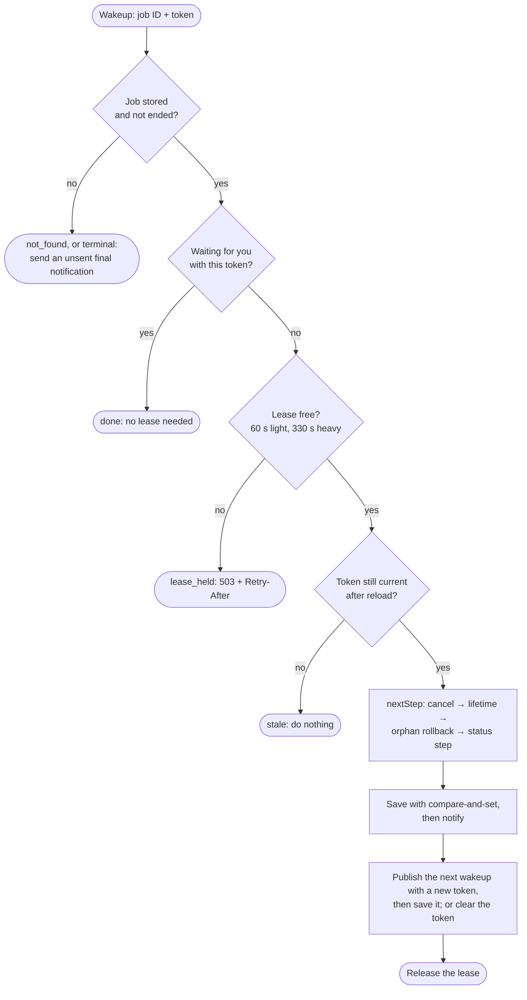
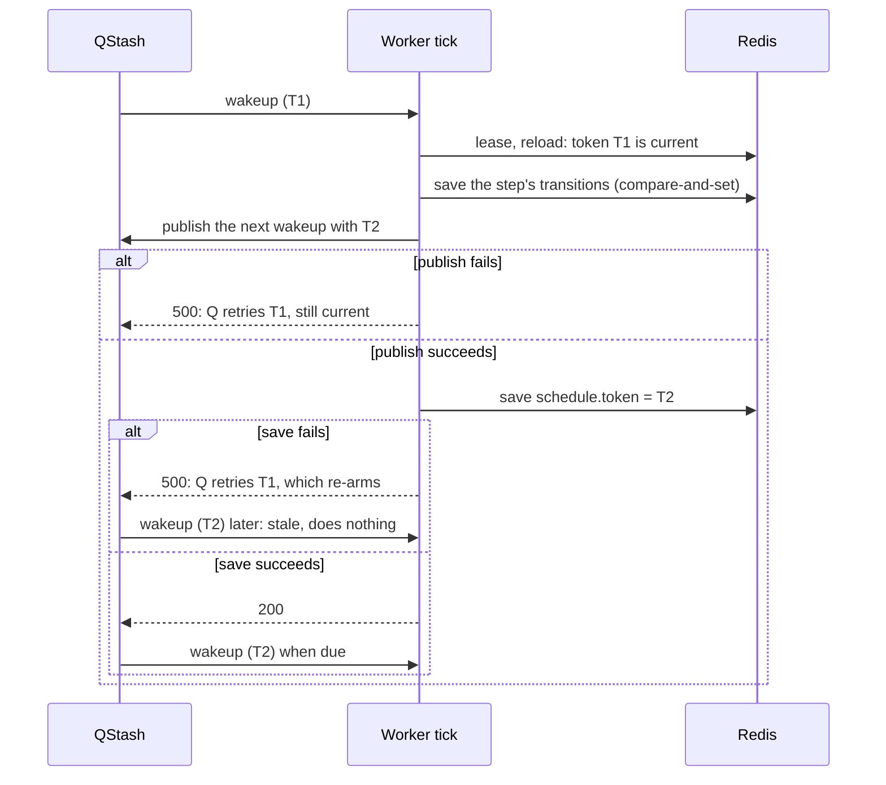
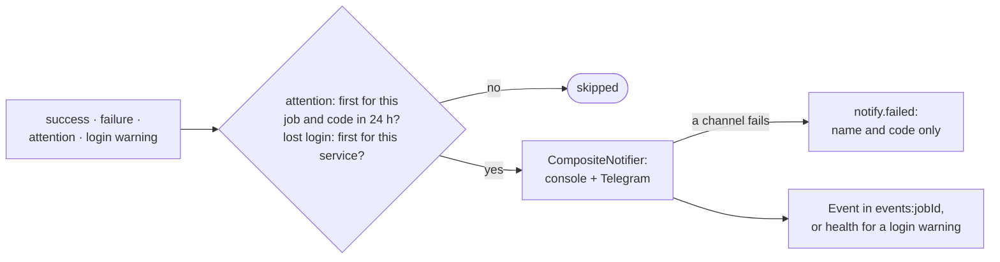
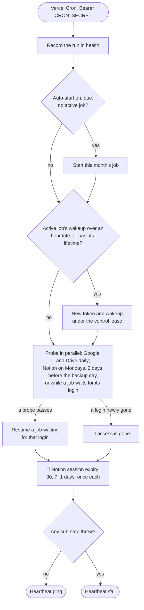

# notion-backup-automation — Job States, Ticks, Notifications and the Daily Cron

Workflow diagrams for the [notion-backup-automation workspace](../). Behavior, codes and
limits are in the [README](../README.md#backup-jobs); the Notion steps inside a tick are in
[notion-export-flow.md](notion-export-flow.md). Structure-level view: the
[repository C4 workspace](../../../../docs/architecture/workspace.dsl).

## Job States

The happy path, one step per tick. `DOWNLOADING`, `VERIFYING` and `UPLOADING` are progress
markers inside one transfer run, not tick entry points. Source of truth:
`src/domain/transitions.ts`.

Not shown, to keep the diagram readable:

- The email timeout is `EMAIL_WAIT_TIMEOUT_HOURS` (default 48 h); the lifetime limit is
  `JOB_MAX_LIFETIME_HOURS` (default 168 h).
- A dead or over-budget transfer run rolls back to `EMAIL_FOUND` once. A link that expires
  during the download also starts a new export attempt.
- A new export attempt (back to `TRIGGERING_EXPORT`) needs attempts left
  (`MAX_EXPORT_ATTEMPTS`); otherwise the job needs attention.
- Any working status can fail as below; any non-terminal status can end as `CANCELLED` or
  `FAILED` (lifetime).

## Failures And Incidents

Supervised codes (such as `NOTION_UI_CHANGED`) first wait one minute for the supervisor; with
no supervisor built yet, the next tick hands them to you.

## One Tick — `ProcessJobUseCase.execute`

Each wakeup runs exactly one step. A Redis failure or a failed publish of the next wakeup
throws, so QStash retries the same delivery with the same token.

## Schedule Token — Publish, Then Save

A delivery runs only with the job's current token. Publishing first and saving second means a
failed publish leaves the delivered token valid for QStash's retry, and a failed save leaves
only a stale message behind.

## Notifications — `JobNotifications`

Nothing in this path throws: a failed channel, gate or event write is logged and the tick goes
on.

## Daily Cron — `DailyMaintenance.run`

A sub-step that throws is logged and skipped, and turns the heartbeat into `/fail`. With no
active job and auto-start off, nothing is published. A probe resumes only the incident it read
before probing, re-checked under the job's lease.

