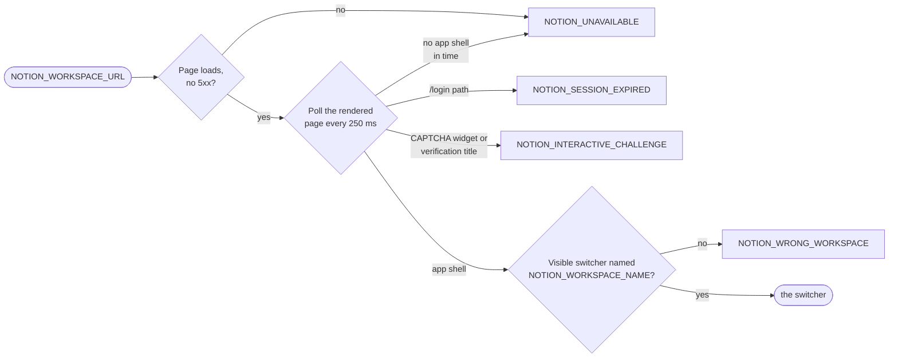
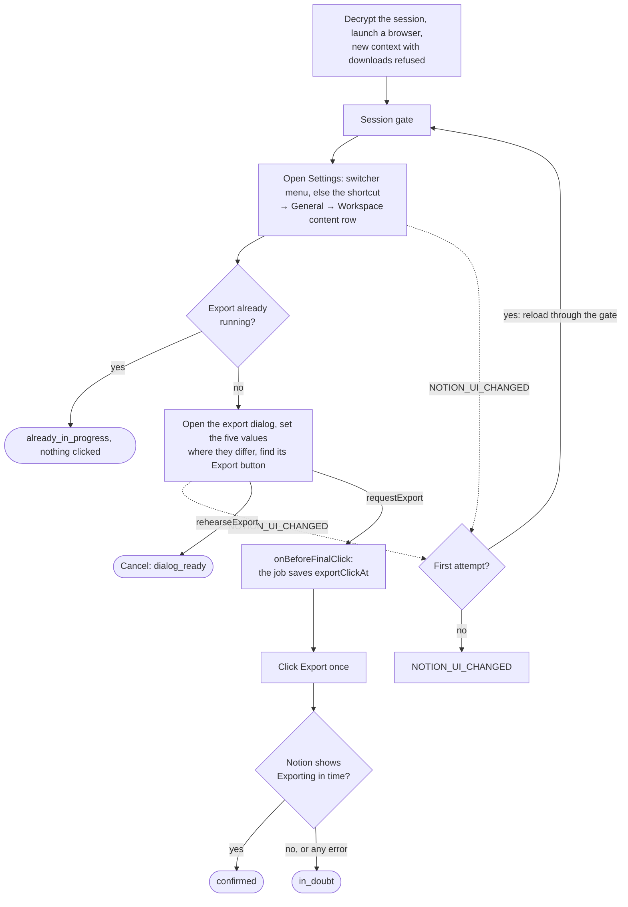

# notion-backup-automation — Notion Session Gate, Export Trigger and Sign-In

Workflow diagrams for the [notion-backup-automation workspace](../). Behavior and error codes
are in the [README](../README.md#notion-session-and-export). Structure-level view:
[repository C4 workspace](../../../../docs/architecture/workspace.dsl).

## Session Gate — `passSessionGate`

Notion answers `200` without a session, so the gate judges the rendered page. Every call of the
trigger, and `auth:notion` twice, passes it first.

## Export Trigger — `requestExport` and `rehearseExport`

Each call decrypts the saved session into a new browser context with downloads refused, and
closes the browser at the end whatever the outcome. An abort before the final click rejects at
once and never clicks. Nothing throws after the click. `rehearseExport` (`dev:trigger --dry-run`)
stops at the dialog and cancels; the cron's Notion probe (`probeExportDialog`) does the same walk
without clicking.

## Sign-In — `auth:notion`

You sign in in a headed Chrome window with a fresh profile, then the session gate runs. Only
Notion's cookies and localStorage are kept, and `token_v2` is required. The new session is
checked for an unexpired `file_token` (the export file host's cookie) before it is saved, so a
sign-in the download cannot use never replaces a working session. It is then encrypted into
Redis as `secret:notion-storage-state` and re-checked in a new headless browser.

## Automatic Sign-In — `_notion-login`

With `NOTION_AUTO_LOGIN_ENABLED=true`, the worker signs in by itself with Notion's email code, at
most once a day and within 120 s.

