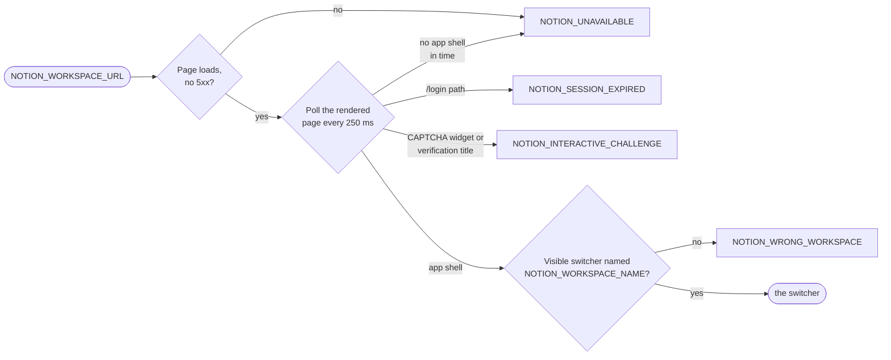
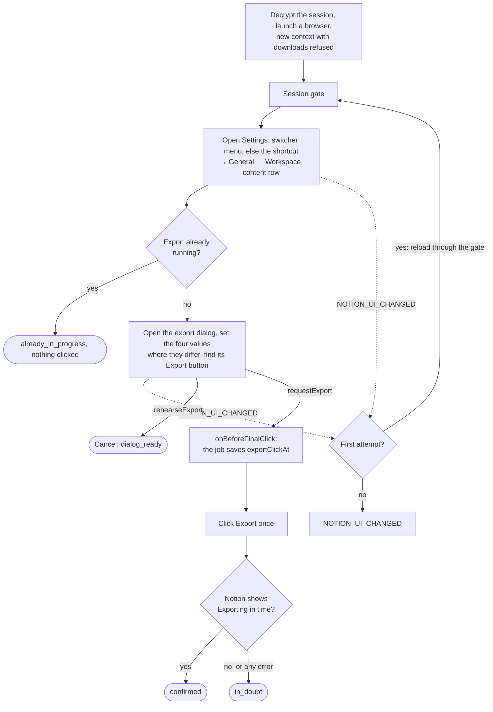
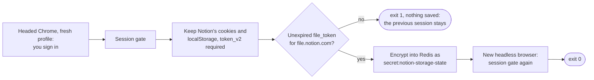

# notion-backup-automation — Notion Sign-In, Session Gate, and Export Trigger

Workflow diagrams for the [notion-backup-automation workspace](../). Behavior and error codes
are described in the [README](../README.md#notion-session-and-export).

Structure-level view: [repository C4 workspace](../../../../docs/architecture/workspace.dsl).

## Session Gate — `passSessionGate`

Notion answers `200` without a session, so the gate judges the rendered page. Every call of the
trigger, and `auth:notion` twice, passes it first.

## Export Trigger — `requestExport` and `rehearseExport`

Each call decrypts the saved session into a new browser context with downloads refused, and
closes the browser at the end whatever the outcome. An abort before the final click rejects at
once and never clicks. Nothing throws after the click.

## Sign-In — `auth:notion`

The new session is checked for the export file host's cookie before it is saved, so a sign-in
the download cannot use never replaces a working session.

