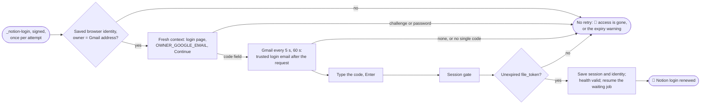

# Notion export and login

The app automates Notion's Settings UI with a saved browser session. It uses no Notion API or
stored password. [Setup and recovery commands](../README.md#local-setup) live in the README.

## Session Gate — `passSessionGate`

An HTTP 200 does not prove sign-in: the gate checks the rendered page and configured workspace.

Source: [session-gate.ts](../src/adapters/notion/session-gate.ts).

## Export Trigger — `requestExport` and `rehearseExport`

The five options are Markdown & CSV, database views set to Current view, page content set to
Everything, private pages enabled and subpage folders enabled. The pre-click marker prevents
another click in the same attempt after interruption. Missing confirmation after a click means
`in_doubt`: wait for Gmail instead of clicking again.

Each call closes its browser and refuses browser downloads; ZIP transfer is a separate adapter.
Changed cookies are saved on a best-effort basis. The cron probe cancels the dialog and checks
the persisted `file_token` too. Source:
[notion-export-trigger.ts](../src/adapters/notion/notion-export-trigger.ts) and
[notion-settings-page.ts](../src/adapters/notion/notion-settings-page.ts).

## Sign-In — `auth:notion`

Headed Chrome opens with a fresh profile. After sign-in, only Notion cookies/localStorage are
retained; valid `token_v2` and file-host `file_token` cookies are required. The encrypted session
is saved in Redis and checked again headlessly. A waiting production job resumes through QStash
when publishing is configured; otherwise use `backup_retry`. Dev jobs resume with `dev:tick`.

## Automatic Sign-In — `_notion-login`

Login emails require Gmail's DKIM/DMARC verdicts for `updates.notion.com`. The code is never
stored or logged, and is typed only on Notion hosts. Password/challenge pages or ambiguous
emails stop the attempt. The once-per-24-hour allowance, timeout and fallback are covered in
[daily maintenance and login renewal](../README.md#daily-maintenance-and-login-renewal).
