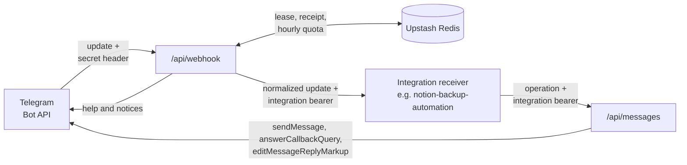

# telegram-webhook-hub

The only owner of the Telegram bot **Artsem Automation Hub** (`@artsem_automation_bot`). It
receives the bot's webhook, routes commands and button taps to registered feature apps over
authenticated HTTP, and sends their replies. Feature apps never see the bot token, the chat ID
or the webhook secret, and never import the hub's code at runtime: they share only the
validated schemas in `@workspaces/telegram-contracts`.

The only integration today is [notion-backup-automation](../notion-backup-automation/README.md)
(`nb-prod`). Deployed as its own Vercel project; public webhook:
`https://telegram-webhook-hub.vercel.app/api/webhook`.

## How It Works



1. Telegram posts an update to `/api/webhook` with `X-Telegram-Bot-Api-Secret-Token`.
2. The hub accepts only private-chat updates from the configured owner, claims a delivery
   lease in Redis, checks the hourly quota, and routes by command or callback namespace.
3. It forwards `{ updateId, input }` to the integration's HTTPS URL with that integration's
   bearer token, and completes the receipt when the integration answers 2xx.
4. The integration replies through `POST /api/messages` with the same token; the hub sends to
   the owner chat.

Step-by-step flow and the cross-app sequence: [docs/webhook-flow.md](docs/webhook-flow.md).

## Layout

| Path                              | Purpose                                                               |
| --------------------------------- | --------------------------------------------------------------------- |
| `api/`                            | Vercel entry points: `webhook.ts`, `messages.ts`, `health.ts`.        |
| `src/config/env.ts`               | Zod env schemas and the `HUB_INTEGRATIONS` registry validation.       |
| `src/config/containers.ts`        | Composition root: auth before config, then the handlers.              |
| `src/http/webhook.ts`             | Update parsing, owner check, lease, quota, routing, forwarding.       |
| `src/http/messages.ts`            | Integration auth, operation validation, callback namespace check.     |
| `src/adapters/redis-state.ts`     | Lua scripts for leases, receipts and the quota.                       |
| `src/adapters/telegram-client.ts` | Bot API client over `fetch`; errors never contain the token or URL.   |
| `src/cli/`                        | `telegram:setup`: chat discovery, test message, webhook registration. |

## Endpoints

| Endpoint             | Auth                                  | Purpose                                                |
| -------------------- | ------------------------------------- | ------------------------------------------------------ |
| `POST /api/webhook`  | `X-Telegram-Bot-Api-Secret-Token`     | Telegram updates from the owner's private chat         |
| `POST /api/messages` | `Authorization: Bearer <integration>` | Send a message, answer a button tap, or remove buttons |
| `GET /api/health`    | Public                                | `{ "ok": true, "service": "telegram-webhook-hub" }`    |

`/api/messages` accepts one of three operations (`hubOperationSchema`):

```json
{
  "action": "sendMessage",
  "message": {
    "html": "Backup complete",
    "buttons": [[{ "text": "Status", "callbackData": "nb-prod:s:2026-10" }]]
  }
}
```

The others are `{ "action": "answerCallbackQuery", "callbackId": "...", "text": "Queued" }` and
`{ "action": "removeButtons", "messageId": 42 }`.

| Response                                     | When                                                                         |
| -------------------------------------------- | ---------------------------------------------------------------------------- |
| `200 { "messageId": 42 }` / `{ "ok": true }` | Sent / done                                                                  |
| `400 INVALID_OPERATION`                      | Body does not match the schema (or is over 64 KiB)                           |
| `401 UNAUTHORIZED`                           | No or unknown bearer token                                                   |
| `403 CALLBACK_NAMESPACE_FORBIDDEN`           | A callback button does not start with the caller's `<id>:`                   |
| `405 METHOD_NOT_ALLOWED`                     | Authenticated `GET`; integrations use it as a token check that sends nothing |
| `422 TELEGRAM_REJECTED`                      | Telegram refused for good (a 4xx but 408/429): bad markup, blocked bot       |
| `503 TELEGRAM_UNAVAILABLE`                   | Telegram or network failure; retry                                           |
| `503 CONFIG_INCOMPLETE`                      | Hub configuration missing or invalid                                         |

The hub always picks the owner chat; callers cannot choose a chat or call other Bot API
methods. URL buttons must be HTTPS. Escaping HTML and removing private data is the caller's job.

## Routing

- **Commands:** `/status` and `/backup_status` go to the integration that lists them in
  `commands`. `/start`, `/help`, unknown commands and plain text get the hub's help, which lists
  every configured command.
- **Buttons:** callback data `nb-prod:s:2026-10` goes to `nb-prod`, which receives `s:2026-10`.
  An unknown namespace (such as an unconfigured `nb-dev`) is refused with "Unknown or
  unavailable integration"; it never falls back to production.
- **Legacy buttons:** old unprefixed `s:`, `r:`, `f:`, `x:`, `l:` and `c:` callbacks go to
  `HUB_LEGACY_INTEGRATION_ID` (`nb-prod`), so messages sent before namespacing keep working.
- **Forwarded body:** `{ "updateId": 1, "input": <input> }`, where `<input>` is
  `{ "kind": "callback", "callbackId": "...", "data": "s:2026-10", "messageId": 42 }` or
  `{ "kind": "message", "text": "/status" }`.

Integrations are trusted services in the same owner's chat, not sandboxed tenants: message
and callback IDs are not scoped per integration. Namespaces prevent routing collisions only.

## Delivery Guarantees

- **At least once.** Each update gets a 60 s processing lease and, once handled, a 48 h
  completed receipt (`<HUB_KEY_PREFIX>:processing|done:<updateId>`). A completed duplicate
  returns 200 without forwarding; one still in progress returns 503 so Telegram retries.
- **Retries.** An integration 5xx, 408, 429, timeout (20 s) or network error, and any Redis or
  Telegram failure, release the lease and return `503` with `Retry-After: 5`. Receivers must
  deduplicate by `updateId`.
- **Final refusals.** An integration 4xx other than 408/429 completes the receipt with a notice
  (`<id> could not handle this button`, or a reply for commands) and returns 200: a resend would
  fail the same way.
- **Quota.** 30 admitted updates per fixed UTC hour; a retry of an admitted update costs
  nothing. Excess updates get 200 (and a short notice for button taps).
- **Ignored with 200:** malformed updates, other chats and other senders.
- **Limits:** bodies are capped at 64 KiB while streaming; responses are `no-store`; the hub
  logs no message content or credentials.

## Configuration

Copy `.env.example` to `.env.local` and fill it from 1Password; Vercel gets the same values as
Production variables. The CLI reads `.env.local` in this directory; shell variables win.

| Variable                                             | Notes                                                                    |
| ---------------------------------------------------- | ------------------------------------------------------------------------ |
| `TELEGRAM_BOT_TOKEN`                                 | From @BotFather. Only this app holds it.                                 |
| `TELEGRAM_CHAT_ID`                                   | The owner's private chat; `telegram:setup --find-chat` saves it.         |
| `TELEGRAM_WEBHOOK_SECRET`                            | 32–256 of `A–Z a–z 0–9 _ -`, e.g. `openssl rand -hex 32`.                |
| `UPSTASH_REDIS_REST_URL`, `UPSTASH_REDIS_REST_TOKEN` | Prefer a database separate from the backup app's.                        |
| `HUB_KEY_PREFIX`                                     | Default `telegram-hub:prod`; never the backup app's prefix.              |
| `HUB_INTEGRATIONS`                                   | JSON registry (below). Secret: it holds bearer tokens.                   |
| `HUB_LEGACY_INTEGRATION_ID`                          | Optional; must name a registry `id`. Receives unprefixed legacy buttons. |
| `APP_BASE_URL`                                       | CLI only: the hub's origin for webhook registration.                     |

`HUB_INTEGRATIONS` lists 1–32 integrations. IDs, tokens and commands must be unique, `start`
and `help` are reserved, URLs must be HTTPS without credentials, tokens 32–256 characters:

```json
[
  {
    "id": "nb-prod",
    "commands": ["status", "backup_status"],
    "url": "https://notion-backup-automation.vercel.app/api/integrations/telegram",
    "token": "<integration bearer token>"
  }
]
```

The integration uses the same token as its `TELEGRAM_HUB_TOKEN` and the same `id` as its
callback namespace. Keep each token separate from the webhook secret and from MCP tokens. To add
an integration, add a registry entry and implement the receiver contract; the hub never takes a
destination URL from an update.

## Setup CLI

```sh
pnpm --filter telegram-webhook-hub cli telegram:setup [option]
```

| Option        | Does                                                                                  |
| ------------- | ------------------------------------------------------------------------------------- |
| (none)        | Registers `<APP_BASE_URL>/api/webhook` with the secret, keeping pending updates.      |
| `--replace`   | Allows replacing a webhook that points elsewhere (registration only).                 |
| `--info`      | Shows the current webhook origin (path hidden), pending count and last error time.    |
| `--find-chat` | Saves your private chat ID to `.env.local` (mode 0600). Needs no webhook registered.  |
| `--test`      | Sends a test message, with a Status button when the legacy integration is configured. |

## Deployment

1. **Vercel project:** Root Directory `workspaces/apps/telegram-webhook-hub`, "Include source
   files outside of the Root Directory" on, Node 24, other settings default. `vercel-build`
   builds `@workspaces/telegram-contracts` first; its exports point to compiled `dist/`.
2. **Chat ID:** put `TELEGRAM_BOT_TOKEN` in `.env.local`, send `/start` to the bot, and run
   `telegram:setup --find-chat` before any webhook is set.
3. **Variables:** add every variable above to Production; mark the token, secret, Redis and
   `HUB_INTEGRATIONS` values Sensitive. Deploy.
4. **Webhook:** `telegram:setup --info`, then `telegram:setup` (add `--replace` only after
   checking who owns the current URL), then `telegram:setup --test`.
5. **Check:** unauthenticated `curl -si -X POST <hub>/api/webhook` and `<hub>/api/messages`
   return 401; `/status` in Telegram reaches the backup app.

Vercel's per-function type check honours `target`/`module` only from this app's
`tsconfig.json`, and finds `undici-types` only through this app's own devDependency. Keep its
version in the range `@types/node` declares, or the build log fills with false
`Request`/`Response` errors.

## Local Checks

```sh
pnpm --filter @workspaces/telegram-contracts build   # after schema changes or --ignore-scripts
pnpm --filter telegram-webhook-hub typecheck
pnpm --filter telegram-webhook-hub lint
pnpm --filter telegram-webhook-hub test
```

Tests use fake Telegram, Redis and HTTP dependencies; they never call the live bot or Redis.
The hub has no Google, Notion, QStash, Playwright or Chromium dependencies.
