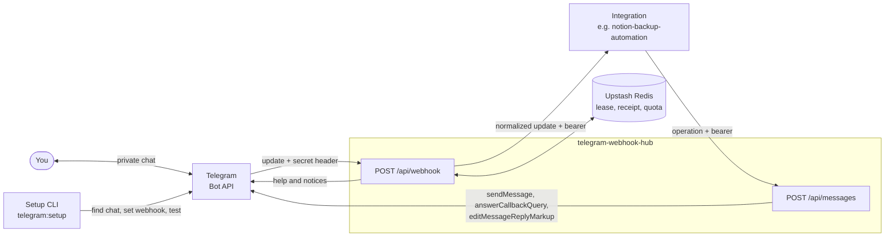

# telegram-webhook-hub

Owns one Telegram bot: receives its webhook, routes commands and button taps to registered apps,
and sends their replies and notifications to the owner's private chat. It runs independently
on Vercel and keeps delivery state in Upstash Redis.

[notion-backup-automation](../notion-backup-automation/README.md) is the current integration.
The hub contains no backup logic. Apps share HTTP schemas from `@workspaces/telegram-contracts`;
only this hub holds the bot token, chat ID and webhook secret.

## Architecture



1. Telegram posts an update to `/api/webhook` with the secret header.
2. The hub checks the owner, takes a Redis delivery lease and applies the hourly quota.
3. It forwards the normalized update to the registered app with that integration's bearer token.
4. The app replies through `/api/messages`. The hub validates the token and operation, then
   sends to the owner chat. Apps use the same endpoint for independent notifications.

Only the webhook uses Redis. `/api/messages` has no outgoing deduplication. The setup CLI
calls the Bot API directly to discover the chat, inspect/register the webhook and send tests.

Implementation: `api/` holds Vercel entry points; `src/http/` handles requests;
`src/adapters/` provides Redis and Telegram clients; `src/config/` validates and wires them;
`src/cli/` owns bot setup. [Delivery flow](docs/webhook-flow.md) includes the actual two-way
backup integration. The [repository C4 model](../../../docs/architecture/workspace.dsl) owns
structural views.

<a id="deployment"></a>

## Setup and deployment

Use **Node.js 24** and the repository's pinned **pnpm**. Run from the repository root:

```sh
pnpm install
cp workspaces/apps/telegram-webhook-hub/.env.example workspaces/apps/telegram-webhook-hub/.env.local
chmod 600 workspaces/apps/telegram-webhook-hub/.env.local
```

The CLI loads this app's `.env.local`; shell variables win. Store real credentials in your
secret manager and Vercel, never in the repository.

1. Create a bot with BotFather and set `TELEGRAM_BOT_TOKEN`. Send `/start` in your private chat,
   then run `pnpm --filter telegram-webhook-hub cli telegram:setup --find-chat` to save the chat
   ID. Discovery requires no existing webhook; do not disable a live webhook just to discover
   the chat. With multiple pending private chats, set your own ID manually.
2. Provision Redis with a hub-specific database or prefix. Fill the remaining variables below,
   including at least one integration.
3. Create a Vercel project: Root Directory `workspaces/apps/telegram-webhook-hub`, Node 24,
   Framework Preset Other, **Include source files outside the Root Directory** enabled. Keep
   the build defaults: `vercel-build` builds the shared contracts first. Functions run in `fra1`;
   webhook/messages allow 30 s, health 10 s.
4. Add Production variables, marking credentials and the integration registry Sensitive. Deploy
   and set the local `APP_BASE_URL` to the production origin. Redeploy after runtime config changes.
5. Inspect, register and test the webhook:

   ```sh
   pnpm --filter telegram-webhook-hub cli telegram:setup --info
   pnpm --filter telegram-webhook-hub cli telegram:setup
   pnpm --filter telegram-webhook-hub cli telegram:setup --test
   ```

6. Check `/api/health`, then send `/status` and tap Status on a backup report. With configuration
   loaded, unauthenticated POSTs to `/api/webhook` and `/api/messages` must return 401.

### Setup CLI

Use `pnpm --filter telegram-webhook-hub cli telegram:setup [option]`:

| Option        | Purpose                                                                     |
| ------------- | --------------------------------------------------------------------------- |
| None          | Register `/api/webhook`; refuse a different existing URL                    |
| `--info`      | Show the current webhook origin, pending count and last error time          |
| `--find-chat` | Save the private chat ID to `.env.local`; requires no registered webhook    |
| `--test`      | Send a test, with a Status button when the legacy integration is configured |
| `--replace`   | Allow replacing another webhook URL after reviewing its ownership           |

Registration preserves pending updates.

### Configuration

[.env.example](.env.example) is the template; [src/config/env.ts](src/config/env.ts) defines
validation. The integration registry contains secrets.

| Variable                                             | Purpose                                                                                 |
| ---------------------------------------------------- | --------------------------------------------------------------------------------------- |
| `TELEGRAM_BOT_TOKEN`                                 | BotFather credential; held only by this app                                             |
| `TELEGRAM_CHAT_ID`                                   | Owner's private chat/user ID                                                            |
| `TELEGRAM_WEBHOOK_SECRET`                            | 32–256 letters, digits, `_` or `-`; generate with `openssl rand -hex 32`                |
| `UPSTASH_REDIS_REST_URL`, `UPSTASH_REDIS_REST_TOKEN` | Hub delivery state                                                                      |
| `HUB_KEY_PREFIX`                                     | Default `telegram-hub:prod`; keep separate from backup state and other hub environments |
| `HUB_INTEGRATIONS`                                   | JSON array of allowed receivers and per-integration bearer tokens                       |
| `HUB_LEGACY_INTEGRATION_ID`                          | Optional registry ID for old unprefixed backup buttons                                  |
| `APP_BASE_URL`                                       | CLI only: hub origin used to register `/api/webhook`                                    |

Example `HUB_INTEGRATIONS` value; replace the token placeholder with a random 32–256-character
token, for example from `openssl rand -base64 32`:

```json
[
  {
    "id": "nb-prod",
    "commands": ["status", "backup_status"],
    "url": "https://<backup-app>.vercel.app/api/integrations/telegram",
    "token": "<integration bearer token>"
  }
]
```

The registry allows 1–32 integrations with unique IDs, tokens and commands. IDs match
`[a-z][a-z0-9-]{1,31}`; commands match `[a-z][a-z0-9_]{0,31}` and omit `/`. `start` and `help`
are reserved. Receiver URLs require HTTPS with no credentials or fragment.

For the backup app, the registry token must equal `TELEGRAM_HUB_TOKEN`, and `id` must equal
`TELEGRAM_INTEGRATION_ID` (default `nb-<APP_ENV>`). Configure its hub URL and notifier too;
see [backup Telegram setup](../notion-backup-automation/README.md#telegram). Use separate
credentials for the webhook secret, each integration and MCP. Updates never supply destination URLs.

### Deployment cleanup

The shared [cleanup procedure](../notion-backup-automation/README.md#deployment-cleanup)
covers retention and dry-runs. This project's GitHub variable is `VERCEL_TELEGRAM_HUB_PROJECT_ID`.
Removed deployments cannot be rolled back to.

## Routing and API

| Endpoint             | Authentication                    | Purpose                                                            |
| -------------------- | --------------------------------- | ------------------------------------------------------------------ |
| `POST /api/webhook`  | `X-Telegram-Bot-Api-Secret-Token` | Receive Telegram updates                                           |
| `POST /api/messages` | Integration bearer token          | Send a message, answer a tap or remove buttons                     |
| `GET /api/health`    | Public                            | Liveness only: `{ "ok": true, "service": "telegram-webhook-hub" }` |

**Commands** go to the integration listing them. `/start`, `/help`, unknown commands and plain
text receive help listing configured commands. **Buttons** use `<id>:<data>`; the hub removes
`<id>:` before forwarding. An unknown namespace is refused and never falls back to production.
Old `s:`, `r:`, `f:`, `x:`, `l:` and `c:` callbacks route only through
`HUB_LEGACY_INTEGRATION_ID`, if configured.

Receivers accept `Authorization: Bearer <registry token>` and this normalized body:

```json
{
  "updateId": 123,
  "input": {
    "kind": "callback",
    "callbackId": "...",
    "data": "s:2026-11",
    "messageId": 42
  }
}
```

For a command, `input` is `{ "kind": "message", "text": "/status" }`. Callback `messageId` is
optional. Receivers must deduplicate `updateId` and return 2xx only after handling the update.

To reply or notify, POST one operation to `/api/messages` with the same bearer token:

```json
{
  "action": "sendMessage",
  "message": {
    "html": "Backup complete",
    "buttons": [[{ "text": "Status", "callbackData": "nb-prod:s:2026-11" }]]
  }
}
```

Other operations: `{ "action": "answerCallbackQuery", "callbackId": "...", "text": "Queued" }`
and `{ "action": "removeButtons", "messageId": 42 }`. The shared
[contracts](../../packages/telegram-contracts/src/index.ts) define all fields and limits.

The hub chooses the chat. Callers must escape HTML and omit private data; URL buttons require
HTTPS and callback buttons must start with the caller's `<id>:`. Message text is limited to
4096 characters, callback data to 64 UTF-8 bytes and request bodies to 64 KiB.
Integrations are trusted services: message IDs and callback IDs are not isolated per integration.

| `/api/messages` result             | Meaning                                                                  |
| ---------------------------------- | ------------------------------------------------------------------------ |
| 200                                | `{ "messageId": 42 }` for send; `{ "ok": true }` for other operations    |
| 400 `INVALID_OPERATION`            | Invalid or oversized body                                                |
| 401 `UNAUTHORIZED`                 | Missing or unknown bearer token                                          |
| 403 `CALLBACK_NAMESPACE_FORBIDDEN` | Button belongs to another namespace                                      |
| 405 `METHOD_NOT_ALLOWED`           | Authenticated non-POST; GET can check a token without sending            |
| 422 `TELEGRAM_REJECTED`            | Permanent Telegram 4xx, excluding 408/429; fix the request or bot access |
| 503 `TELEGRAM_UNAVAILABLE`         | Retryable Telegram/network failure                                       |
| 503 `CONFIG_INCOMPLETE`            | Missing or invalid hub configuration                                     |

## Delivery and troubleshooting

- **At least once:** webhook updates have a 60 s processing lease and a 48 h completed receipt.
  Completed duplicates return 200; an update still processing returns 503. The hub forwards with
  a 20 s timeout; receivers need their own idempotency protection.
- **Temporary failures:** integration 5xx, 408, 429, timeout or network error, and Redis/Telegram
  failures during delivery return 503 with `Retry-After: 5`. Only the owning request releases
  its lease; a failed release leaves it to expire.
- **Permanent refusals:** integration 4xx except 408/429 get a short notice and completed receipt,
  then 200. Telegram redelivery cannot fix a wrong integration token or invalid request.
- **Quota:** 30 admitted updates per fixed UTC hour. Retries of an admitted update do not count
  again. Excess updates complete with 200 and a notice for button taps. Malformed updates and
  updates from other users/chats are also ignored with 200.
- **Outgoing duplicates:** `/api/messages` has no deduplication. A lost response or retried reply
  can send the same message twice even when the underlying backup action runs once.

Telegram retries non-2xx webhook responses ([Bot API](https://core.telegram.org/bots/api#setwebhook));
the hub acknowledges with 200. Responses are `no-store`, and the hub logs no message content or
credentials.

For delivery trouble, run `telegram:setup --info` to inspect pending updates and the last error
time. Check Vercel configuration, Redis access, the integration's health and its registry token.
A healthy public endpoint does not prove those dependencies work. For refused buttons, compare
the registry ID with the backup app's namespace; add a dedicated dev route instead of reusing
`nb-prod`. Use `--test` to check outgoing delivery.

## Local checks

```sh
pnpm --filter @workspaces/telegram-contracts build
pnpm --filter telegram-webhook-hub typecheck
pnpm --filter telegram-webhook-hub lint
pnpm --filter telegram-webhook-hub test
```

Rebuild contracts after schema changes or installation with `--ignore-scripts`. Tests use fake
Telegram, Redis and HTTP dependencies. Keep `target`/`module` in this app's `tsconfig.json` and
its local `undici-types` dependency to avoid false `Request`/`Response` errors in Vercel's type
check. Runtime bundles need no Google, Notion or Chromium dependencies.

## Resources

Each link needs your own sign-in; credentials are in 1Password, not here.

- **Vercel:** [project](https://vercel.com/artsem-paulenkas-projects/telegram-webhook-hub)
  (variables), [deployments](https://vercel.com/artsem-paulenkas-projects/telegram-webhook-hub/deployments)
  (rollback targets), [logs](https://vercel.com/artsem-paulenkas-projects/telegram-webhook-hub/logs)
  (kept 1 hour on Hobby).
- **Live:** [hub health](https://telegram-webhook-hub.vercel.app/api/health).
- **Telegram:** [@artsem_automation_bot](https://t.me/artsem_automation_bot),
  [@BotFather](https://t.me/BotFather) (token and settings).
- **Upstash:** [console](https://console.upstash.com/home); keys under `HUB_KEY_PREFIX`.
- **GitHub:** [nodejs-backend-mastery](https://github.com/itemka/nodejs-backend-mastery) (Vercel
  deploys `main`), [deployment cleanup runs](https://github.com/itemka/nodejs-backend-mastery/actions/workflows/vercel-deployment-cleanup.yml).
- **Integration:** [notion-backup-automation resources](../notion-backup-automation/README.md#resources).
