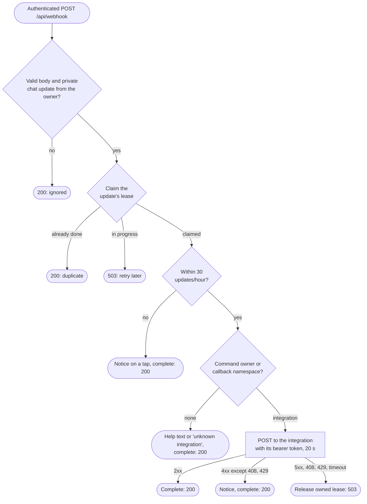
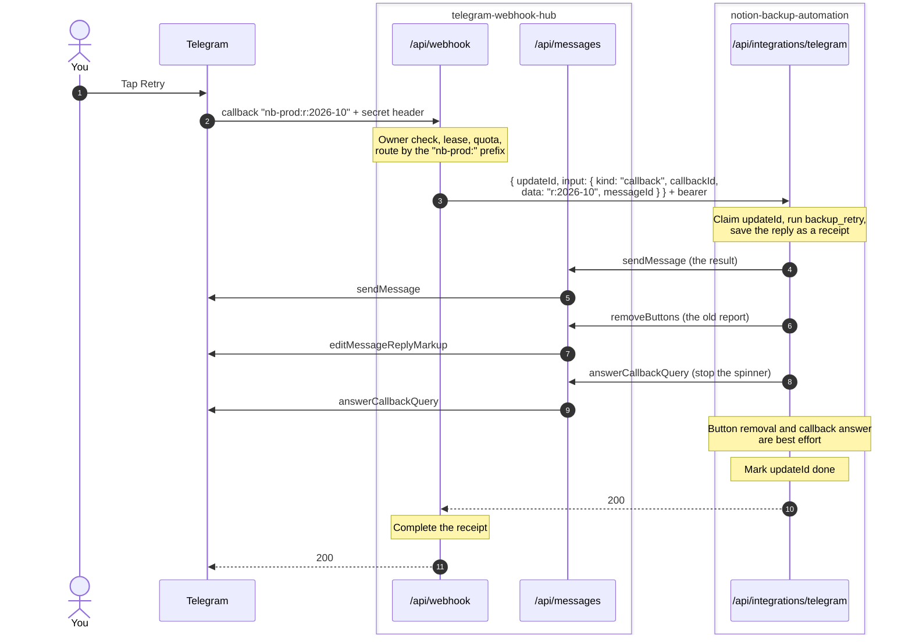

# Telegram delivery flow

[Configuration, contracts and limits](../README.md) live in the README. These diagrams show
webhook handling and the two-way integration with the backup app.

## Webhook — `handleWebhookRequest`

The entry point checks the Telegram secret and POST method before processing an update.
Missing/wrong secrets return 401, authenticated non-POSTs 405, and invalid configuration 503.
The diagram starts with a configured, authenticated POST.

Malformed/oversized bodies and other users' updates are ignored. A busy lease returns 503
`DELIVERY_IN_PROGRESS`. Redis, network or Telegram failures during processing return 503
`DELIVERY_UNAVAILABLE`. Both include `Retry-After: 5`. A failing request releases only its
own lease; if release fails, it expires after 60 s. An integration's permanent refusal is a
4xx other than 408/429. Source: [webhook.ts](../src/http/webhook.ts) and
[Redis state](../src/adapters/redis-state.ts).

## Button Tap Across Both Apps

A Retry tap uses both directions of the integration:

The hub strips the integration namespace before forwarding, preserving `updateId`. Both apps
keep delivery receipts. Once the backup app saves an action reply receipt, a redelivery replays
that reply instead of repeating the mutation. A lost response or retried reply can show a
message more than once: `/api/messages` has no outgoing deduplication.

Transport/storage/scheduling failures remain retryable; permanent refusals finish with a notice.
Worker and cron notifications use only the outgoing half: backup app → `/api/messages` → Telegram.
