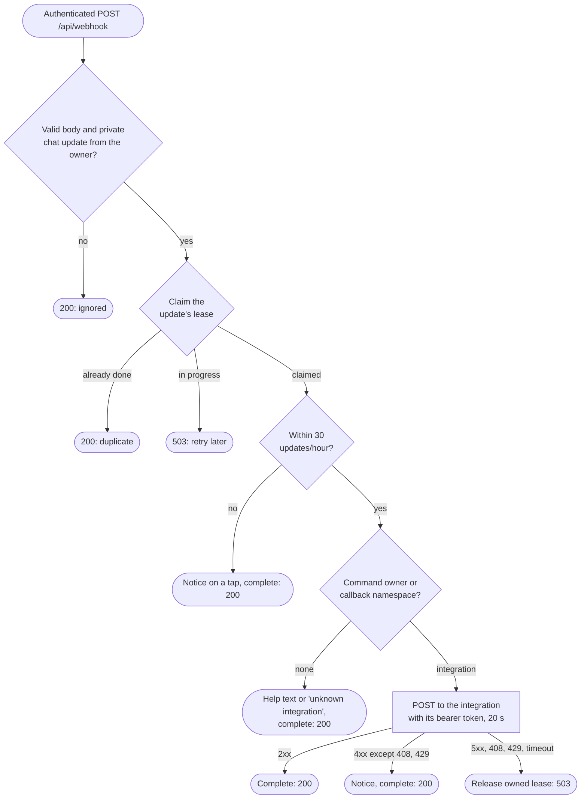
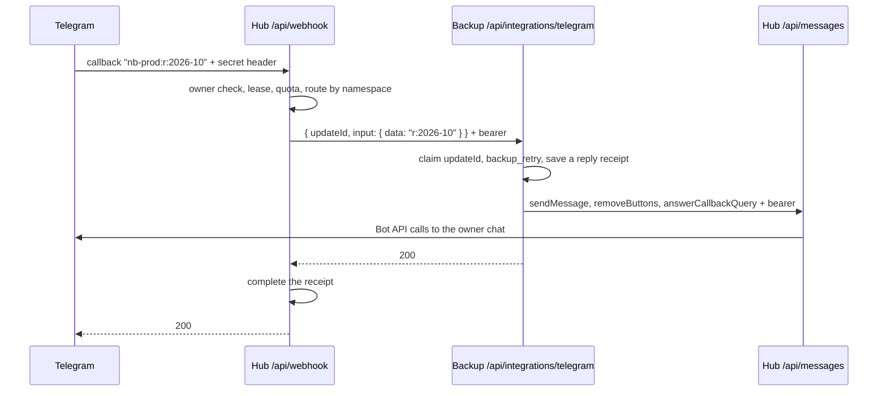

# telegram-webhook-hub — Update Delivery

Workflow diagrams for the [telegram-webhook-hub workspace](../). Codes and limits are in the
[README](../README.md#delivery-guarantees). Structure-level view: the
[repository C4 workspace](../../../../docs/architecture/workspace.dsl).

## Webhook — `handleWebhookRequest`

Only successful responses acknowledge delivery (`200` in this handler). Telegram retries
non-2xx responses, as described in the [Bot API](https://core.telegram.org/bots/api#setwebhook).
Before delivery processing, a missing or wrong secret returns `401`, an authenticated
non-POST returns `405`, and invalid configuration in `serveWebhook` returns
`503 CONFIG_INCOMPLETE`. These checks do not claim a delivery lease.

The flow below starts after those checks, with a configured, authenticated POST:

Malformed JSON, oversized bodies and invalid updates follow the ignored `200` path. A Redis
failure during claim, quota or completion (including an expired lease), or a Telegram or
network failure, returns `503 DELIVERY_UNAVAILABLE` with `Retry-After: 5`. The handler tries
to release a lease only if this request claimed it; if release fails, the lease expires after
60 s. `503 DELIVERY_IN_PROGRESS` leaves the other request's lease intact.

## Button Tap Across Both Apps

A tap on a backup report's Retry button. The backup app replies through the hub's messages
endpoint before it answers the forwarded request, so the hub completes its receipt only after
the action and the reply are done.

If the backup app answers 503 (Redis, QStash or the hub unavailable), the hub releases its
lease and returns 503, and Telegram redelivers the same `updateId`. The backup app's own
receipt makes the redelivery replay the saved reply instead of retrying the job twice.
Outgoing notifications (backup stored, needs attention) use only the last two participants:
the backup worker or cron calls `/api/messages` directly.
