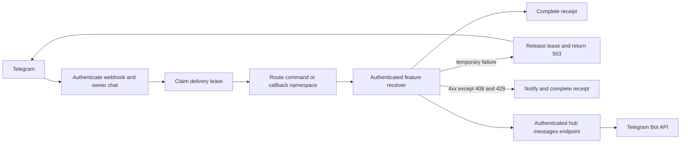

# Telegram update delivery

The feature receiver deduplicates domain actions by update ID. A completed hub
receipt prevents repeat forwarding. In-flight duplicates retry after the current
lease; delivery resumes after temporary failures. A permanent refusal (an
integration 4xx other than 408 and 429) is finished with a notice instead of
being redelivered. Both apps retain their own
state and deployment boundaries.
