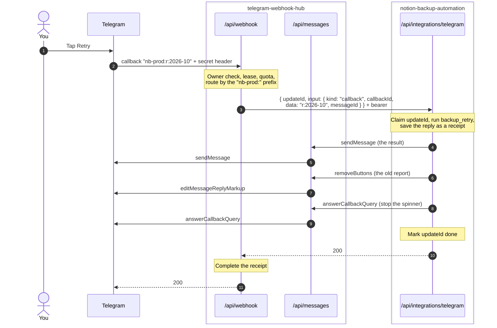

# telegram-webhook-hub — Update Delivery

Workflow diagrams for the [telegram-webhook-hub workspace](../). Codes and limits are in the
[README](../README.md#delivery-guarantees). Structure-level view: the
[repository C4 workspace](../../../../docs/architecture/workspace.dsl).

## Webhook — `handleWebhookRequest`

Telegram retries any non-2xx response ([Bot API](https://core.telegram.org/bots/api#setwebhook)),
so only `200` acknowledges a delivery. Before the handler runs, `serveWebhook` returns `401` for
a missing or wrong secret, `405` for a non-POST, and `503 CONFIG_INCOMPLETE` for invalid
configuration; none of these claims a lease.

The flow below starts with a configured, authenticated POST:

Malformed JSON, oversized bodies and invalid updates take the ignored `200` path. A Redis
failure during claim, quota or completion (including an expired lease), or a Telegram or network
failure, returns `503 DELIVERY_UNAVAILABLE` with `Retry-After: 5`. The handler releases a lease
only if this request claimed it; if the release fails, the lease expires after 60 s.
`503 DELIVERY_IN_PROGRESS` leaves the other request's lease intact.

## Button Tap Across Both Apps

What happens when you tap **Retry** on a backup report. Arrows are numbered; notes are work done
inside one endpoint.

The backup app replies (arrows 4–9) before it answers the hub (arrow 10). So the hub marks the
update done only after the job was retried and you saw the reply.

**If something fails**

- **Temporary failure** (Redis, QStash or the hub unavailable): the backup app answers 503, the
  hub releases its lease and answers 503 instead of arrow 11, and Telegram redelivers the same
  `updateId`.
- **Redelivery:** the backup app finds the receipt it saved before arrow 4, so it sends the saved
  reply again and does not retry the job a second time.
- **Final refusal** (a 4xx other than 408/429 from the backup app): the hub sends a short notice,
  completes the receipt and answers 200; a resend would fail the same way.

Outgoing notifications (backup stored, needs attention) skip the webhook: the backup worker or
cron calls `/api/messages` with `sendMessage`, as in arrows 4–5.
